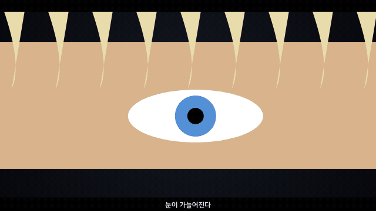

# 2026.11.06 (금)

### 별품소 전투 씬 애니매틱 및 카메라 애니매틱 제작

`별품소` `애니매틱`

---

## 별품소 — 전투 씬 애니매틱

  
   
  인물을 도형으로 단순하게 그려 카메라 위치와 컷 순서만 먼저 확인한 미리보기

- 영상을 뽑기 전에 전투 씬이 컷 순서대로 어떻게 흘러가는지 눈으로 보고 싶어서, 씬 전체를 여러 컷으로 나눠 움직이는 애니매틱으로 만들었다.
- 그것만으로는 카메라가 어디서 찍는지 감이 잘 안 와서, 카메라 위치와 움직임만 따로 보는 카메라 애니매틱을 하나 더 만들었다.
- 이미 만들어 둔 영상 중 다시 쓸 수 있는 구간을 골라서, 새로 만들어야 하는 분량을 줄였다.

---

## 정리

| 다룬 프로젝트 | 작업 대화 | 결과물 |
|:---:|:---:|:---:|
| 1 | - | 2 |

---

Claude와 함께 정리한 작업 일지 · <a href="../../../README.md">전체 기록 보기</a>

