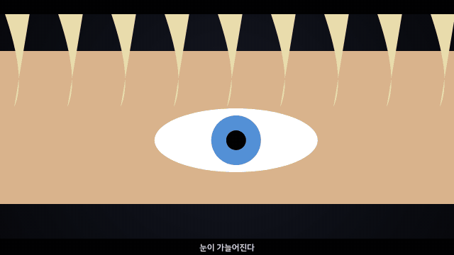

# 🗓️ 2026.11.06 · 금요일

### 달빛 아래 칼끝이 그려지다
전투 씬을 컷 단위로 미리 돌려 본 날

 

`#별품소` `#애니메이션` `#애니매틱`

---

## ✨ 오늘의 작업

### 🎬 별품소 애니 — 전투 씬 애니매틱

  
   
  ▲ 인물을 도형으로 단순하게 그려 카메라 위치와 컷 순서만 먼저 확인한 미리보기

- 🎞️ 전투 씬을 **컷 여러 개**로 나눠 움직이는 애니매틱으로 그려 봄
- 🎥 컷마다 **카메라 · 화면 크기 · 편집 길이 · 확인할 점**을 정리해 생성 결과 검수 기준을 만듦
- ♻️ 이미 만든 영상을 다시 쓸 구간을 정해 새로 만들 분량을 줄임

---

## 📊 오늘의 기록

| 🗂️ 다룬 프로젝트 | 💬 작업 대화 | 🖼️ 결과물 |
|:---:|:---:|:---:|
| **1** | - | **1** |

---

🤖 Claude와 함께 정리한 작업 일지 · <a href="../../../README.md">전체 기록 보기</a>

