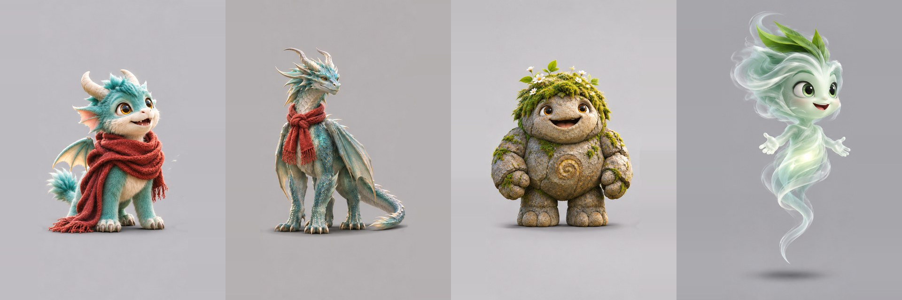
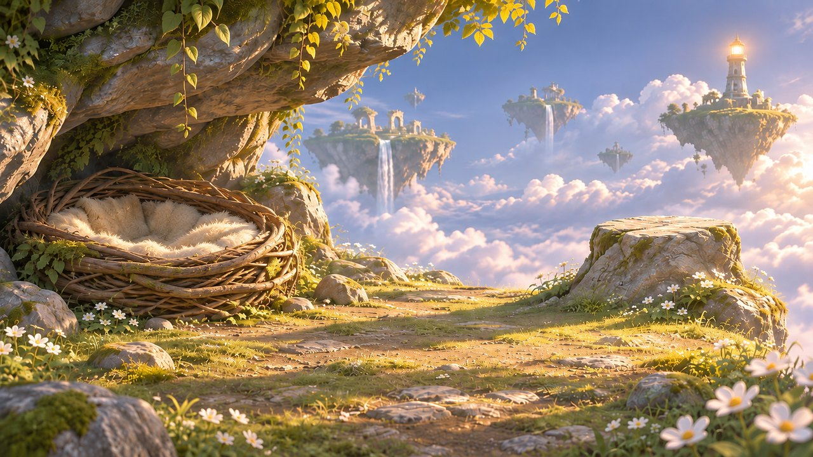
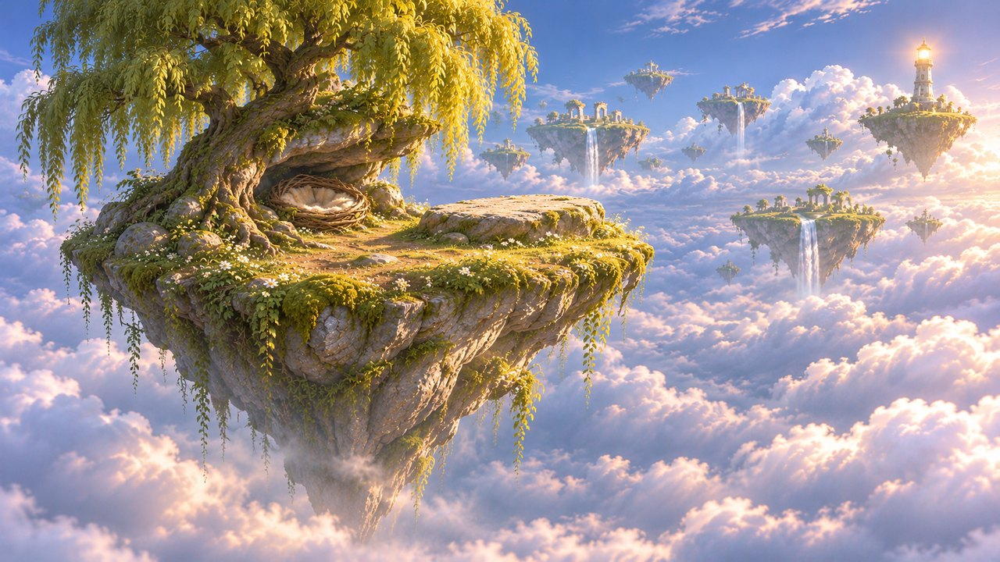

# 2026.11.09 (월)

### LUNO 프롤로그 캐릭터·배경·컷 영상 제작 및 Moon Films 채널 개설

`LUNO` `프롤로그` `캐릭터 디자인` `배경` `컷 영상` `Moon Films`

  
   
  오늘 만든 캐릭터들. 왼쪽부터 루노, 엄마 드래곤, 모코, 휘리

> 첫 작품 「LUNO」 제작 첫날이다. 캐릭터와 배경을 만들고, 프롤로그 컷 영상 9개를 뽑아 하나로 이어 붙이는 데까지 갔다. 저녁에는 보정 준비를 시작했고, 작품을 올릴 채널 Moon Films도 열었다.

| 단계 | 한 일 | 결과 |
|:---|:---|:---|
| 캐릭터 | 주인공과 주요 캐릭터 디자인 | 캐릭터 5종, 목도리를 두른 모습 2종, 소품 1종 |
| 배경 | 프롤로그에 나오는 장소 | 하늘 둥지 5장, 밤의 등대 원경 1장 |
| 컷 영상 | 프롤로그 전체 | 컷 영상 9개, 약 2분 분량 |
| 가편집 | 컷을 하나로 잇기 | 4번 고쳐 4차에서 마무리 |
| 보정 | 분석과 구역 나누기 | 구역 6개, 1차 미리보기 |
| 채널 | Moon Films 개설 | 유튜브·인스타 계정 |

---

## LUNO — 캐릭터

- 첫 작품 이름을 「LUNO」로 정했다. 주인공은 어린 아기 드래곤 루노다.
- 루노를 비늘 있는 버전과 털 있는 버전으로 둘 다 뽑아 봤다. 비늘 쪽은 귀여운 맛이 확 떨어져서 털 있는 아기 드래곤으로 확정했다.
- 털의 양도 세 가지로 뽑았다. 털이 많은 것, 적은 것, 그 중간. 중간 버전으로 정했다.
- 그림체는 3D 애니메이션 느낌을 기본으로 하되, 너무 만화 같지 않게 재질과 빛을 살짝 더 사실적으로 맞췄다.
- 루노는 목도리를 두른 모습과 두르지 않은 모습을 따로 만들었다. 엄마 드래곤도 마찬가지다. 프롤로그 안에서 목도리가 엄마에게서 루노에게로 넘어가기 때문이다. 목도리는 엄마 것이라 루노에게는 크고 길게 그렸다.
- 수호자는 처음 뽑았을 때 새처럼 두 발로 선 모습으로 나왔다. 네 발로 서는 체형으로 몸 구조를 다시 잡아서 완성했다.
- 엄마 드래곤은 다른 캐릭터보다 그림체가 실사 판타지 쪽으로 나왔다. 어른 드래곤이라 그 정도 차이는 두기로 했다.
- 모든 캐릭터를 정면, 반측면, 옆, 뒤 네 방향으로 정리했다.

## LUNO — 배경

<table>
<tr>
<td width="50%" align="center" valign="top"> 루노가 사는 하늘 둥지</td>
<td width="50%" align="center" valign="top"> 하늘에서 본 섬 전경</td>
</tr>
</table>

- 오늘은 프롤로그에 나오는 배경만 만들었다. 하늘 둥지 다섯 장(기본, 반대 방향, 섬 전경, 훈련 바위, 둥지 가까이)과 폭풍이 오는 밤의 등대 원경 한 장이다.
- 반대 방향 그림은 앞쪽에 바위를 넣은 버전도 만들었는데, 바위가 화면을 가려서 처음 버전을 쓰기로 했다.
- 섬 전경은 같은 그림을 여러 번 고치다 보니 화질이 뭉개지고 그림체까지 달라졌다. 고치던 것을 버리고 처음부터 새로 만들었다. 앞으로 고치는 건 한두 번까지만 하고, 그 이상이면 새로 만들기로 했다.
- 밤 등대 그림에는 마지막 장면에서 수호자가 앉을 자리를 미리 비워 뒀다.

## LUNO — 프롤로그 컷 영상

- 프롤로그를 컷 영상 9개로 나눠 만들었다. 다 합치면 2분쯤 된다.
- 컷 사이는 페이드로 넘기지 않고 카메라와 캐릭터의 움직임만으로 잇기로 했다. 오후에서 노을로 시간이 건너뛰는 한 곳만 예외로 뒀다.
- 대사가 없는 작품이라 감정은 몸짓과 표정으로만 보여 준다.

| 컷 | 무엇이 문제였나 | 어떻게 됐나 |
|:---|:---|:---|
| 구름을 뚫고 섬이 나오는 첫 컷 | 엄마가 둥지에 누워 있는 장면으로 시작하니 밋밋했다 | 엄마가 날아와 카메라를 스쳐 지나가고, 구름이 걷히면 섬과 루노가 보이게 바꿨다 |
| 날기 연습 | 힘껏 뛰어오르게 했더니 루노가 진짜로 날아 버렸다 | 날개만 파닥이고 작게 뛰기만 하는 모습으로 다시 만들었다 |
| 엄마와 얼굴을 맞대는 컷 | 첫 컷에 이미 비슷한 장면이 나왔다 | 겹치는 컷 하나를 뺐다 |
| 목도리를 묶어 주는 컷 | 묶인 모습이 정해 둔 루노의 목도리 모양과 달랐다 | 같은 모양이 나올 때까지 다시 만들었다 |
| 기뻐서 한 바퀴 도는 컷 | 다음 컷과 각도가 달라 이어 붙이면 튀었다 | 다음 컷의 첫 모습으로 끝나도록 새로 만들었다 |
| 마지막 수호자 컷 | 첫 번째는 캐릭터가 사라지고 빈 둥지로 넘어갔고, 두 번째는 하늘섬이 바닷가 언덕으로 바뀌었다 | 세 번째에서 제대로 나왔다 |

## LUNO — 가편집

- 컷 영상 9개를 이어 붙여 가편집본을 만들었다. 네 번 고쳤다.
- 1차는 컷이 이어지는 곳마다 카메라가 살짝 들어갔다 나오는 듯한 움직임이 보였다. 2차에서 없앴다.
- 2차에서도 화면이 세로로 살짝 늘었다 줄어드는 느낌이 남았다. 이어서 만든 컷이 앞 컷보다 화면이 아주 조금 작게 나온다는 걸 찾아냈고, 3차에서 그 차이를 맞추니 사라졌다.
- 4차는 내가 직접 다듬은 편집본에 새로 만든 마지막 컷을 이어 붙인 것이다. 길이는 1분 58초다.

## LUNO — 보정 준비

- 가편집본을 1080p로 키워서 보정을 시작했다. 뒤쪽 한 군데가 살짝 끊겨 보여서 다시 키운 영상으로 바꿨다.
- 컷 경계가 아니라 빛과 시간대가 바뀌는 지점을 기준으로 영상을 6개 구역으로 나눴다. 구름 속 하늘, 한낮의 섬, 해가 낮아진 풀밭, 해 질 녘, 노을에서 밤, 폭풍이 오는 밤이다.
- 구역마다 대표 장면을 뽑아서 그대로 둘 곳과 고칠 곳을 나눴다. 같은 낮인데 컷마다 따뜻한 정도가 들쭉날쭉한 곳, 밤 둥지가 너무 어두워 날개와 둥지가 뭉개지는 곳 같은 것들이 나왔다.
- 앞쪽 구역들은 보정 전후를 나란히 보는 1차 미리보기까지 만들었다.

## Moon Films — 채널 개설

- 기존 계정을 쓰지 않고 새 채널을 만들었다. 이름은 Moon Films, 유튜브와 인스타 둘 다 @moonfilmsyt로 맞췄다.
- 아이들만 보는 채널이 아니라 가족이 다 같이 보는 채널로 설정했다.
- 처음에는 유튜브를 메인으로 두고, 에피소드마다 인스타 릴스로 홍보하는 구조로 시작했다. 대사가 없어서 해외에서도 볼 수 있으니 처음부터 글로벌을 노린다.

---

## 공개 링크

| 항목 | 링크 |
|:---|:---|
| Moon Films 인스타그램 | [www.instagram.com/moonfilmsyt](https://www.instagram.com/moonfilmsyt/) |
| Moon Films 유튜브 채널 | [www.youtube.com/channel/UCL3KZs12lTBKj6pYnjI9CHg](https://www.youtube.com/channel/UCL3KZs12lTBKj6pYnjI9CHg) |

---

Claude와 함께 정리한 작업 일지 · <a href="../../../README.md">전체 기록 보기</a>

