

# 2026.11.09 (월)

### LUNO 프롤로그 캐릭터·배경·컷 영상 제작 및 Moon Films 채널 개설

`LUNO` `프롤로그` `캐릭터 디자인` `배경` `컷 영상` `가편집` `Moon Films`

  
   
  오늘 만든 캐릭터들. 왼쪽부터 루노, 엄마 드래곤, 모코, 휘리

> 첫 작품 「LUNO」 제작 첫날이다. 아침에 캐릭터와 배경을 만들고, 오후에 프롤로그 컷 영상 9개를 뽑아 저녁에 하나로 이어 붙였다. 밤에는 보정 준비를 시작했고, 작품을 올릴 채널 Moon Films도 열었다.

| 단계 | 한 일 | 결과 |
|:---|:---|:---|
| 캐릭터 | 주인공과 주요 캐릭터 디자인 | 캐릭터 5종, 목도리를 두른 모습 2종, 소품 1종 |
| 배경 | 프롤로그에 나오는 장소 | 하늘 둥지 5장, 밤의 등대 원경 1장 (버린 것 4장) |
| 컷 영상 | 프롤로그 전체 | 컷 영상 9개, 약 2분 분량 (버린 것 5개) |
| 가편집 | 컷을 하나로 잇기 | 4번 고쳐 4차에서 마무리, 1분 58초 |
| 보정 | 분석과 구역 나누기 | 구역 6개, 1차 미리보기 |
| 채널 | Moon Films 개설 | 유튜브·인스타 계정 |

---

## LUNO — 캐릭터

<table>
<tr>
<td width="33%" align="center" valign="top">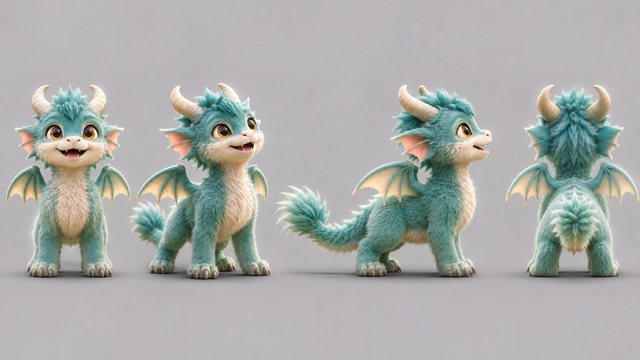 시도 1: 털이 많음</td>
<td width="33%" align="center" valign="top">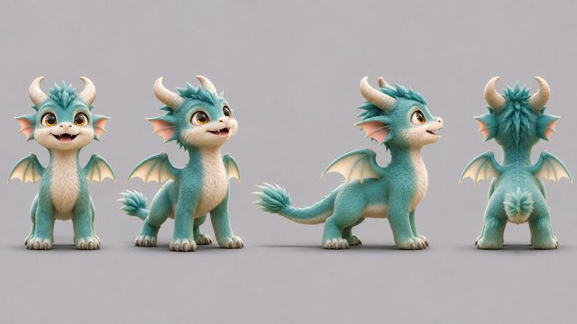 시도 2: 털이 적음</td>
<td width="33%" align="center" valign="top">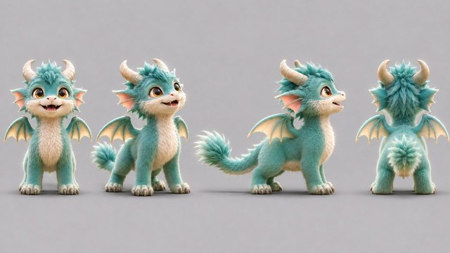 시도 3: 중간. 이걸로 확정</td>
</tr>
</table>

- 첫 작품 이름을 「LUNO」로 정했다. 주인공은 어린 아기 드래곤 루노다.
- 루노를 비늘 있는 버전과 털 있는 버전으로 둘 다 뽑아 봤다. 비늘 쪽은 귀여운 맛이 확 떨어져서 털 있는 아기 드래곤으로 확정했다.
- 털의 양도 세 가지로 뽑았다. 털이 많은 것, 적은 것, 그 중간이다. 나란히 놓고 보고 중간으로 정했다.
- 몸의 비율도 정했다. 머리가 몸의 절반쯤 되는 아기 비율과 조금 더 큰 어린이 비율 중에서 어린이 비율로 갔다.
- 그림체는 3D 애니메이션 느낌을 기본으로 하되, 너무 만화 같지 않게 재질과 빛을 살짝 더 사실적으로 맞췄다.

<table>
<tr>
<td width="25%" align="center" valign="top">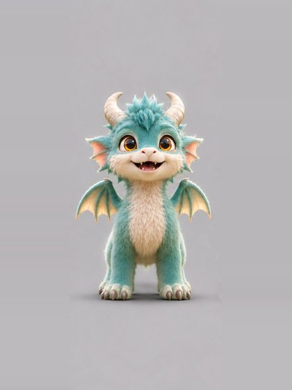 루노</td>
<td width="25%" align="center" valign="top">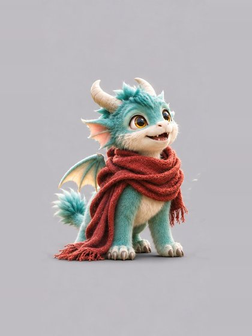 목도리를 두른 루노</td>
<td width="25%" align="center" valign="top">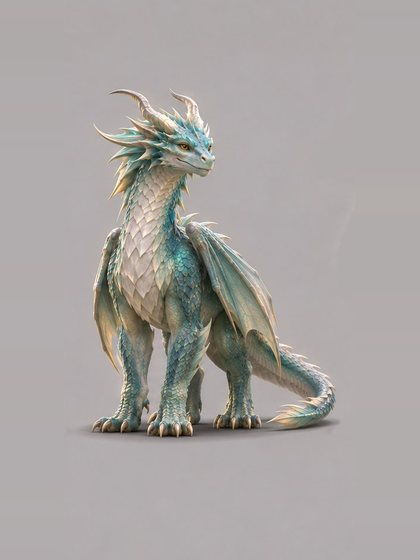 엄마 드래곤</td>
<td width="25%" align="center" valign="top">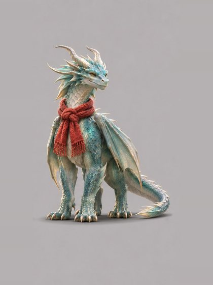 목도리를 두른 엄마</td>
</tr>
</table>

<table>
<tr>
<td width="25%" align="center" valign="top">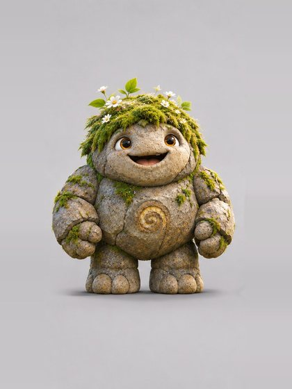 모코</td>
<td width="25%" align="center" valign="top">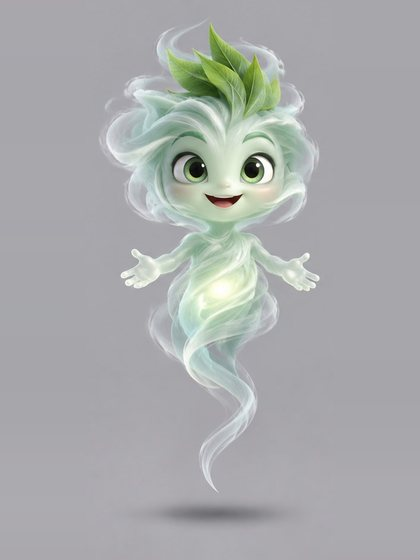 휘리</td>
<td width="25%" align="center" valign="top">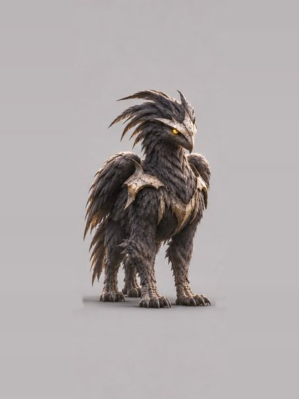 수호자</td>
<td width="25%" align="center" valign="top">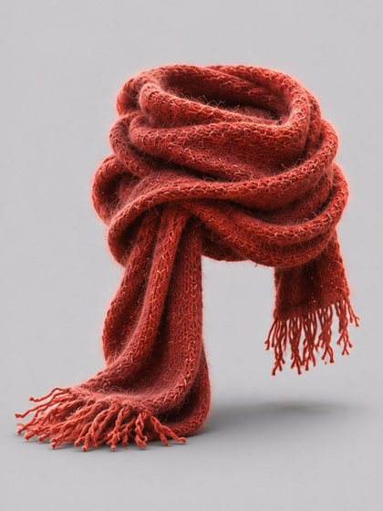 소품: 빨간 목도리</td>
</tr>
</table>

- 루노는 목도리를 두른 모습과 두르지 않은 모습을 따로 만들었다. 엄마 드래곤도 마찬가지다. 프롤로그 안에서 목도리가 엄마에게서 루노에게로 넘어가기 때문이다. 목도리는 엄마 것이라 루노에게는 크고 길게 그렸다.
- 빨간 목도리는 소품으로도 따로 만들었다. 감은 모양, 펼친 모양, 털실의 질감을 각각 그렸다. 편마다 매듭 방향과 색이 달라지면 안 되는 물건이다.
- 수호자는 처음 뽑았을 때 새처럼 두 발로 선 모습으로 나왔다. 네 발로 서는 체형으로 몸 구조를 다시 잡아서 완성했다.
- 엄마 드래곤은 다른 캐릭터보다 그림체가 실사 판타지 쪽으로 나왔다. 어른 드래곤이라 그 정도 차이는 두기로 했다.
- 프롤로그에는 나오지 않는 모코와 휘리도 오늘 같이 만들었다. 앞으로 계속 나올 캐릭터라 처음에 한꺼번에 정해 두는 편이 낫다.
- 모든 캐릭터를 정면, 반측면, 옆, 뒤 네 방향으로 정리했다.

## LUNO — 배경

<table>
<tr>
<td width="33%" align="center" valign="top">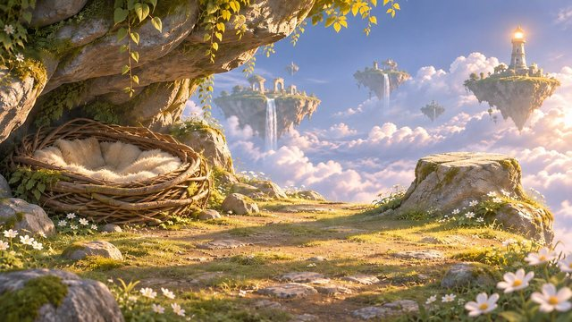 하늘 둥지 (기본)</td>
<td width="33%" align="center" valign="top">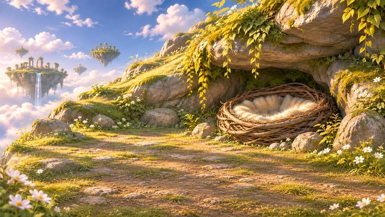 반대 방향</td>
<td width="33%" align="center" valign="top"> 섬 전경</td>
</tr>
</table>

<table>
<tr>
<td width="33%" align="center" valign="top">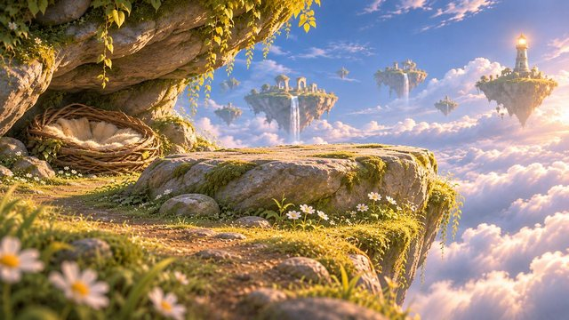 훈련 바위</td>
<td width="33%" align="center" valign="top">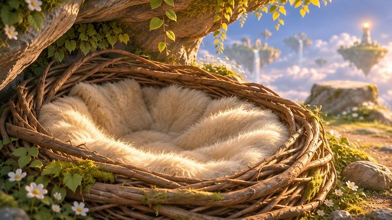 둥지 가까이</td>
<td width="33%" align="center" valign="top">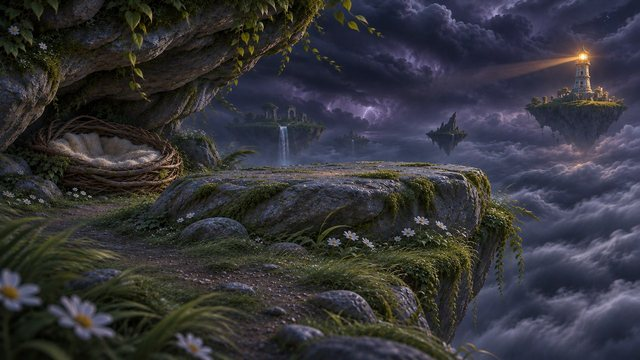 폭풍이 오는 밤의 등대</td>
</tr>
</table>

- 오늘은 프롤로그에 나오는 배경만 만들었다. 하늘 둥지 다섯 장과 폭풍이 오는 밤의 등대 원경 한 장이다.
- 하늘 둥지는 같은 장소를 각도와 거리를 바꿔 다섯 장으로 만들었다. 한 장만 있으면 카메라가 늘 같은 방향에서만 찍게 되기 때문이다.
- 밤 등대 그림에는 마지막 장면에서 수호자가 앉을 자리를 미리 비워 뒀다.

<table>
<tr>
<td width="25%" align="center" valign="top">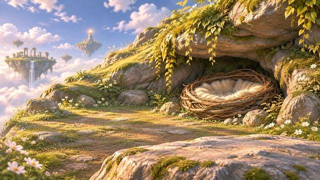 바위를 앞에 넣은 버전: 화면을 가림</td>
<td width="25%" align="center" valign="top">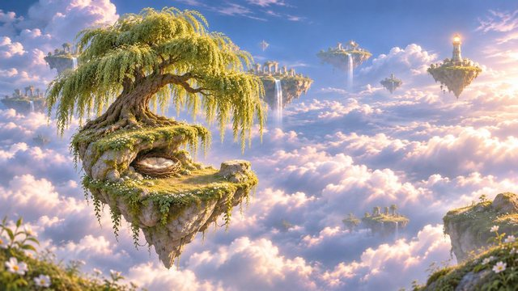 섬 전경 처음 버전</td>
<td width="25%" align="center" valign="top">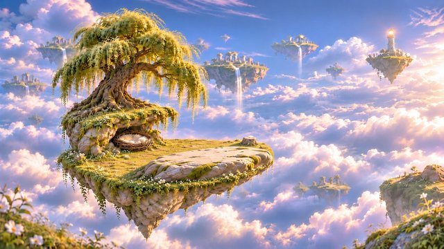 여러 번 고친 버전: 그림체가 뭉개짐</td>
<td width="25%" align="center" valign="top">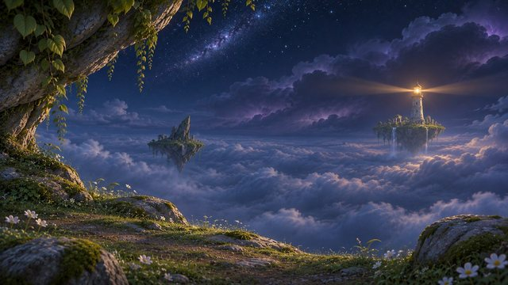 밤 등대 첫 시도</td>
</tr>
</table>

- 반대 방향 그림은 앞쪽에 바위를 넣은 버전도 만들었는데, 바위가 화면을 가려서 처음 버전을 쓰기로 했다.
- 섬 전경은 같은 그림을 여러 번 고치다 보니 화질이 뭉개지고 그림체까지 달라졌다. 고치던 것을 버리고 처음부터 새로 만들었다. 앞으로 고치는 건 한두 번까지만 하고, 그 이상이면 새로 만들기로 했다.
- 밤 등대는 첫 시도에서 밤하늘이 예쁘게만 나왔다. 폭풍 구름이 낀 하늘로 다시 만들었다.

## LUNO — 프롤로그 컷 영상

<table>
<tr>
<td width="33%" align="center" valign="top">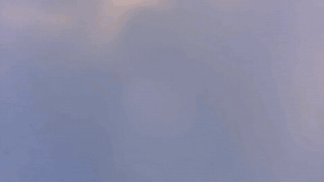 구름을 뚫고 나오면 섬이 보임</td>
<td width="33%" align="center" valign="top">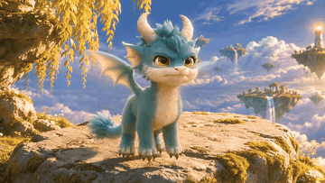 날기 연습</td>
<td width="33%" align="center" valign="top">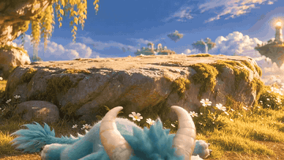 꽈당 넘어진 루노</td>
</tr>
</table>

<table>
<tr>
<td width="33%" align="center" valign="top">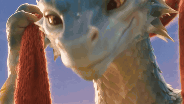 목도리를 묶어 줌</td>
<td width="33%" align="center" valign="top">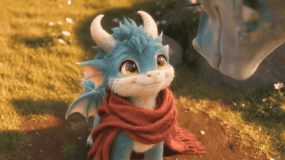 목도리에 얼굴이 폭</td>
<td width="33%" align="center" valign="top">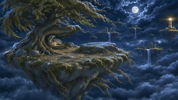 수호자가 다가옴</td>
</tr>
</table>

- 프롤로그를 컷 영상 9개로 나눠 만들었다. 다 합치면 2분쯤 된다.
- 처음 계획은 8컷이었다. 날기 연습과 넘어지는 장면은 하나로 합쳤고, 한 번에 만들기에 긴 두 컷은 앞뒤로 나눴다.
- 컷 사이는 페이드로 넘기지 않고 카메라와 캐릭터의 움직임만으로 잇기로 했다. 오후에서 노을로 시간이 건너뛰는 한 곳만 예외로 뒀다.
- 대사가 없는 작품이라 감정은 몸짓과 표정으로만 보여 준다.
- 캐릭터 크기도 정했다. 엄마는 둥지 안에 들어갈 크기이고, 루노는 엄마의 10분의 1쯤이다. 처음 뽑은 그림에서 캐릭터가 섬만큼 크게 나와서 정한 기준이다.

#### 컷 9개

<table>
<tr>
<td width="33%" align="center" valign="top">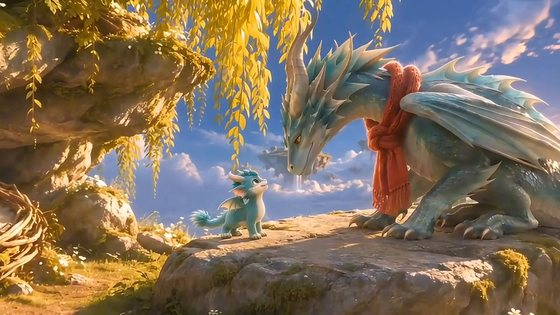 01 엄마가 날아와 얼굴을 맞댐</td>
<td width="33%" align="center" valign="top">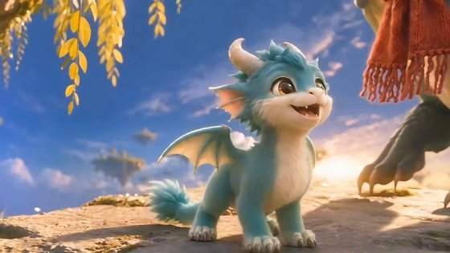 01a 기뻐서 한 바퀴</td>
<td width="33%" align="center" valign="top">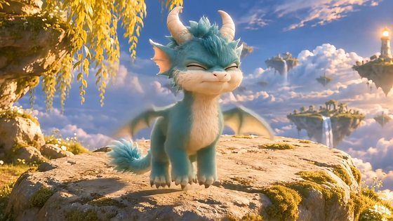 02 날기 연습과 꽈당</td>
</tr>
</table>

<table>
<tr>
<td width="33%" align="center" valign="top">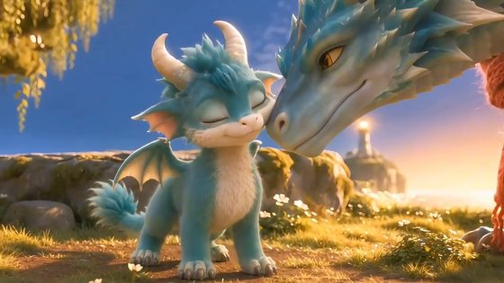 04a 엄마가 일으켜 줌</td>
<td width="33%" align="center" valign="top">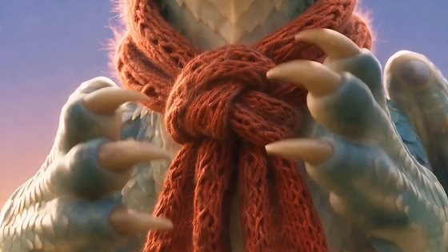 05a 목도리를 묶어 줌</td>
<td width="33%" align="center" valign="top">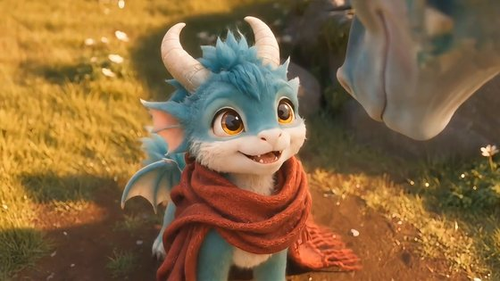 05b 목도리에 얼굴이 폭</td>
</tr>
</table>

<table>
<tr>
<td width="33%" align="center" valign="top">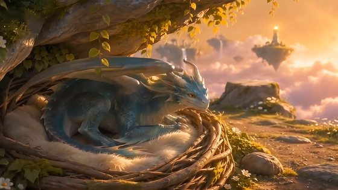 06 노을, 엄마 날개 아래로</td>
<td width="33%" align="center" valign="top">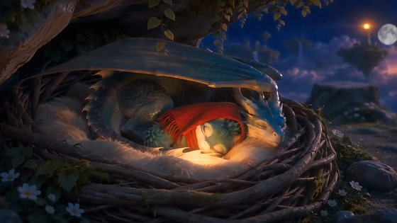 07 잠든 얼굴</td>
<td width="33%" align="center" valign="top">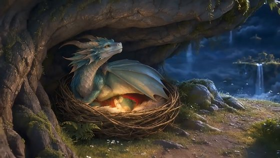 08 폭풍과 수호자</td>
</tr>
</table>

| 컷 | 장면 | 무엇이 문제였나 | 어떻게 됐나 |
|:---|:---|:---|:---|
| 01 | 구름을 뚫고 섬이 나오고, 엄마가 날아와 루노와 얼굴을 맞댐 | 엄마가 둥지에 누워 있는 장면으로 시작하니 밋밋했다 | 엄마가 날아와 카메라를 스쳐 지나가고, 구름이 걷히면 섬과 루노가 보이게 바꿨다. 방향을 세 번 고쳤다 |
| 01a | 루노가 기뻐서 한 바퀴 돌고 마음을 다잡음 | 콩콩 뛰는 버전은 다음 컷과 각도가 달라 이어 붙이면 튀었다 | 다음 컷의 첫 모습으로 끝나도록 새로 만들었다 |
| 02 | 날기 연습을 하다 꽈당 넘어짐 | 힘껏 뛰어오르게 했더니 루노가 진짜로 날아 버렸다 | 날개만 파닥이고 작게 뛰기만 하는 모습으로 다시 만들었다 |
| 04a | 엄마가 일으켜 먼지를 털어 줌 | | |
| (삭제) | 엄마가 코끝을 루노 이마에 댐 | 첫 컷에 이미 비슷한 장면이 나왔다 | 겹쳐서 뺐다 |
| 05a | 엄마가 목도리를 풀어 루노에게 묶어 줌 | 묶인 모습이 정해 둔 루노의 목도리 모양과 달랐다 | 같은 모양이 나올 때까지 다시 만들었다 |
| 05b | 목도리에 얼굴이 폭 덮였다가 웃음 | | |
| 06 | 노을이 지고 엄마 날개 아래로 들어감 | | |
| 07 | 둥지에서 잠든 얼굴 | 끝부분은 다음 컷이 이어받는다 | 앞 11초만 썼다 |
| 08 | 폭풍이 오고 수호자가 다가옴 | 캐릭터가 사라지고 빈 둥지로 넘어갔고, 다음엔 날개로 덮지 않은 모습으로 시작해 앞 컷과 안 이어졌고, 그다음엔 하늘섬이 바닷가 언덕으로 바뀌었다 | 네 번째에 제대로 나왔다 |

#### 버린 것들

<table>
<tr>
<td width="25%" align="center" valign="top">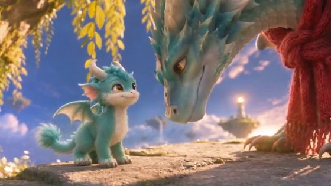 01a: 콩콩 뛰기만 해서 다음 컷과 안 이어짐</td>
<td width="25%" align="center" valign="top">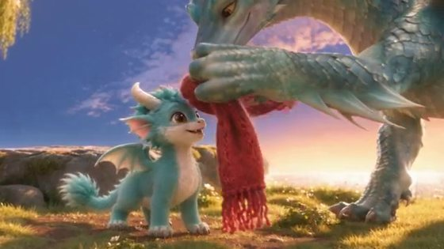 05a: 묶인 목도리 모양이 다름</td>
<td width="25%" align="center" valign="top">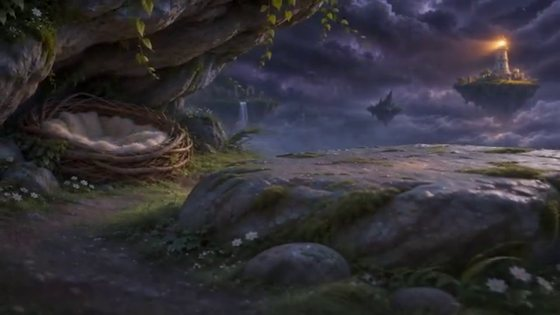 08: 캐릭터가 사라지고 빈 둥지로 넘어감</td>
<td width="25%" align="center" valign="top">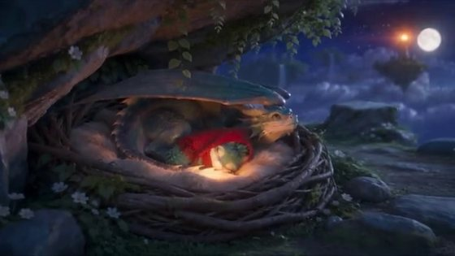 08: 앞 컷과 달리 날개로 덮고 있지 않음</td>
</tr>
</table>

<table>
<tr>
<td width="25%" align="center" valign="top">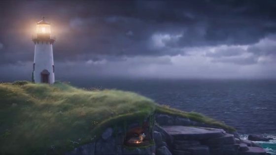 08: 하늘섬이 바닷가 언덕으로 바뀜</td>
<td width="25%" align="center" valign="top">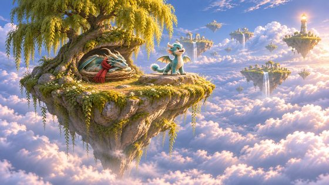 참고 그림: 캐릭터가 섬만큼 큼</td>
<td width="25%" align="center" valign="top">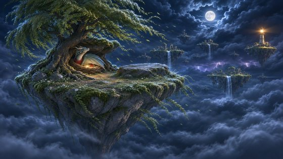 밤 섬 그림: 엄마가 다른 용으로 나옴</td>
<td width="25%" align="center" valign="top">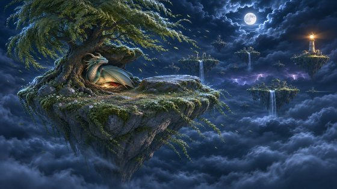 밤 섬 그림: 둥지와 용이 너무 큼</td>
</tr>
</table>

- 마지막 수호자 컷이 가장 오래 걸렸다. 오후 5시에 처음 뽑아서 저녁 7시 50분에야 끝났다.
- 그 컷의 배경으로 쓸 밤의 섬 그림도 세 번 그렸다. 처음에는 엄마가 전혀 다른 용으로 나왔고, 두 번째는 둥지와 용이 섬에 비해 너무 컸다.

## LUNO — 가편집

- 컷 영상 9개를 이어 붙여 가편집본을 만들었다. 네 번 고쳤다.
- 이어서 만든 컷은 앞 컷의 마지막 장면에서 시작하지만, 정확히 같은 그림으로 시작하지는 않는다. 그래서 뒤 컷의 앞부분에서 앞 컷의 끝과 가장 똑같은 순간을 찾아 거기서부터 붙였다.
- 1차는 컷이 이어지는 곳마다 카메라가 살짝 들어갔다 나오는 듯한 움직임이 보였다. 2차에서 없앴다.
- 2차에서도 화면이 세로로 살짝 늘었다 줄어드는 느낌이 남았다. 이어서 만든 컷이 앞 컷보다 화면이 아주 조금 작게 나온다는 걸 찾아냈고, 3차에서 그 차이를 맞추니 사라졌다.
- 4차는 내가 직접 다듬은 편집본에 새로 만든 마지막 컷을 이어 붙인 것이다. 길이는 1분 58초다.
- 마지막 컷은 끝의 1초만 조금 빠르게 돌려서 수호자가 확 다가오는 느낌을 살렸다.

## LUNO — 보정 준비

<table>
<tr>
<td width="33%" align="center" valign="top">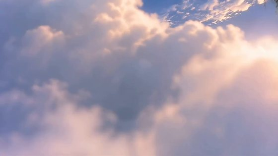 구역 1: 구름 속 하늘</td>
<td width="33%" align="center" valign="top">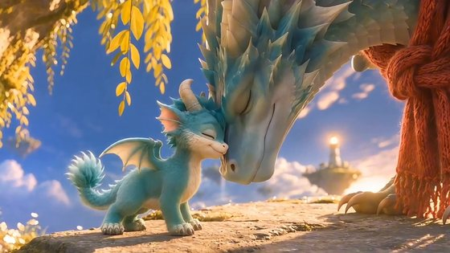 구역 2: 한낮의 섬</td>
<td width="33%" align="center" valign="top">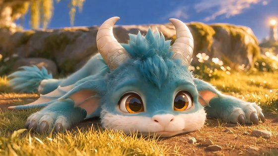 구역 3: 해가 낮아진 풀밭</td>
</tr>
</table>

<table>
<tr>
<td width="33%" align="center" valign="top">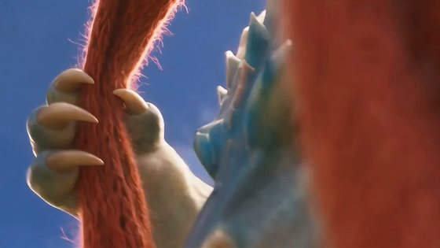 구역 4: 해 질 녘</td>
<td width="33%" align="center" valign="top">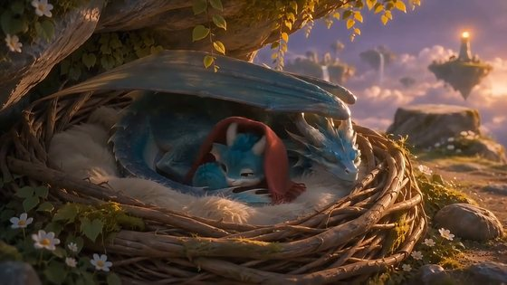 구역 5: 노을에서 밤</td>
<td width="33%" align="center" valign="top"> 구역 6: 폭풍이 오는 밤</td>
</tr>
</table>

- 가편집본을 1080p로 키워서 보정을 시작했다. 뒤쪽 한 군데가 살짝 끊겨 보여서 다시 키운 영상으로 바꿨다.
- 컷 경계가 아니라 빛과 시간대가 바뀌는 지점을 기준으로 영상을 6개 구역으로 나눴다. 한 컷 안에서도 카메라가 풀밭으로 내려가거나 노을이 보이기 시작하면 거기서 구역이 바뀐다.
- 구역마다 대표 장면을 뽑아서 그대로 둘 곳과 고칠 곳을 나눴다. 같은 낮인데 컷마다 따뜻한 정도가 들쭉날쭉한 곳, 구름 속 장면이 하얗게 떠 보이는 곳, 밤 둥지가 너무 어두워 날개와 둥지가 뭉개지는 곳 같은 것들이 나왔다.
- 화면을 0.25초마다 재서 밝기와 색이 어디서 튀는지 숫자로도 확인했다.
- 앞쪽 구역들은 보정 전후를 나란히 보는 1차 미리보기까지 만들었다.

## Moon Films — 채널 개설

- 기존 계정을 쓰지 않고 새 채널을 만들었다. 이름은 Moon Films, 유튜브와 인스타 둘 다 @moonfilmsyt로 맞췄다.
- 아이들만 보는 채널이 아니라 가족이 다 같이 보는 채널로 설정했다.
- 처음에는 유튜브를 메인으로 두고, 에피소드마다 인스타 릴스로 홍보하는 구조로 시작했다. 대사가 없어서 해외에서도 볼 수 있으니 처음부터 글로벌을 노린다.

---

## 공개 링크

| 항목 | 링크 |
|:---|:---|
| Moon Films 인스타그램 | [www.instagram.com/moonfilmsyt](https://www.instagram.com/moonfilmsyt/) |
| Moon Films 유튜브 채널 | [www.youtube.com/channel/UCL3KZs12lTBKj6pYnjI9CHg](https://www.youtube.com/channel/UCL3KZs12lTBKj6pYnjI9CHg) |

---

Claude와 함께 정리한 작업 일지 · <a href="../../../README.md">전체 기록 보기</a>

