

# 2026.11.11 (수)

### LUNO 프롤로그 보정 완료 및 음향 방향 결정

`LUNO` `프롤로그` `보정` `음향`

  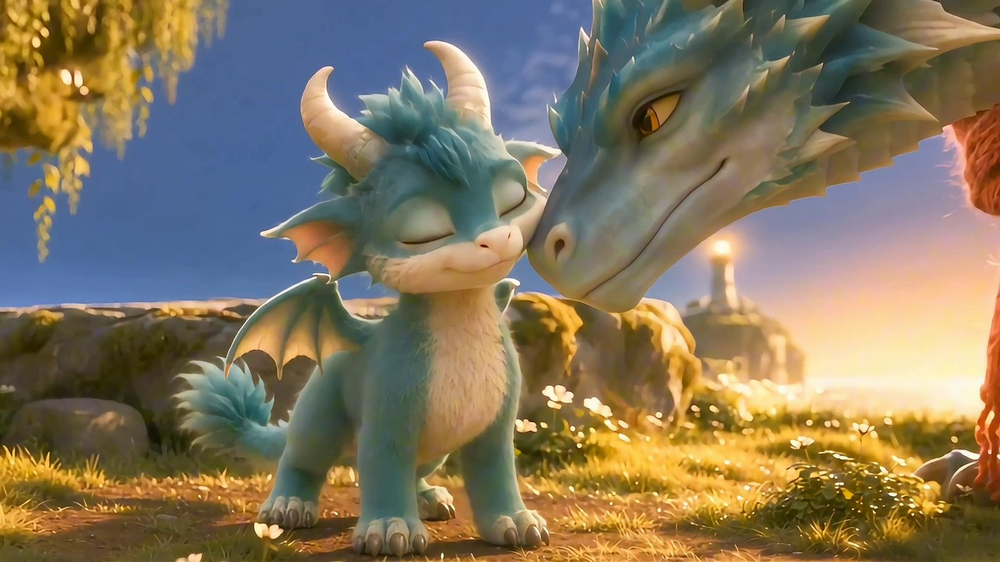
   
  보정을 마친 프롤로그의 한 장면

> 프롤로그 보정을 끝냈다. 아침에 6개 구역을 마저 보정해 합쳤는데, 합친 영상이 흐리고 어둡게 나오는 문제가 생겨서 뽑는 방식을 바꿔 다시 만들었다. 보정을 마무리하면서 캐릭터 소리를 어떻게 낼지 방향도 잡았다.

| 단계 | 한 일 | 결과 |
|:---|:---|:---|
| 보정 | 6개 구역 보정 마무리 | 구역별 보정본 6개 |
| 보정 | 구역 합치기와 화질 문제 해결 | 프롤로그 보정본 완성 (1분 58초, 2,840프레임) |
| 보정 | 구역 경계 확인 | 다섯 곳 모두 색·밝기 튐 없음 |
| 음향 | 캐릭터 소리 방향 | 루노와 엄마 드래곤의 소리 정함 |

---

## LUNO — 프롤로그 보정

#### 구역별 전후

<table>
<tr>
<td width="50%" align="center" valign="top">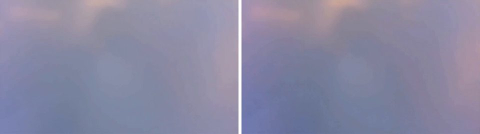 구역 1 · 구름 속 하늘 (왼쪽 보정 전, 오른쪽 후)</td>
<td width="50%" align="center" valign="top">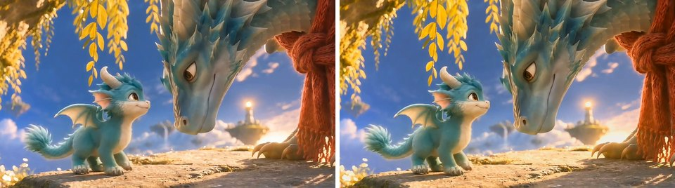 구역 2 · 한낮의 섬 (왼쪽 보정 전, 오른쪽 후)</td>
</tr>
</table>

<table>
<tr>
<td width="50%" align="center" valign="top">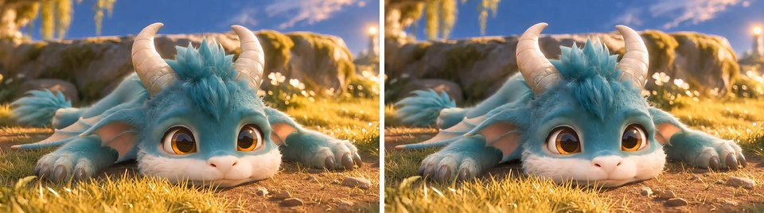 구역 3 · 해가 낮아진 풀밭 (왼쪽 보정 전, 오른쪽 후)</td>
<td width="50%" align="center" valign="top">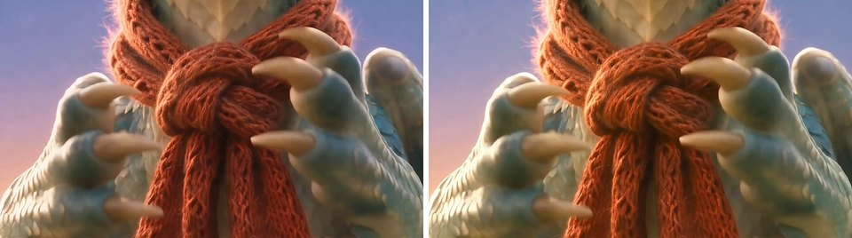 구역 4 · 해 질 녘, 역광 (왼쪽 보정 전, 오른쪽 후)</td>
</tr>
</table>

<table>
<tr>
<td width="50%" align="center" valign="top">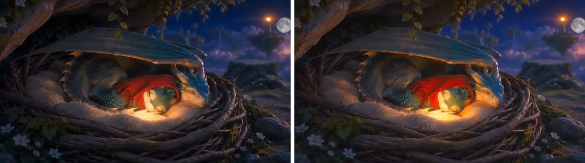 구역 5 · 밤의 둥지 (왼쪽 보정 전, 오른쪽 후)</td>
<td width="50%" align="center" valign="top">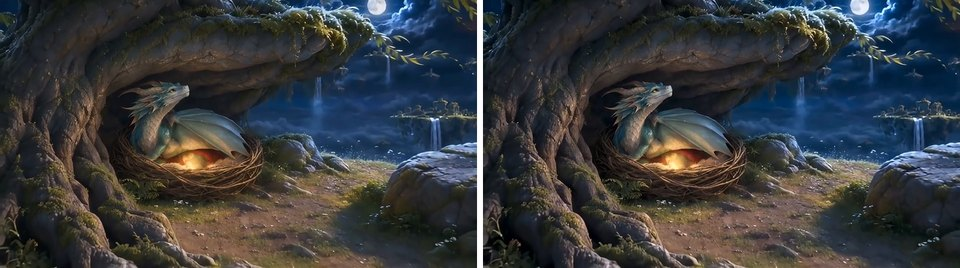 구역 6 · 폭풍이 오는 밤 (왼쪽 보정 전, 오른쪽 후)</td>
</tr>
</table>

- 9일에 나눠 둔 6개 구역을 하나씩 보정했다. 구역마다 보정 전후를 나란히 놓은 비교 이미지와 짧은 미리보기를 보고 확인한 뒤 내보냈다.
- 모든 장면에 같은 보정을 기계적으로 입히지 않았다. 이야기와 감정을 전하는 데 도움이 되는 것만 골랐고, 효과가 필요 없는 장면에는 일부러 넣지 않았다.

| 구역 | 보정 전 상태 | 한 일 | 하지 않은 것 |
|:---|:---|:---|:---|
| 1. 구름 속 하늘 | 구름 안개 때문에 대비가 낮고, 몇 초 동안은 화면이 거의 하얗게 떴다 | 하얗게 뜨는 부분만 대비를 살짝 올리고, 섬이 나오는 순간 다음 구역의 따뜻한 빛으로 이어지게 했다 | 안개를 다 걷어 내지 않았다. 구름을 뚫고 나오는 느낌이 사라지기 때문이다 |
| 2. 한낮의 섬 | 같은 낮인데 컷마다 색이 달랐다. 어떤 컷은 따뜻하고 어떤 컷은 차가웠다 | 구역 전체를 하나의 맑은 낮 색으로 맞추고, 넘어지기 직전 루노의 표정이 읽히게 얼굴을 살짝 밝혔다 | 웃긴 장면에 충격 효과를 넣지 않았다 |
| 3. 해가 낮아진 풀밭 | 풀이 금빛으로 변하는 구간. 엄마 머리가 화면을 가리는 순간 잠깐 어두워진다 | 해가 낮아지는 흐름이 갑자기 바뀌지 않게 하고, 엎어진 루노의 눈이 잘 보이게 했다 | 엄마가 다가올 때 생기는 그림자는 자연스러워서 밝히지 않았다 |
| 4. 해 질 녘 | 역광 클로즈업에서 엄마의 얼굴과 손이 붉고 어두웠다. 뒤쪽 컷은 지나치게 노랬다 | 엄마 얼굴과 손을 살짝 밝히고, 목도리를 건네는 순간 빨간색이 잘 읽히게 했다. 너무 노란 컷은 앞 컷에 맞췄다 | 화면 가장자리를 어둡게 누르지 않았다. 두 캐릭터의 눈빛이 죽기 때문이다 |
| 5. 노을에서 밤 | 노을은 해 주변이 하얗게 날아갈 만큼 밝았고, 밤 둥지는 검정이 너무 깊어 날개와 둥지가 뭉개졌다 | 금빛 노을에서 남보라, 밤으로 서서히 넘어가게 했다. 밤 둥지의 어두운 부분을 들어 올리고 루노 얼굴과 목도리에 약한 따뜻한 빛을 줬다 | 밤을 낮처럼 밝히지 않았다 |
| 6. 폭풍이 오는 밤 | 수호자의 얼굴이 꽤 자세히 보였다 | 가장 차가운 색으로 잡았다. 수호자는 몸을 어둡게 눌러 실루엣처럼 보이게 하고 금빛 눈만 살렸다. 번개는 은은하게, 밝게 번쩍이는 건 한 번만 넣었다 | 번쩍임을 연달아 넣지 않았다 |

<table>
<tr>
<td width="50%" align="center" valign="top">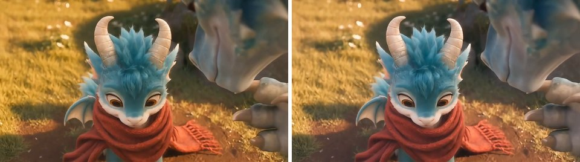 목도리를 건네는 순간: 빨간색이 잘 읽히게</td>
<td width="50%" align="center" valign="top">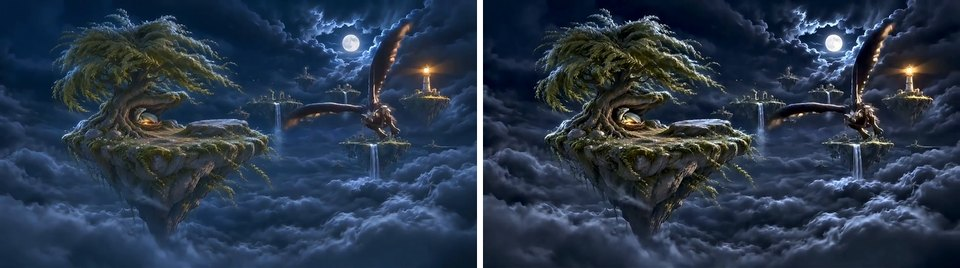 수호자: 몸은 어둡게 누르고 눈만 살림</td>
</tr>
</table>

- 어느 구역에서든 루노의 청록 털, 크림색 가슴털, 빨간 목도리, 수호자의 금빛 눈은 색이 바뀌지 않게 지켰다. 특히 빨간 목도리는 어두운 장면에서도 알아볼 수 있어야 한다.
- 마지막 폭풍 구역은 한 번에 끝나지 않았다. 수호자를 어둡게 누르는 효과를 여러 번 고쳐서 다섯 번째 판에서 마무리했다.

#### 합치기와 화질 문제

- 6개 구역 보정본을 하나로 합쳤는데, 합친 영상이 구역별로 볼 때보다 흐리고 어둡게 보였다.
- 원인은 세 가지였다. 구역별로 한 번 저장하고 합칠 때 또 저장해서 압축이 두 번 들어갔고, 색 표준 표시가 빠져서 기기마다 색이 다르게 보였고, 저장할 때마다 밝기가 조금씩 깎였다.
- 구역별 영상을 합치는 방식을 버리고, 원본에서 6개 구역의 보정을 한 번에 적용해 바로 뽑는 방식으로 바꿨다. 의도한 화면과의 차이가 눈에 띄게 줄었고 밝기가 깎이는 문제도 없어졌다.
- 먼저 만든 흐린 보정본은 지우지 않고 따로 보관했다. 앞으로 최종본은 항상 원본에서 한 번에 뽑는다.

#### 구역 경계 확인

- 구역이 바뀌는 다섯 곳을 따로 확인했다. 구역마다 보정이 다르니까, 경계에서 색이나 밝기가 툭 바뀌면 안 된다.
- 경계 앞뒤 몇 초 동안은 두 구역의 보정이 서서히 섞이게 했다. 확인해 보니 보정 때문에 새로 생긴 튐은 없었다. 큰 변화가 있는 곳은 원래 컷이 바뀌는 자리와, 일부러 넣은 번개와 수호자 장면뿐이었다.

<table>
<tr>
<td width="33%" align="center" valign="top">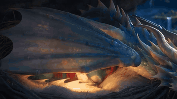 폭풍 구역 (보정 후)</td>
<td width="33%" align="center" valign="top">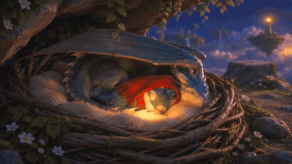 밤의 둥지 (보정 후)</td>
<td width="33%" align="center" valign="top">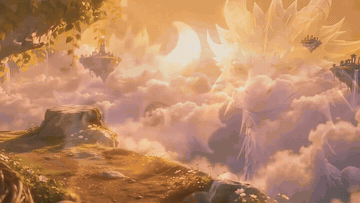 노을에서 밤으로 (보정 후)</td>
</tr>
</table>

## LUNO — 프롤로그 음향 방향

- 대사가 없는 작품이라 캐릭터가 내는 소리가 감정을 거의 다 전달해야 한다. 보정을 마무리하면서 소리도 같이 고민했다.
- 루노는 귀엽게 흥얼거리는 소리, 엄마 드래곤은 든든하고 따뜻한 울음소리로 방향을 잡았다. 둘 다 말이 아니라 동물 소리다.
- 순서는 배경음악을 먼저 만들고, 그 위에 캐릭터 소리와 효과음을 얹기로 했다.
- 음악과 효과음을 어떤 느낌으로 갈지 장면별로 정리해 뒀다. 실제로 만드는 건 내일이다.

---

Claude와 함께 정리한 작업 일지 · <a href="../../../README.md">전체 기록 보기</a>

