

# 2026.11.16 (월)

### LUNO EP1 배경·컷 영상 제작 및 가편집

`LUNO` `EP1` `배경` `컷 이미지` `컷 영상` `가편집` `보정`

  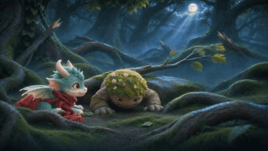
   
  EP1에 처음 나오는 친구 모코

> EP1 제작에 들어갔다. 오전에 배경과 컷 이미지를 만들고, 오후에 컷 영상 17개를 뽑아 저녁에 가편집본으로 이어 붙였다. 밤에는 보정에 쓸 분석까지 해 뒀다.

| 단계 | 한 일 | 결과 |
|:---|:---|:---|
| 준비 | 프롤로그에서 고칠 점 정리, 캐릭터 목소리 방식 변경 | EP1 제작 규칙 |
| 배경 | 이끼 숲 | 6장 (버린 것 11장) |
| 컷 이미지 | 주요 장면 구도, 소품 | 6장 (버린 것 2장) |
| 컷 영상 | EP1 전체 | 17개 (버린 것 10개) |
| 가편집 | 컷 잇기 | 4차, 2분 8초 |
| 보정 | 분석과 1차 미리보기 | 숏 33개, 구역 4개 |

---

## LUNO — EP1 준비

- 프롤로그를 올리고 나서 다시 들어 보니, 루노의 '삐익' 하는 높은 소리가 다른 소리보다 커서 귀에 거슬렸다. 새가 짹짹거리는 것 같은 울음소리 자체도 마음에 들지 않았다.
- EP1부터 루노 목소리를 바꾸기로 했다. 루노는 이제 "루" 한 마디만 하고, 억양만 바꿔서 기쁨이나 슬픔을 표현한다. 여러 번 이어 말하는 건 괜찮다. 친구 캐릭터들도 같은 식으로 간다. 엄마 드래곤은 어른이라 원래 소리 그대로 둔다.
- 작업 폴더를 편마다 따로 나누고, 앞으로 만드는 편도 같은 구조로 쌓이게 정리했다.
- 새 편의 첫 장면은 앞 편의 마지막 컷과 꼭 이어지지 않아도 되는 것으로 정했다.
- 프롤로그를 만들며 정한 것들을 EP1 제작 규칙으로 한 장에 정리하고 시작했다.

## LUNO — EP1 배경

<table>
<tr>
<td width="33%" align="center" valign="top">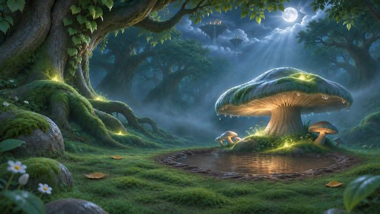 이끼 숲 (기본)</td>
<td width="33%" align="center" valign="top"> 진흙 웅덩이</td>
<td width="33%" align="center" valign="top">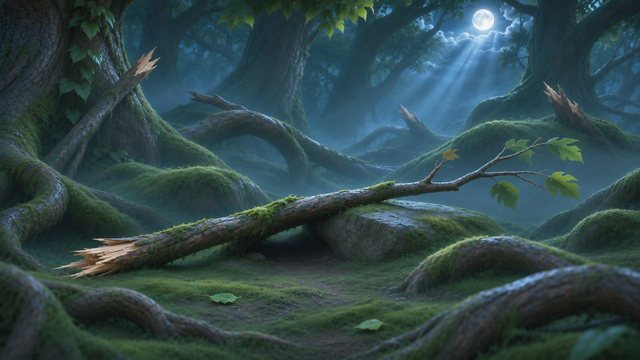 쓰러진 가지</td>
</tr>
</table>

<table>
<tr>
<td width="33%" align="center" valign="top">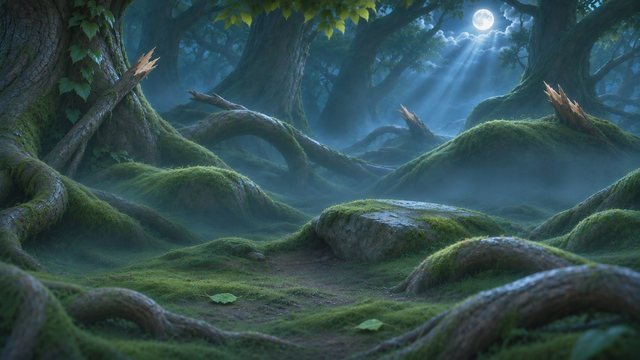 가지를 치운 같은 자리</td>
<td width="33%" align="center" valign="top">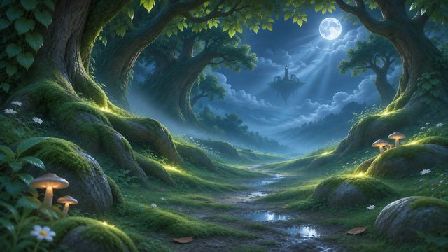 숲길과 등대</td>
<td width="33%" align="center" valign="top">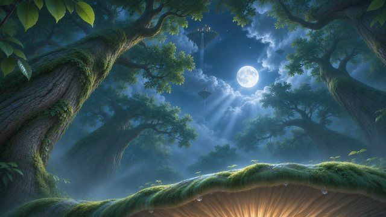 올려다본 하늘</td>
</tr>
</table>

- 이끼 숲 배경을 여섯 장 만들었다. 같은 숲을 자리와 각도를 바꿔 가며 그린 것이다. 쓰러진 가지가 있는 자리는 가지가 있을 때와 치운 뒤를 따로 만들었다. 가지를 들어 올리는 장면 앞뒤로 쓴다.
- 폭풍이 치는 밤의 등대 섬은 프롤로그 때 만든 그림을 이어 썼다.

<table>
<tr>
<td width="25%" align="center" valign="top">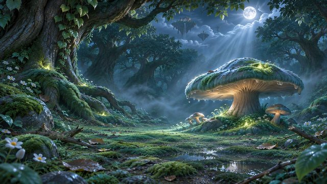 처음: 잎과 이끼가 너무 세밀함</td>
<td width="25%" align="center" valign="top">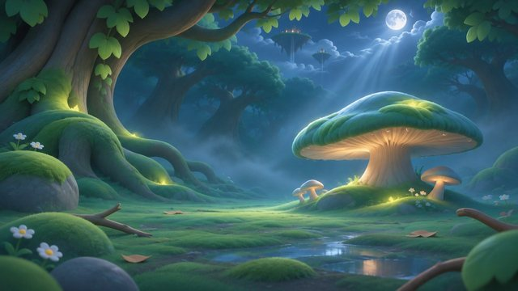 다듬기 1차: 너무 단순함</td>
<td width="25%" align="center" valign="top">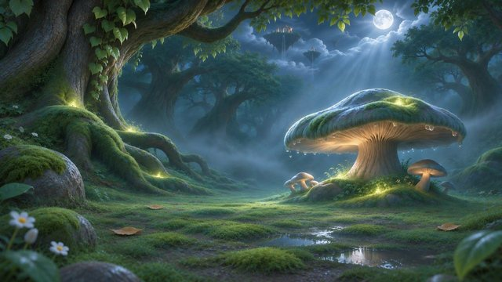 다듬기 2차: 웅덩이가 멀어짐</td>
<td width="25%" align="center" valign="top">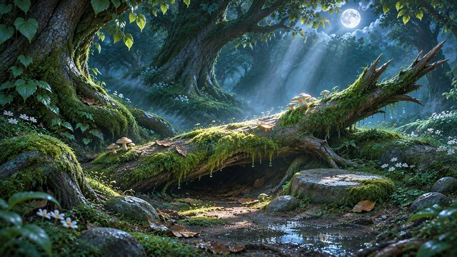 쓰러진 가지 1차: 가지가 너무 큼</td>
</tr>
</table>

- 처음 뽑은 그림들은 잎과 이끼가 지나치게 세밀했다. 다듬은 버전을 뽑았더니 이번엔 너무 단순해졌고, 그다음 것은 웅덩이가 멀리 밀려나 있었다. 세 번째에 적당한 정도를 찾았다.
- 쓰러진 가지는 처음에 화면을 다 차지할 만큼 크게 나와서 줄였다.
- 여섯 장을 얻기까지 열한 장을 버렸다.

## LUNO — EP1 컷 이미지

<table>
<tr>
<td width="25%" align="center" valign="top"> 폭풍 하늘 배경</td>
<td width="25%" align="center" valign="top">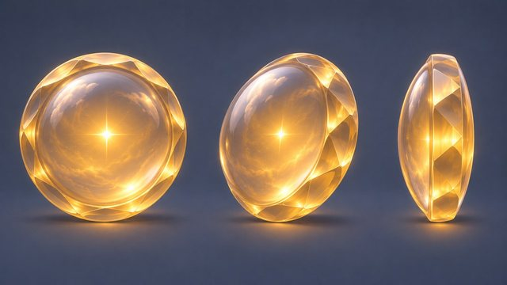 소품: 등대의 수정 렌즈</td>
<td width="25%" align="center" valign="top">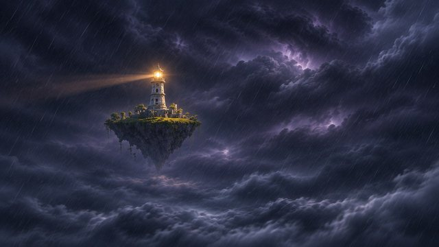 폭풍 속의 등대</td>
<td width="25%" align="center" valign="top">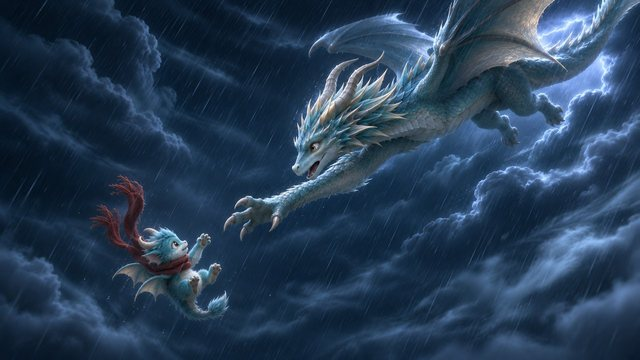 닿을 듯한 앞발</td>
</tr>
</table>

<table>
<tr>
<td width="25%" align="center" valign="top">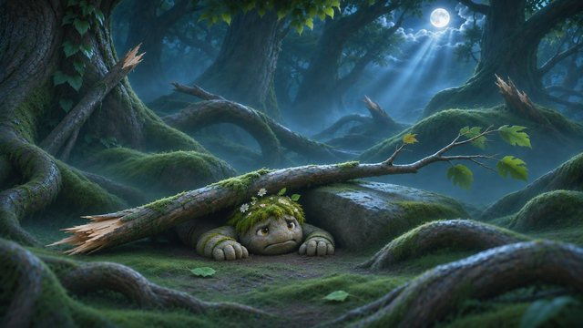 가지 아래 깔린 모코</td>
<td width="25%" align="center" valign="top">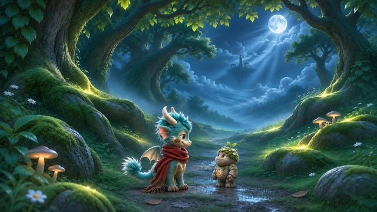 숲길에 선 둘 (확정)</td>
<td width="25%" align="center" valign="top">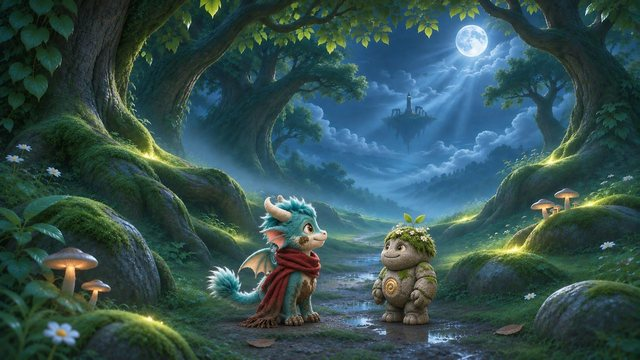 버림: 모코가 루노만큼 큼</td>
<td width="25%" align="center" valign="top">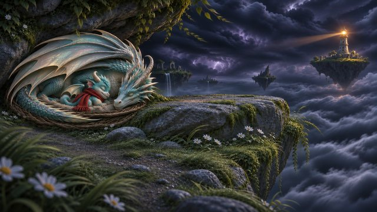 버림: 첫 장면을 자는 모습으로</td>
</tr>
</table>

- 주요 장면의 구도를 잡는 컷 이미지를 만들었다. 폭풍 하늘, 등대의 수정 렌즈, 등대가 깨지는 장면, 엄마의 앞발이 닿을 듯한 장면, 가지 아래 깔린 모코, 숲길에 나란히 선 둘이다.
- 새 친구 모코가 처음 뽑았을 때 루노와 키가 거의 같게 나왔다. 작은 친구로 보여야 해서 확실히 작게 줄였다.
- 첫 장면용으로 둥지에서 자는 모습을 그려 봤지만 쓰지 않았다.

## LUNO — EP1 컷 영상

<table>
<tr>
<td width="33%" align="center" valign="top">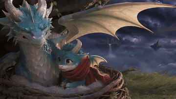 폭풍에 날아가는 루노</td>
<td width="33%" align="center" valign="top">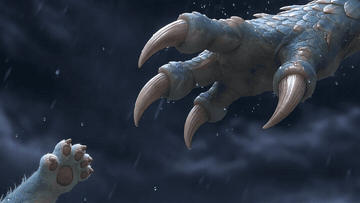 닿을 듯한 앞발</td>
<td width="33%" align="center" valign="top">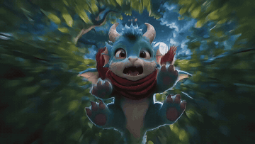 가지에 걸렸다 떨어짐</td>
</tr>
</table>

<table>
<tr>
<td width="33%" align="center" valign="top"> 날아오르려다 떨어짐</td>
<td width="33%" align="center" valign="top">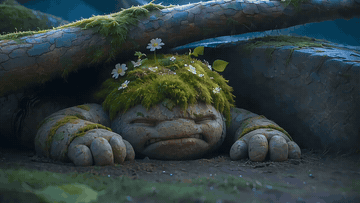 가지를 들어 모코를 구함</td>
<td width="33%" align="center" valign="top">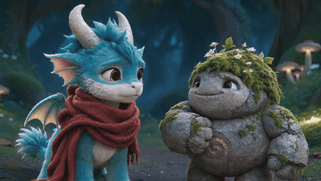 손을 잡음</td>
</tr>
</table>

- 컷 영상 17개를 만들었다. 오후 1시 50분에 첫 컷이 나왔고 5시 20분에 마지막 컷이 나왔다.
- 카메라가 캐릭터를 계속 따라다니는 방식보다, 애니메이션처럼 컷이 딱딱 바뀌는 리듬으로 가기로 했다.
- 컷들을 이어 붙여 한 편을 만드는 것이라, 컷 하나가 천천히 마무리되며 끝나면 안 된다. 한 편이 끝나는 것처럼 보이기 때문이다. 그런 컷은 다시 만들었다.
- 어색하게 나온 부분은 컷 전체를 버리지 않고 그 부분만 다시 만들어 끼웠다.

#### 컷 17개

<table>
<tr>
<td width="25%" align="center" valign="top">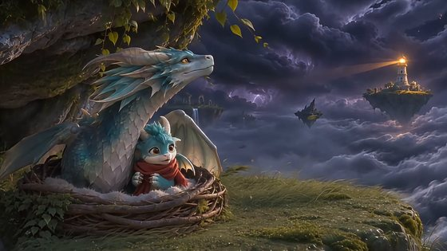 C01 폭풍 속 둥지</td>
<td width="25%" align="center" valign="top">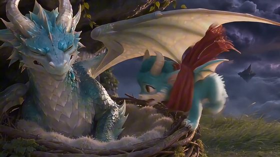 C02 날아가는 루노</td>
<td width="25%" align="center" valign="top">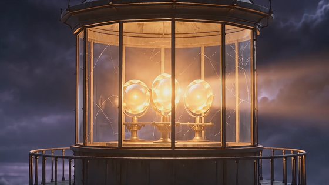 C03 깨지는 등대</td>
<td width="25%" align="center" valign="top">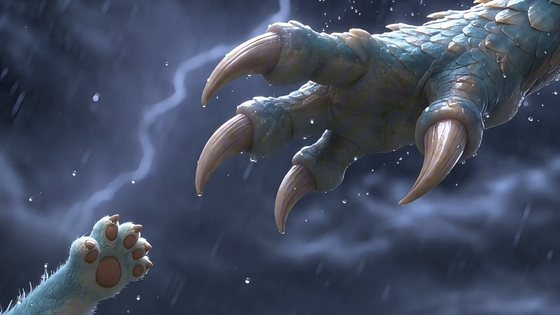 C04 닿을 듯한 앞발</td>
</tr>
</table>

<table>
<tr>
<td width="25%" align="center" valign="top"> C05 떨어지는 시점</td>
<td width="25%" align="center" valign="top">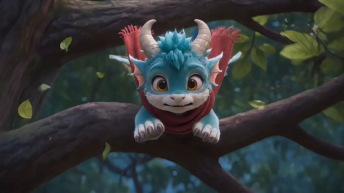 C06 가지에 부딪힘</td>
<td width="25%" align="center" valign="top">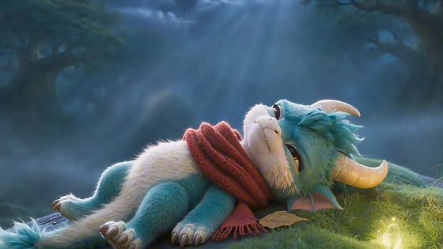 C07 깨어나 두리번</td>
<td width="25%" align="center" valign="top">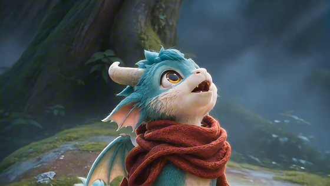 C08 하늘섬을 올려다봄</td>
</tr>
</table>

<table>
<tr>
<td width="25%" align="center" valign="top">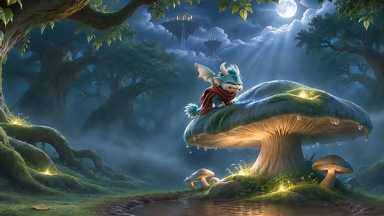 C09 날아오르다 떨어짐</td>
<td width="25%" align="center" valign="top">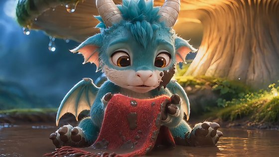 C10 진흙과 목도리</td>
<td width="25%" align="center" valign="top">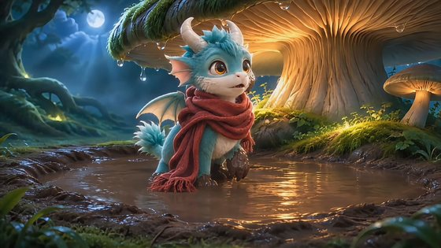 C11 소리를 따라감</td>
<td width="25%" align="center" valign="top">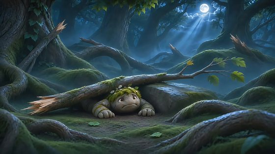 C12 가지 아래 모코</td>
</tr>
</table>

<table>
<tr>
<td width="25%" align="center" valign="top">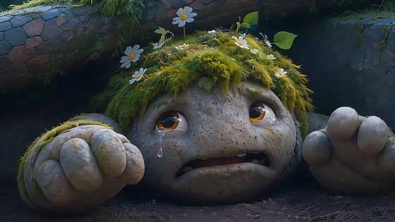 C13 도움을 바라는 모코</td>
<td width="25%" align="center" valign="top">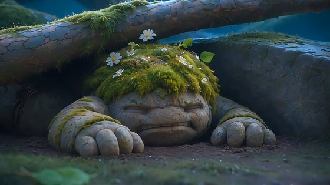 C14 가지를 듦</td>
<td width="25%" align="center" valign="top">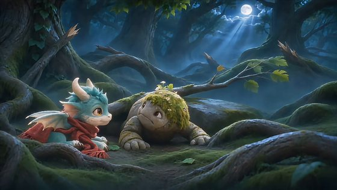 C15 기뻐하는 모코</td>
<td width="25%" align="center" valign="top">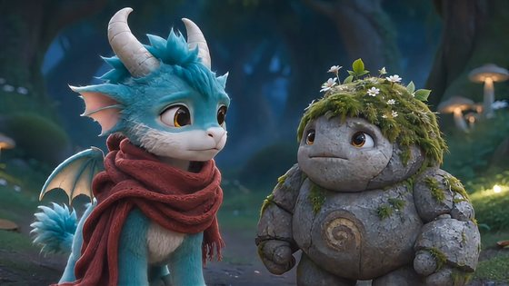 C16 등대를 가리킴</td>
</tr>
</table>

<table>
<tr>
<td width="25%" align="center" valign="top">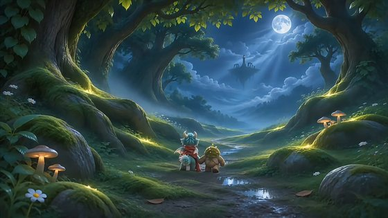 C17 숲길을 떠남</td>
<td width="25%"></td>
<td width="25%"></td>
<td width="25%"></td>
</tr>
</table>

| 컷 | 장면 | 다시 만든 이유 |
|:---|:---|:---|
| C01 | 폭풍 속 둥지, 엄마 날개 아래의 루노 | |
| C02 | 돌풍에 루노가 날아감 | 첫 번째는 너무 천천히 떠내려갔고, 두 번째는 포탄처럼 날아갔다. 세 번째 것을 썼다 |
| C03 | 등대가 깨지고 수정 렌즈가 날아감 | 렌즈가 여러 개로 나오고 카메라가 다가갔고, 깨지는 시간이 너무 길었고, 카메라가 따라가 버렸다. 네 번째에 나왔다 |
| C04 | 쫓아온 엄마의 앞발이 닿을 듯 말 듯 | |
| C05 | 떨어지는 루노의 시점, 검은 날개가 가림 | 두 조각을 이어 붙이는 시험을 해 보고 정했다 |
| C06 | 가지에 부딪히고 버섯 위로 떨어짐 | 눈을 감고 인형처럼 떨어졌다 |
| C07 | 깨어나 두리번거림 | |
| C08 | 멀어진 하늘섬을 올려다봄 | |
| C09 | 다짐하고 날아오르려다 떨어짐 | |
| C10 | 진흙에 떨어진 목도리를 주워 안음 | |
| C11 | 딸각거리는 소리를 따라감 | |
| C12 | 가지 아래 깔린 모코를 발견 | |
| C13 | 모코가 울며 도움을 바람 | |
| C14 | 루노가 가지를 들어 모코를 구함 | 가지는 안 들리는데 반응만 컸다 |
| C15 | 모코가 기뻐하며 고마워함 | |
| C16 | 등대를 가리키고 손을 잡음 | 루노가 중간에 엉뚱한 곳을 봤다. 그 순간만 편집에서 잘라 냈다 |
| C17 | 손을 잡고 숲길을 떠남 | |

#### 버린 것들

<table>
<tr>
<td width="33%" align="center" valign="top">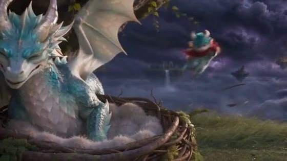 C02: 포탄처럼 날아감</td>
<td width="33%" align="center" valign="top">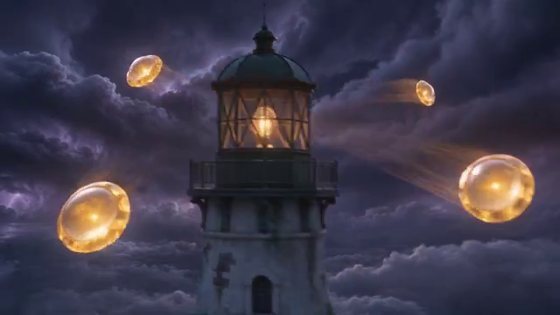 C03: 렌즈가 여러 개로 나옴</td>
<td width="33%" align="center" valign="top">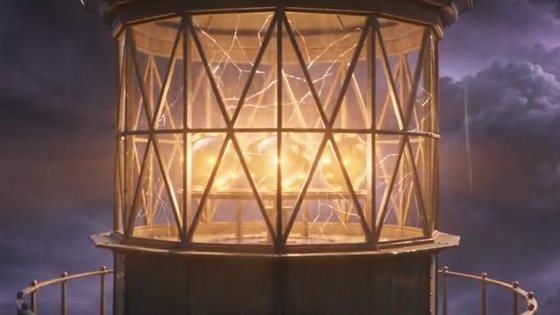 C03: 깨지는 시간이 너무 김</td>
</tr>
</table>

<table>
<tr>
<td width="33%" align="center" valign="top">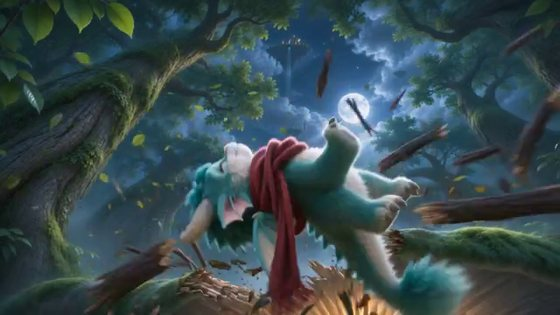 C06: 눈 감고 인형처럼 떨어짐</td>
<td width="33%" align="center" valign="top">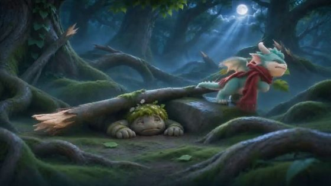 C14: 가지는 안 들리는데 반응만 큼</td>
<td width="33%" align="center" valign="top">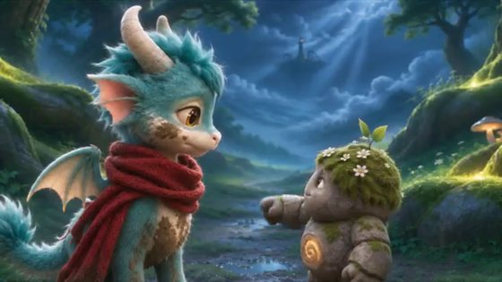 C16: 루노가 엉뚱한 곳을 봄</td>
</tr>
</table>

- 컷 영상 17개를 얻는 동안 10개를 버렸다. 가장 애먹은 건 등대가 깨지는 컷이다. 한 컷에 세 번을 버렸다.
- 버린 영상도 지우지 않고, 어디가 문제였는지 이름에 적어서 따로 모아 뒀다. 다음에 비슷한 장면을 만들 때 본다.

## LUNO — EP1 가편집과 보정 준비

- 컷 영상을 이어 붙인 가편집본을 저녁 5시 20분부터 6시 40분 사이에 네 번 고쳤다. 4차 길이는 2분 8초다.
- 가편집본을 숏 단위로 나눠 보니 33개였다. 컷 영상 하나 안에 숏이 두세 개씩 들어 있기 때문이다.
- 빛과 장소가 바뀌는 곳을 기준으로 4개 구역으로 묶었다. 폭풍 속 하늘섬, 이끼 숲 빈터, 모코를 만나는 뿌리 숲, 마지막 숲길이다.
- 구역마다 그대로 둘 숏과 고칠 숏을 나누고, 보정 전후를 나란히 보는 1차 미리보기를 만들었다. 실제 보정은 내일 한다.

## 작업 방송 — 대기화면

- 작업하는 모습을 라이브로 보여 주는데, 밥 먹으러 가거나 잠깐 자리를 비울 때 틀어 둘 루프 영상이 필요했다.
- 아늑한 로파이 분위기의 대기화면 영상을 만들기로 했다.

---

Claude와 함께 정리한 작업 일지 · <a href="../../../README.md">전체 기록 보기</a>

