

# 2026.11.17 (화)

### LUNO EP1 보정 완료·음향 작업 및 방송용 얼굴 가림 도구 제작

`LUNO` `EP1` `보정` `음향` `목소리` `StreamGuard`

  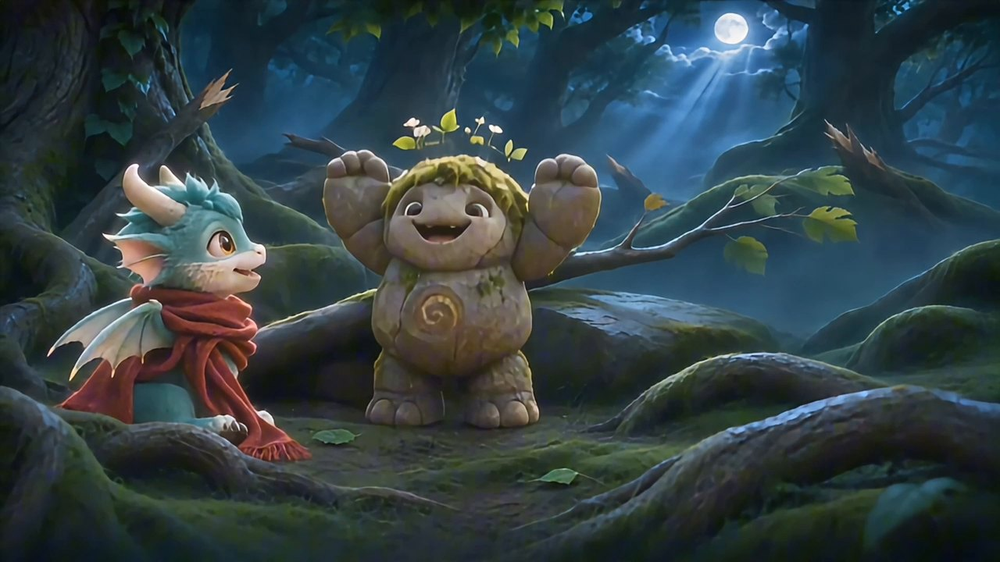
   
  보정을 마친 EP1의 한 장면

> 오전에 EP1 보정을 끝내고, 오후에는 음악과 효과음을 만들었다. 캐릭터 목소리는 여러 방법을 시험해 봤지만 마음에 들지 않아 직접 녹음하기로 했다. 그 사이에 작업 방송에서 얼굴을 가려 주는 도구의 첫 버전도 만들었다.

| 프로젝트 | 한 일 | 결과 |
|:---|:---|:---|
| LUNO EP1 | 보정 | 보정본 완성 (2분 8초, 3,075프레임) |
| LUNO EP1 | 음악 | 2곡 |
| LUNO EP1 | 효과음 | 40여 개, 장면별 시간표 |
| LUNO EP1 | 캐릭터 목소리 시험 | 직접 녹음하기로 결정, 녹음 목록 작성 |
| StreamGuard | 얼굴 가림 도구 | 첫 버전, 대기화면 영상 2개, 사용 설명서 |

---

## LUNO — EP1 보정

<table>
<tr>
<td width="50%" align="center" valign="top">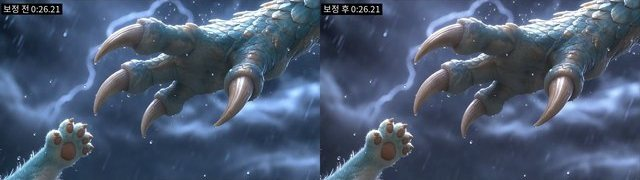 엄마가 쫓아오는 숏: 폭풍 색에 맞춤 (왼쪽 전, 오른쪽 후)</td>
<td width="50%" align="center" valign="top">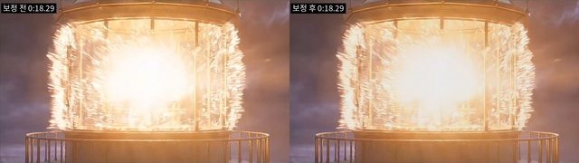 등대가 깨지는 순간: 가장 밝은 곳만 누름 (왼쪽 전, 오른쪽 후)</td>
</tr>
</table>

<table>
<tr>
<td width="50%" align="center" valign="top">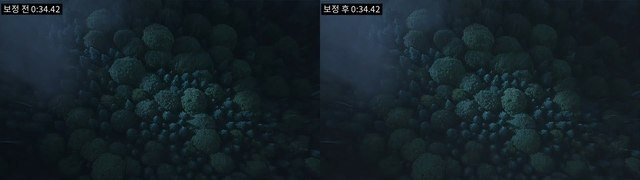 숲으로 떨어지는 숏: 어두운 곳을 들어 올림 (왼쪽 전, 오른쪽 후)</td>
<td width="50%" align="center" valign="top">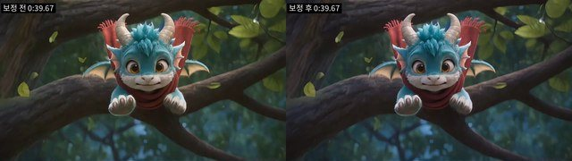 가지에 걸린 숏: 초록빛을 밤 색으로 (왼쪽 전, 오른쪽 후)</td>
</tr>
</table>

<table>
<tr>
<td width="50%" align="center" valign="top"> 버섯 아래: 주황빛을 조금 가라앉힘 (왼쪽 전, 오른쪽 후)</td>
<td width="50%" align="center" valign="top">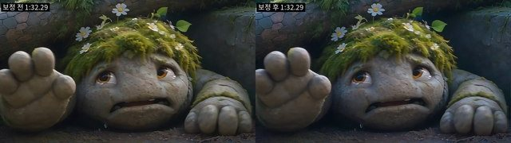 모코 얼굴: 회색빛에서 이끼 초록으로 (왼쪽 전, 오른쪽 후)</td>
</tr>
</table>

<table>
<tr>
<td width="50%" align="center" valign="top">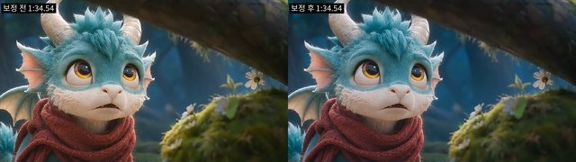 루노 얼굴: 낮처럼 밝던 것을 달빛으로 (왼쪽 전, 오른쪽 후)</td>
<td width="50%" align="center" valign="top">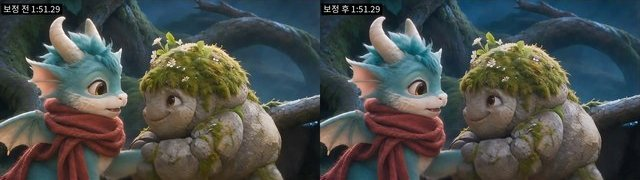 둘의 가까운 숏: 넓은 숏과 같은 밤으로 (왼쪽 전, 오른쪽 후)</td>
</tr>
</table>

- 1080p로 키운 영상을 원래 가편집본과 한 장씩 대조했더니, 원래 없던 프레임이 두 장 끼어 있었다. 하나는 같은 그림이 한 번 더 들어가서 움직임이 멈칫했고, 다른 하나는 루노의 눈 방향과 앞발이 앞뒤와 달라서 한순간 번쩍 바뀌어 보였다. 둘 다 빼고 썼다.
- EP1은 편 전체가 밤이다. 색을 새로 입히기보다 숏끼리 톤을 맞추는 데 집중했다. 같은 장소인데 가까이 찍은 숏만 따뜻하거나 밝은 곳, 한 숏만 색이 튀는 곳을 앞뒤에 맞췄다.
- 따뜻한 색은 등대 불빛, 수정 렌즈, 버섯 불빛, 빨간 목도리에만 남겼다.
- 색의 흐름은 이렇게 잡았다. 차가운 보랏빛 폭풍에서 시작해, 달빛이 든 푸른 이끼 숲, 더 깊고 푸른 뿌리 숲을 지나, 달과 꺼진 등대가 보이는 숲길로 끝난다.
- 프롤로그 때 압축을 두 번 거쳐 화질이 깎였던 일이 있어서, 이번에는 처음부터 원본에서 한 번에 뽑았다.

| 구역 | 장면 | 무엇이 문제였나 | 어떻게 맞췄나 |
|:---|:---|:---|:---|
| 폭풍 속 하늘섬 | 엄마가 쫓아오는 숏 | 다른 폭풍 숏보다 색이 진하고 파랬다 | 앞뒤 폭풍 숏의 색에 맞췄다 |
| 폭풍 속 하늘섬 | 등대가 깨지는 순간 | 한 프레임이 매우 밝았다 | 번쩍임은 한 번뿐이라 두고, 가장 밝은 부분만 부드럽게 눌렀다 |
| 폭풍 속 하늘섬 | 수정 렌즈가 날아가는 먼 숏 | 어두워서 렌즈의 불빛이 작게 보였다 | 살짝 밝히고 불빛이 조금 번지게 했다 |
| 폭풍 속 하늘섬 | 숲으로 떨어지는 숏 | 너무 어두워서 휴대폰에서는 숲 모양이 안 보였다 | 어두운 부분만 조금 들어 올렸다. 검은 날개가 가리는 순간은 일부러 그대로 뒀다 |
| 이끼 숲 빈터 | 가지에 부딪히는 숏 | 앞뒤 밤 숏보다 초록빛이고 따뜻했다 | 차갑게, 살짝 어둡게 해서 밤으로 맞췄다 |
| 이끼 숲 빈터 | 버섯 아래 숏 | 버섯 불빛이 주황으로 너무 강했다 | 조금 가라앉히되, 슬픈 장면의 유일한 온기라 따뜻함은 남겼다 |
| 뿌리 숲 | 루노와 모코의 가까운 숏 | 넓은 숏보다 따뜻하고 밝아서 낮처럼 보였다 | 넓은 숏의 달빛 톤에 맞췄다 |
| 뿌리 숲 | 모코 얼굴 숏 | 색이 빠져 회색으로 보였다 | 이끼의 초록이 살아나게 했다 |
| 숲길 | 마지막 숏 | | 걸어가는 둘과 달로 눈이 가게 가장자리를 아주 약하게 눌렀다. 다음 편으로 이어지니까 엔딩처럼 어둡게 닫지는 않았다 |

<table>
<tr>
<td width="33%" align="center" valign="top">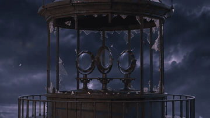 폭풍 구역 (보정 후)</td>
<td width="33%" align="center" valign="top">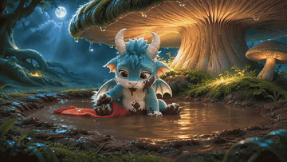 버섯 아래 (보정 후)</td>
<td width="33%" align="center" valign="top">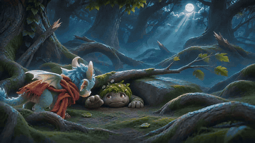 모코를 만나는 숲 (보정 후)</td>
</tr>
</table>

- 보정본은 오전 11시 50분에 나왔다. 프레임 수와 순서가 가편집본과 같은지, 보정값이 숏이 바뀌는 자리에서만 바뀌는지 확인하고 음향으로 넘어갔다.

## LUNO — EP1 음향

- 배경음악을 두 곡 만들었다. 폭풍 장면에 쓸 곡과 이끼 숲에 쓸 곡이다.
- 음악을 장면 길이에 맞춰 자르면 중간에 뚝 끊기는 게 싫었다. 곡이 자연스럽게 이어지도록 다시 맞췄다.
- 효과음은 40개 넘게 만들었다. 장면마다 어느 시점에 어떤 소리가 들어가는지 시간표로 정리했다.

| 장면 | 만든 소리 |
|:---|:---|
| 폭풍과 둥지 | 폭풍 바람, 천둥, 날개가 바람에 펼쳐지는 소리, 둥지의 나뭇가지가 뜯기는 소리, 바람에 휩쓸리는 소리 |
| 엄마의 추격 | 하늘로 뛰어드는 소리, 큰 날갯짓, 구름 속을 나는 바람 |
| 등대 | 유리창이 덜컹거리는 소리, 금이 가는 소리, 팡 하고 깨지는 소리, 수정이 날아가는 소리 |
| 추락 | 떨어지는 소리, 구름을 뚫는 소리, 나무에 부딪히는 소리, 굵은 가지에 툭 걸리는 소리 |
| 이끼 숲 | 밤 숲의 바탕 소리, 버섯이 튕기는 소리, 진흙물에 빠지는 소리, 작은 날갯짓, 목도리를 줍고 터는 소리 |
| 모코 | 돌끼리 부딪히는 소리, 돌 손이 바닥을 긁는 소리, 기어 나오는 돌 소리, 쏙 빠져나오는 소리 |
| 가지 | 들썩이는 소리, 움직이는 소리, 내려놓는 쿵 소리 |
| 마지막 | 돌이 맞닿는 소리, 둘이 걸어가는 소리 |

- 나무에 부딪히며 떨어지는 소리는 세 번, 밤 숲의 바탕 소리는 네 번 만들어서 골랐다.
- 작게 들리는 소리 13개는 크게 키운 버전을 따로 만들었다.
- 음악과 효과음을 장면 타이밍에 맞춰 넣는 작업은 내가 편집 프로그램에서 직접 했다. 오늘 조정을 끝냈다.

## LUNO — EP1 캐릭터 목소리

- 모코는 자기 이름 "모코"로 말하게 했다. "모코..", "모코! 모코!"처럼 억양과 반복으로 감정을 낸다.
- 루노 목소리를 만들어 봤는데 "루" 발음이 너무 또렷했다. 사람이 영어로 말하는 것처럼 들려서 동물 소리 같지 않았다.
- 다른 방법으로 만든 목소리도 들어 봤지만 마찬가지로 마음에 들지 않았다.
- 결국 내가 집에서 영상을 보며 직접 녹음해 오기로 했다. 어느 장면에서 어떤 소리를 내야 하는지 녹음 목록을 만들어 뒀다.

## StreamGuard — 방송용 얼굴 가림 도구

<table>
<tr>
<td width="50%" align="center" valign="top">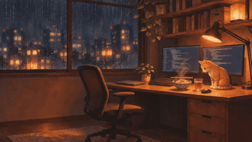 식사 중 대기화면</td>
<td width="50%" align="center" valign="top">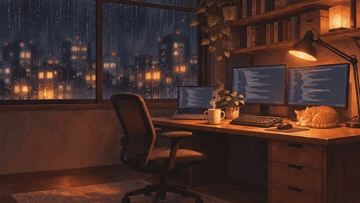 자리 비움 대기화면</td>
</tr>
</table>

- 작업 방송을 할 때 카메라에 내 얼굴이 나오지 않게 가려 주는 도구를 만들기 시작했다. 이름은 StreamGuard다. 점심 무렵 시작해서 오후 4시 반쯤 첫 버전이 돌아갔다.
- 가장 중요한 조건은 얼굴이 절대 드러나지 않는 것이다. 얼굴뿐 아니라 뒤통수까지, 머리 전체를 따라다니는 둥근 흐림으로 가린다. 화면 끝에 걸치거나 빠르게 움직이는 순간에도 풀리면 안 된다.
- 카메라 화질과 속도는 그대로 두고 지연은 최소로 잡았다.
- 방송 화면은 브라우저 창에 띄우고, 그 창을 그대로 방송에 내보내는 방식으로 했다. 방송용 프로그램을 따로 쓰지 않아도 된다.
- 키 하나로 화면을 바꿀 수 있게 했다. 1은 식사 중, 2는 자리 비움, 3은 라이브 화면이고, 4를 누르면 화면마다 띄울 메모를 고칠 수 있다.
- 식사 중과 자리 비움에 틀어 둘 대기화면 영상 두 개를 넣었다. 어제 만들기로 한 그 영상이다.
- 카메라가 처음에는 연결되지 않았다. 카메라 쪽 설정을 바꾸고 다시 켠 뒤에 연결됐다.
- 설치와 실행을 더블클릭 한 번으로 할 수 있게 하고 사용 설명서도 같이 만들었다. 방송 화면과 별도로, 추적이 잘 되는지 확인하는 점검 화면도 따로 열 수 있다.

---

Claude와 함께 정리한 작업 일지 · <a href="../../../README.md">전체 기록 보기</a>

