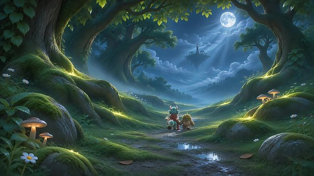
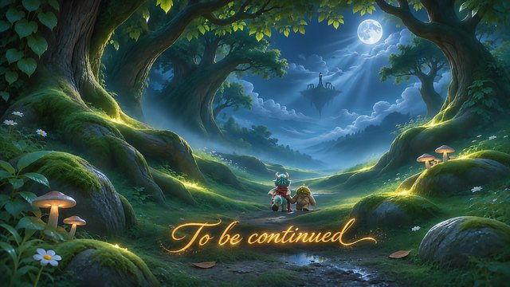
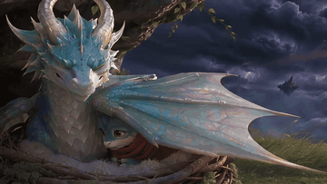
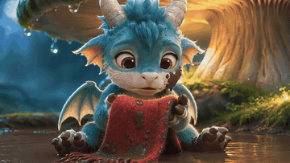
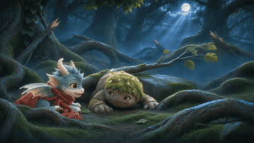
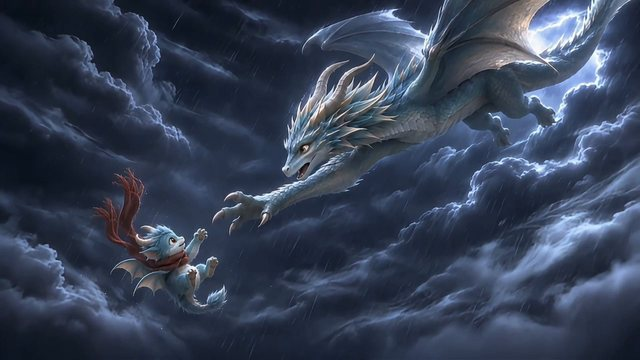
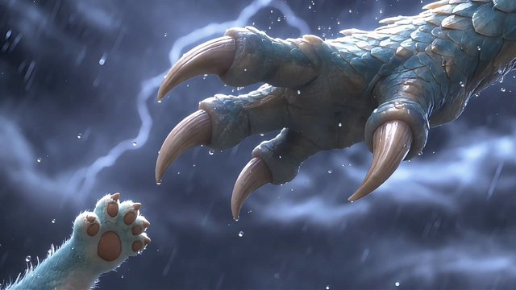
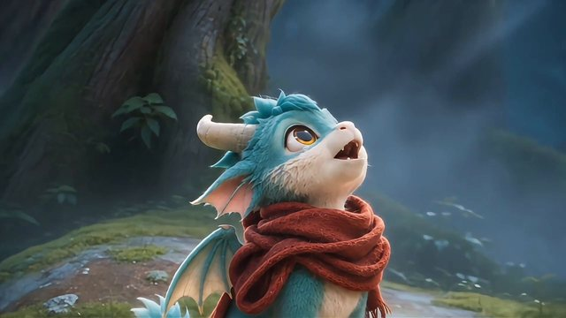
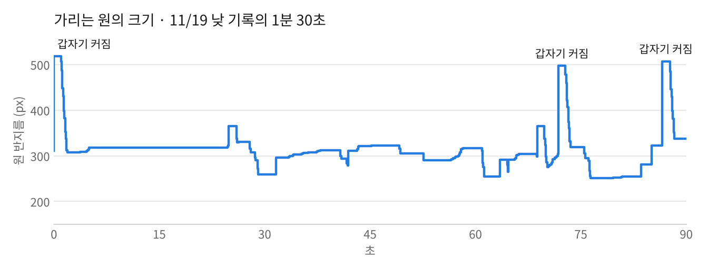

# 2026.11.19 (목)

### LUNO EP1 더빙·엔딩 화면 완성 및 업로드

`LUNO` `EP1` `더빙` `엔딩` `썸네일` `업로드` `StreamGuard`

  
   
  숲길을 걸어가는 동안 금빛 글자가 적히는 EP1 엔딩

> 직접 녹음해 온 목소리를 입히고 엔딩 화면을 만들어 EP1을 완성했다. 오후 4시쯤 완성본이 나왔고, 세로 영상으로 바꿔 올렸다. StreamGuard는 실제 방송에 써 보면서 나온 문제의 원인을 찾을 준비를 했다.

| 프로젝트 | 한 일 | 결과 |
|:---|:---|:---|
| LUNO EP1 | 캐릭터 목소리 | 루노, 모코, 엄마 드래곤 목소리 완성 |
| LUNO EP1 | 엔딩 화면 | 금빛 "To be continued" |
| LUNO EP1 | 완성본 | 2분 8초, 가로 완성본과 세로 영상 |
| LUNO EP1 | 업로드 준비와 업로드 | 영어 업로드 문구, 썸네일 후보 3장, 인스타·쇼츠 공개 |
| StreamGuard | 문제 원인 찾기 | 방송 중 추적 기록(약 21만 프레임), 진단 도구 3개 |

---

## LUNO — EP1 목소리

- 집에서 녹음해 온 루노와 모코의 목소리를 캐릭터 목소리로 바꿔 입혔다.
- 엄마 드래곤의 그르렁거리는 소리는 녹음보다 효과음으로 만드는 쪽이 더 나았다. 처음 만든 엄마 소리가 마음에 들지 않아 다시 만들었다.
- 루노, 모코, 엄마 드래곤 세 캐릭터의 목소리가 모두 들어갔다. 17일에 음악과 효과음은 끝내 뒀으니 이걸로 소리 작업이 끝났다.

## LUNO — EP1 엔딩 화면

<table>
<tr>
<td width="50%" align="center" valign="top"> 엔딩의 시작: 글자가 없는 마지막 장면</td>
<td width="50%" align="center" valign="top"> 엔딩의 끝: 글자가 다 적힌 모습</td>
</tr>
</table>

- 편 끝에 "To be continued" 화면을 넣었다.
- 멈춘 그림 위에 글자만 뜨는 건 싫었다. 캐릭터들이 숲길을 걸어가는 동안, 동화책이 끝날 때처럼 붓으로 적히듯 금빛 글자가 생기고 반짝이가 날리게 만들었다.
- 글자가 없는 마지막 장면에서 시작해서 글자가 다 적힌 모습으로 끝난다. 그 사이에 글자가 한 획씩 생긴다.

## LUNO — EP1 완성과 업로드

<table>
<tr>
<td width="33%" align="center" valign="top"> 완성본: 폭풍 속 둥지</td>
<td width="33%" align="center" valign="top"> 완성본: 목도리를 안은 루노</td>
<td width="33%" align="center" valign="top"> 완성본: 기뻐하는 모코</td>
</tr>
</table>

- EP1 완성본이 나왔다. 길이는 2분 8초다. 소리 크기는 프롤로그와 같은 기준으로 맞췄다.
- 프롤로그와 같은 방식으로 세로 영상을 만들었다. 가운데에 가로 영상, 위아래는 흐린 배경이다.
- 업로드 문구는 영어로 썼다. 봐 줘서 고맙다는 느낌으로 친근하게 다듬고, 좋아요와 팔로우를 부탁하는 말을 함께 넣었다.

<table>
<tr>
<td width="33%" align="center" valign="top"> 썸네일 후보 장면 1</td>
<td width="33%" align="center" valign="top"> 썸네일 후보 장면 2</td>
<td width="33%" align="center" valign="top"> 썸네일 후보 장면 3</td>
</tr>
</table>

- 썸네일로 쓸 만한 장면을 완성본에서 세 장 뽑았다. 세로 썸네일은 프롤로그와 달리 이번에는 글자를 넣기로 했다.
- 완성한 EP1을 인스타 릴스와 유튜브 쇼츠에 올렸다.
- 세로 화면의 위아래 빈 곳에 좋아요를 눌러 달라는 작은 움직임을 가끔 넣는 것도 생각해 봤다. 아직 정하지는 않았다.

## StreamGuard — 문제 원인 찾기

  
   
  방송 중 남긴 기록에서 가리는 원의 크기만 뽑아 그린 것. 1분 30초 사이에 원이 갑자기 커졌다 줄어든 순간이 세 번 있다

- 이틀 동안 실제 방송에 써 보니 얼굴을 가리는 원이 떨리거나, 커졌다 작아졌다 하는 순간이 있었다.
- 눈으로만 봐서는 원인을 알기 어려웠다. 그래서 방송 중에 추적 결과를 기록으로 남기게 하고, 그 기록을 다시 돌려 보며 어느 순간에 무엇이 틀어지는지 찾는 진단 도구를 붙였다.

#### 기록으로 남긴 것

- 프레임마다 한 줄씩 남긴다. 시간, 화면 전체를 가렸는지와 그 이유, 잡은 머리 수, 원의 크기와 위치, 움직이는 속도다.
- 낮 12시 13분부터 기록을 남기기 시작했다. 첫 기록은 2시간 26분 동안 약 21만 프레임이다.
- 오후 2시 50분부터는 감지된 것 하나하나의 위치와 크기도 같이 남기게 했다. 원이 엉뚱한 곳에 생겼을 때 무엇을 보고 그랬는지 알기 위해서다.
- 위 그림은 첫 기록의 한 구간이다. 300 안팎이던 원의 반지름이 한순간 500 안팎으로 뛰었다가 1~2초에 걸쳐 줄어든다. 원이 커졌다 작아졌다 하던 순간이 기록에는 이렇게 남아 있다.

#### 진단 도구

- 상황별로 프레임마다 전체 가림이 켜졌는지, 켜졌다면 이유가 무엇인지를 한 줄로 죽 보여 주는 도구를 만들었다.
- 원이 얼마나 떨리는지 숫자로 재는 시험도 만들었다. 이어지는 두 프레임 사이에 원의 반지름이 3% 넘게 바뀐 횟수와, 머리는 가만히 있는데 원의 위치가 움직인 횟수를 센다. 고치기 전후를 숫자로 비교하려는 것이다.
- 같은 기준으로 첫 기록을 세어 보면, 원 크기가 3% 넘게 바뀐 것이 1분에 22.5번꼴이다.
- 방송 중에 남긴 기록을 그대로 다시 돌려 보는 도구도 붙였다.
- 대기화면과 메모를 띄우는 화면 쪽도 손봤다.

---

## 공개 링크

| 항목 | 링크 |
|:---|:---|
| LUNO EP1 (인스타 릴스) | [www.instagram.com/p/Df6gEpOxkae](https://www.instagram.com/p/Df6gEpOxkae/) |
| LUNO EP1 (유튜브 쇼츠) | [www.youtube.com/shorts/JmANX1cN3KA](https://www.youtube.com/shorts/JmANX1cN3KA) |

---

Claude와 함께 정리한 작업 일지 · <a href="../../../README.md">전체 기록 보기</a>

