

# 2026.11.20 (금)

### LUNO 시즌1 기획서 개정 및 EP2 캐릭터·배경·컷 영상 제작

`LUNO` `EP2` `기획서` `캐릭터 디자인` `배경` `컷 이미지` `컷 영상` `StreamGuard`

  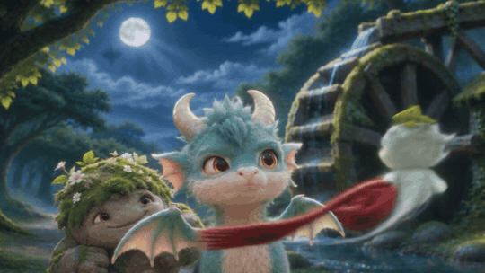
   
  EP2 컷 영상 중 하나

> 아침에 시즌1 기획서를 고치고 바로 EP2 제작에 들어갔다. 휘리를 다시 디자인하고, 배경 4장과 컷 이미지 11장을 만들고, 컷 영상 20개를 뽑아 이어 붙였다. 원하는 장면이 나올 때까지 버린 영상이 34개다. StreamGuard의 추적도 고쳤다.

| 프로젝트 | 한 일 | 결과 |
|:---|:---|:---|
| LUNO | 시즌1 기획서 개정 | 아침에만 네 버전을 거쳐 EP2부터 쓸 기준 문서 확정 |
| LUNO EP2 | 캐릭터 | 휘리 새 디자인(3번째에 확정), 루노의 새 모습, 소품 1종 |
| LUNO EP2 | 배경 | 4장 (버린 것 2장) |
| LUNO EP2 | 컷 이미지 | 11장 (버린 것 13장) |
| LUNO EP2 | 컷 영상 | 20개 (버린 것 34개) |
| LUNO EP2 | 가편집과 보정 준비 | 가편집 3차 2분 24초, 숏 31개, 구역 5개 |
| StreamGuard | 얼굴 추적 개선 | 원이 틀어지던 문제들 수정 |

---

## LUNO — 시즌1 기획서 개정

- 시즌1 이야기를 조금 손보고 캐릭터 성격을 더 분명하게 넣어서 기획서를 새 버전으로 고쳤다.
- 고치고 나서 다시 읽어 보면 앞뒤가 안 맞는 곳이 보여서 또 고쳤다. 아침 7시 반부터 10시 사이에만 네 버전이 나왔고, 마지막 버전을 EP2부터 쓸 기준 문서로 정했다.
- 지난번에 너무 작게 줄였던 모코의 크기도 루노와 어울리게 다시 맞췄다. 루노 어깨쯤 오는 키다.
- 기획서를 고친 다음 EP2를 몇 컷으로 나눌지 컷 계획을 세웠다. 계획은 영상을 뽑으면서 일곱 번 고쳤다. 뽑아 보면 빠진 동작이 보여서 컷을 하나 더 넣기도 했다.

## LUNO — EP2 캐릭터

<table>
<tr>
<td width="25%" align="center" valign="top">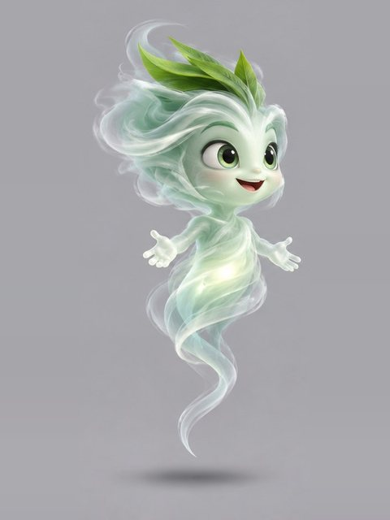 이전 휘리</td>
<td width="25%" align="center" valign="top">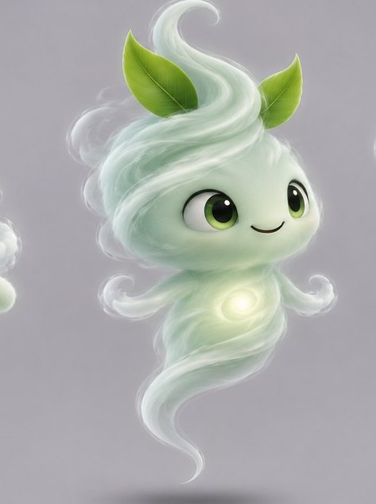 1차: 너무 순함</td>
<td width="25%" align="center" valign="top">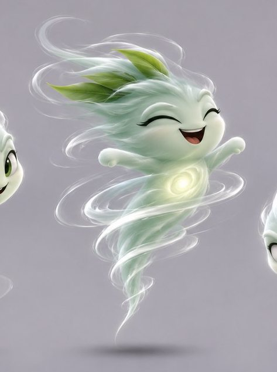 2차: 날렵한 쪽으로</td>
<td width="25%" align="center" valign="top">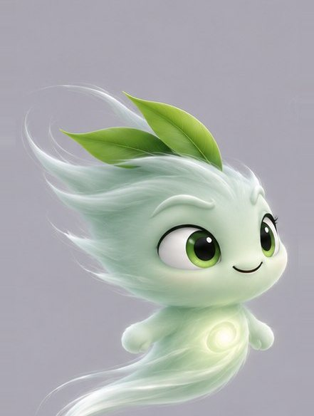 확정한 새 휘리</td>
</tr>
</table>

- 조연 캐릭터 휘리를 다시 디자인했다. 기존 휘리는 보고 있으면 묘하게 불쾌한 느낌이 있었다. 사람 같으면서 사람이 아닌 얼굴에서 오는 느낌이었다.
- 첫 번째 새 디자인은 너무 동글동글하고 순해 보였다. 휘리는 재빠르고 장난기 많은 아이라 맞지 않았다.
- 두 번째에서 눈매와 몸의 흐름이 날렵해졌다. 그 방향으로 다듬어서 확정하고, 정면·반측면·옆·뒤 네 방향으로 정리했다.

<table>
<tr>
<td width="25%" align="center" valign="top">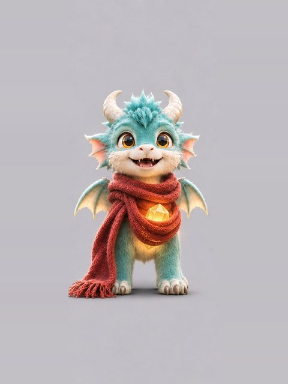 루노의 새 모습 (정면)</td>
<td width="25%" align="center" valign="top">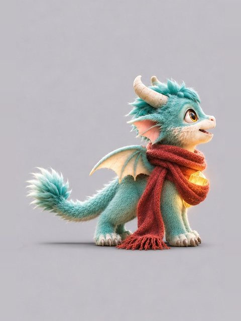 루노의 새 모습 (옆)</td>
<td width="25%" align="center" valign="top">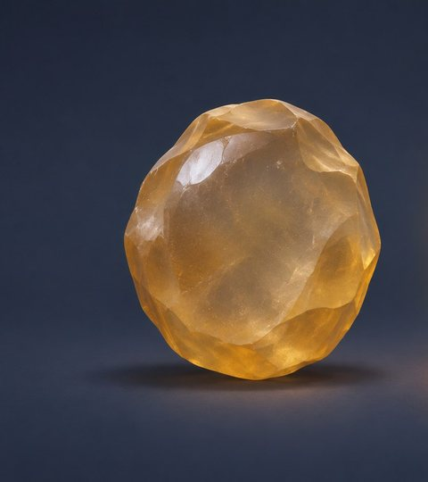 소품: 꺼진 금빛 수정</td>
<td width="25%" align="center" valign="top">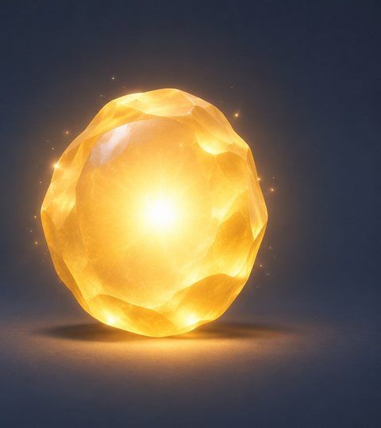 소품: 켜진 금빛 수정</td>
</tr>
</table>

- EP2 후반부터 루노의 모습이 조금 달라진다. 그 모습을 네 방향으로 만들어 뒀다. 오후에 컷 영상을 뽑다가 그 모습이 이상하게 나와서, 기준이 될 그림을 따로 만들었다.
- 이번 편부터 나오는 소품인 금빛 수정은 꺼진 모습과 켜진 모습을 한 쌍으로 만들었다. 크기와 모양은 같고 빛만 다르다.

## LUNO — EP2 배경

<table>
<tr>
<td width="25%" align="center" valign="top">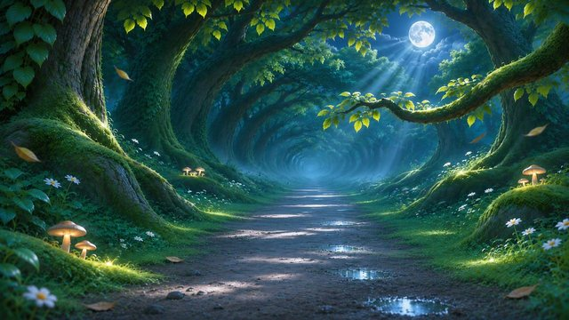 뿌리가 가로지르는 숲길</td>
<td width="25%" align="center" valign="top">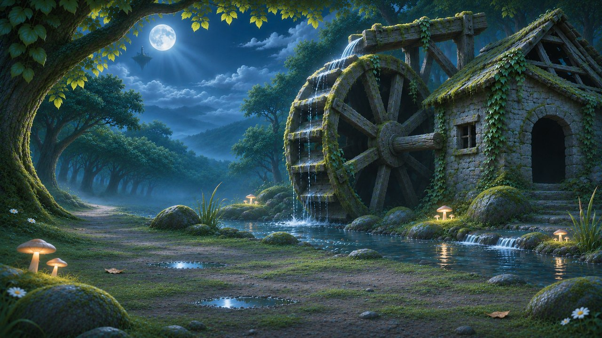 물레방아 전경</td>
<td width="25%" align="center" valign="top">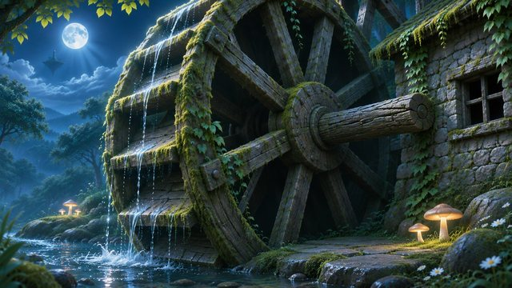 물레방아 바퀴 가까이</td>
<td width="25%" align="center" valign="top">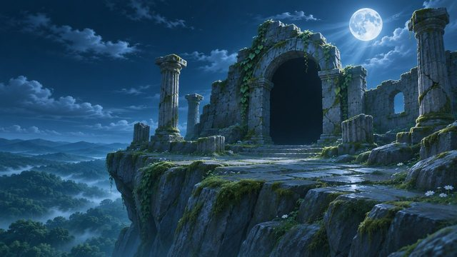 돌 폐허</td>
</tr>
</table>

- 배경은 네 장을 만들었다. 추격 장면의 숲길, 물레방아가 있는 빈터, 물레방아 바퀴를 가까이서 본 자리, 그리고 돌 폐허다.
- 숲길은 EP1 마지막 장면의 숲과 색과 빛이 이어지게 맞췄다. 같은 숲을 계속 걷고 있는 것처럼 보여야 하기 때문이다.

<table>
<tr>
<td width="33%" align="center" valign="top">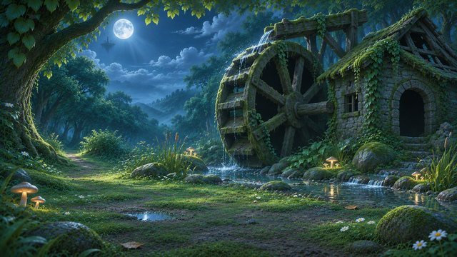 1차: 풀이 너무 많음</td>
<td width="33%" align="center" valign="top">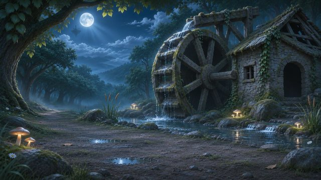 2차: 풀이 아예 없음</td>
<td width="33%" align="center" valign="top"> 확정</td>
</tr>
</table>

- 물레방아 전경은 세 번 만에 정했다. 처음에는 풀이 화면을 덮을 만큼 많았고, 줄여 달라고 하니 이번엔 풀이 아예 없는 맨땅이 나왔다. 세 번째에 그 중간이 나왔다.

## LUNO — EP2 컷 이미지

<table>
<tr>
<td width="20%" align="center" valign="top">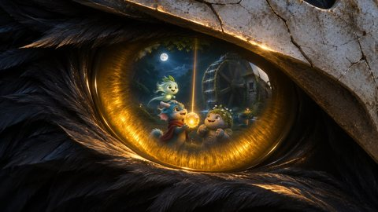 1차: 너무 빛남</td>
<td width="20%" align="center" valign="top">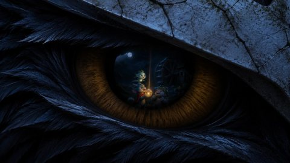 2차: 진짜 새 같음</td>
<td width="20%" align="center" valign="top">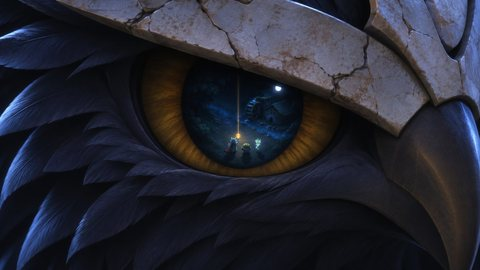 3차: 눈이 귀여움</td>
<td width="20%" align="center" valign="top">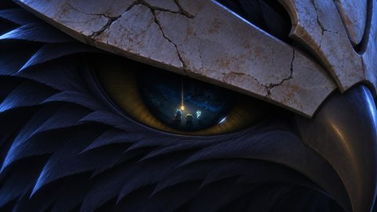 4차: 수호자와 다름</td>
<td width="20%" align="center" valign="top">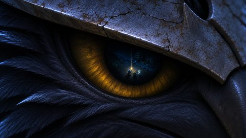 5차: 확정</td>
</tr>
</table>

- 가장 여러 번 다시 그린 건 수호자의 눈이다. 눈동자에 아이들이 비치는 장면이라 눈 하나가 화면을 가득 채운다.
- 첫 번째는 눈 전체가 너무 빛났고, 두 번째는 진짜 새의 눈처럼 사실적이었다. 세 번째는 그림체는 맞는데 눈이 귀여워서 위협이 안 됐다. 네 번째는 눈매가 사나운 대신 정해 둔 수호자의 모습과 달랐다. 다섯 번째에서 맞췄다.

<table>
<tr>
<td width="25%" align="center" valign="top">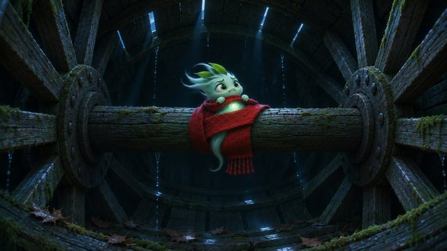 바퀴 안쪽: 통 속처럼 나옴</td>
<td width="25%" align="center" valign="top">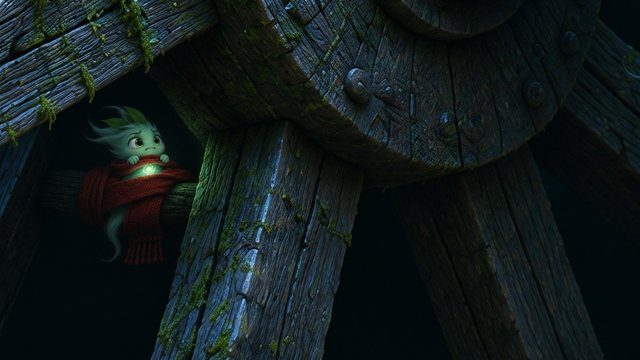 바퀴 안쪽: 확정</td>
<td width="25%" align="center" valign="top"> 위에서 본 빈터: 캐릭터가 넷이 됨</td>
<td width="25%" align="center" valign="top">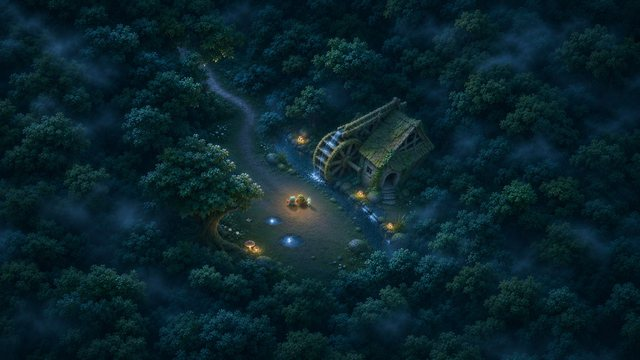 위에서 본 빈터: 확정</td>
</tr>
</table>

<table>
<tr>
<td width="25%" align="center" valign="top">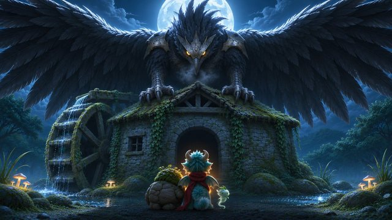 지붕 위의 수호자: 얼굴과 그림체가 다름</td>
<td width="25%" align="center" valign="top">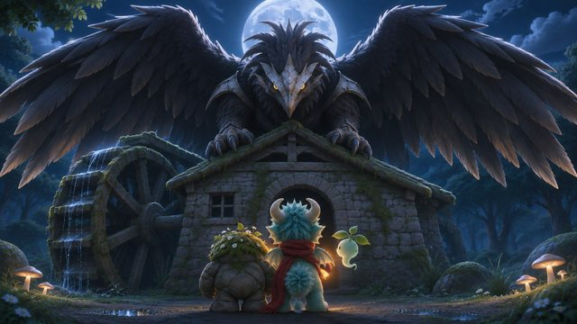 지붕 위의 수호자: 확정</td>
<td width="25%" align="center" valign="top">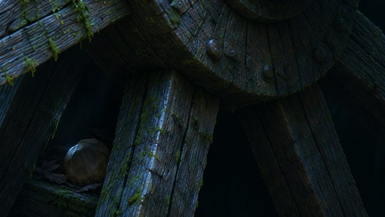 어둠 속의 꺼진 수정</td>
<td width="25%" align="center" valign="top">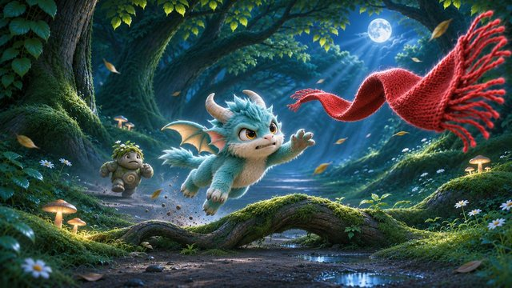 첫 장면 구도 후보 (쓰지 않음)</td>
</tr>
</table>

- 컷 이미지와 소품 그림을 모두 11장 만들었고, 그 과정에서 13장을 버렸다.
- 휘리가 갇히는 바퀴 안쪽 그림은 처음에 나무통 속처럼 나왔다. 바퀴살 사이로 들여다보는 느낌이 나도록 다시 만들었다.
- 위에서 내려다본 빈터 그림은 아이들이 위를 쳐다보고 있거나, 캐릭터가 넷으로 늘어나 있었다. 세 번째 뒤에야 셋이 아무것도 모르고 서 있는 그림이 나왔다.
- 지붕 위의 수호자는 구도가 대각선으로 틀어졌다가, 구도는 맞는데 얼굴과 그림체가 다른 것이 나왔다가, 세 번째에 맞았다.
- 첫 장면은 루노와 목도리, 모코를 한 그림에 다 넣은 정면 구도도 만들어 봤다. 추격의 속도감이 안 나서 쓰지 않았다.
- 컷 이미지를 쓰는 방식을 바꿨다. 영상에 그 그림이 꼭 한 장면으로 나오게 하면, 그 한 장면을 만들어 내느라 앞뒤 움직임이 이상해진다. 이번부터는 자세와 구도를 참고하는 용도로만 쓴다.

## LUNO — EP2 컷 영상

<table>
<tr>
<td width="33%" align="center" valign="top">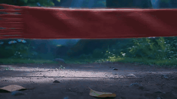 목도리를 쫓는 첫 장면</td>
<td width="33%" align="center" valign="top">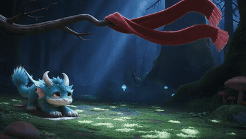 목도리가 루노를 휘감음</td>
<td width="33%" align="center" valign="top">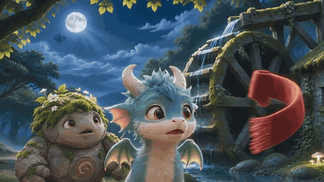 휘리가 모습을 드러냄</td>
</tr>
</table>

<table>
<tr>
<td width="33%" align="center" valign="top">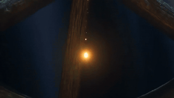 불티가 닿아 수정이 켜짐</td>
<td width="33%" align="center" valign="top">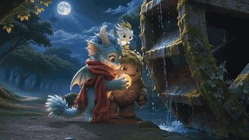 금빛 줄기가 솟음</td>
<td width="33%" align="center" valign="top">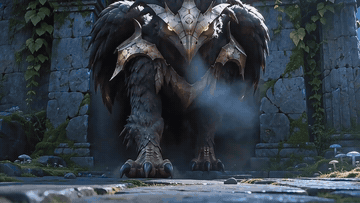 수호자의 급강하</td>
</tr>
</table>

- EP1이 폭풍 장면으로 강하게 시작한 것에 비해 EP2 첫 장면이 약하다고 느꼈다. 첫 장면이 약하면 보는 사람을 붙잡지 못한다. 목도리가 풀려 날아가는 과정은 빼고, 한밤의 숲에서 이미 목도리를 쫓고 있는 장면으로 시작하게 바꿨다.
- 달리는 루노는 추격전처럼 옆에서 속도감 있게 찍고, 뒤따라오는 모코는 카메라가 휙 돌아가며 따로 보여 줬다.
- 휘리는 처음에는 보이지 않는다. 목도리가 바람에 날리는 것처럼 보이다가, 따라가 보니 휘리의 장난이었던 것으로 드러난다.
- 편의 끝은 다음 화가 보고 싶게 끝나되, 앞 내용과 상관없이 갑자기 끊기는 건 피했다. 수호자가 아이들을 발견하고 내려오는 과정을 차례로 보여 준 뒤에 끊는다.

#### 컷 20개

<table>
<tr>
<td width="25%" align="center" valign="top">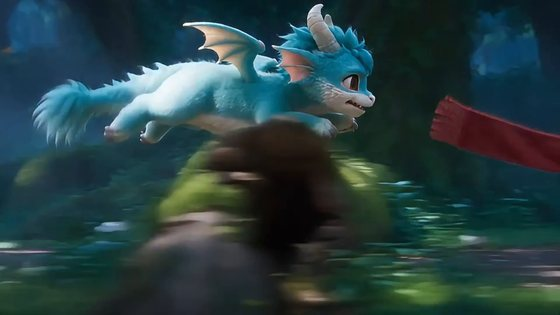 C01 목도리를 쫓는 루노</td>
<td width="25%" align="center" valign="top">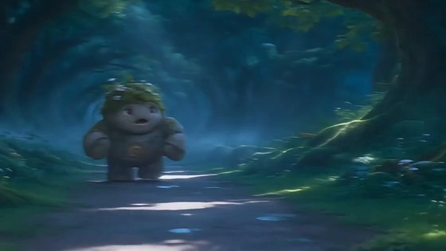 C02 뒤따르는 모코</td>
<td width="25%" align="center" valign="top">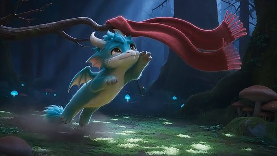 C03 목도리가 휘감음</td>
<td width="25%" align="center" valign="top">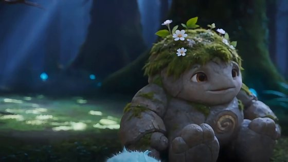 C03-1 몸을 털고 다시</td>
</tr>
</table>

<table>
<tr>
<td width="25%" align="center" valign="top">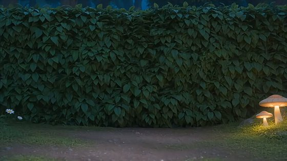 C04 덤불에서 튀어나옴</td>
<td width="25%" align="center" valign="top">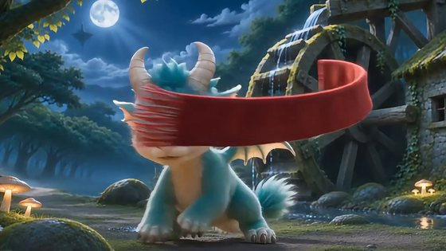 C05-1 어지러워 주저앉음</td>
<td width="25%" align="center" valign="top">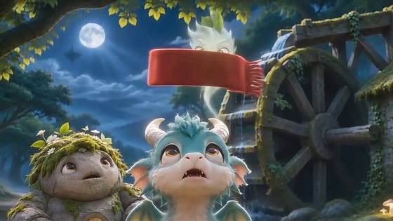 C05-2 휘리 등장</td>
<td width="25%" align="center" valign="top">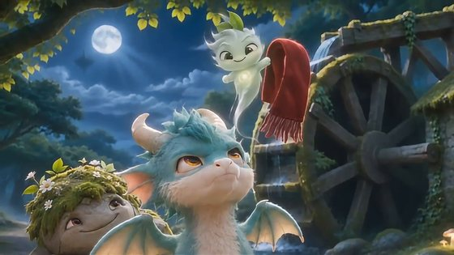 C06 휘리가 놀림</td>
</tr>
</table>

<table>
<tr>
<td width="25%" align="center" valign="top">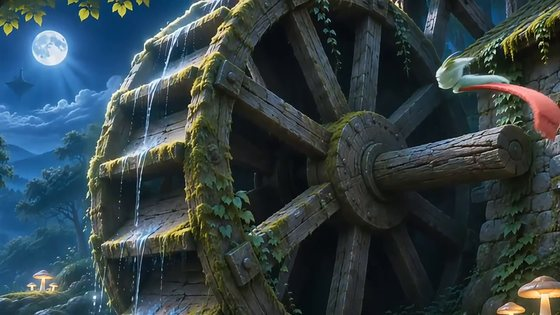 C07 물레방아를 돎</td>
<td width="25%" align="center" valign="top">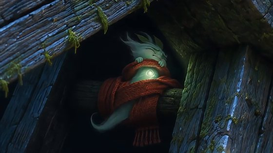 C08 바퀴 안쪽에 묶임</td>
<td width="25%" align="center" valign="top">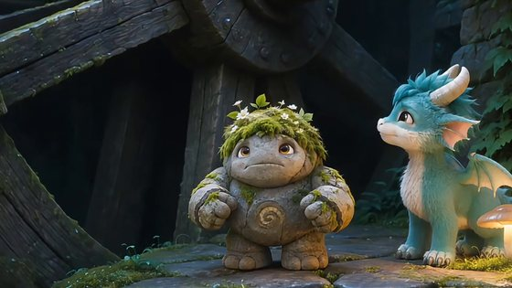 C09 모코가 바퀴를 버팀</td>
<td width="25%" align="center" valign="top">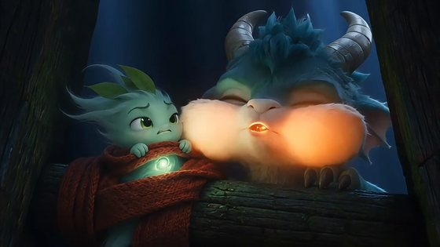 C10 첫 불티</td>
</tr>
</table>

<table>
<tr>
<td width="25%" align="center" valign="top">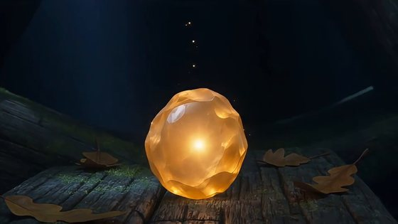 C11 수정이 켜짐</td>
<td width="25%" align="center" valign="top">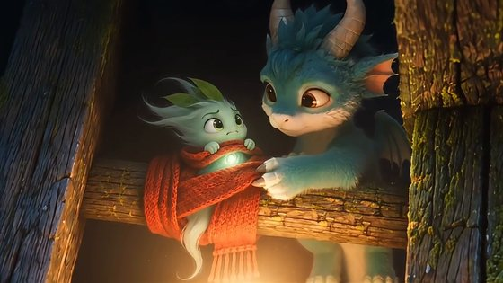 C12 휘리를 풀어 줌</td>
<td width="25%" align="center" valign="top">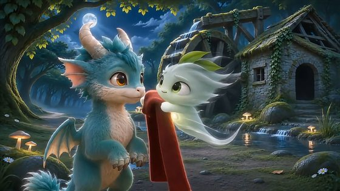 C13 목도리를 돌려줌</td>
<td width="25%" align="center" valign="top">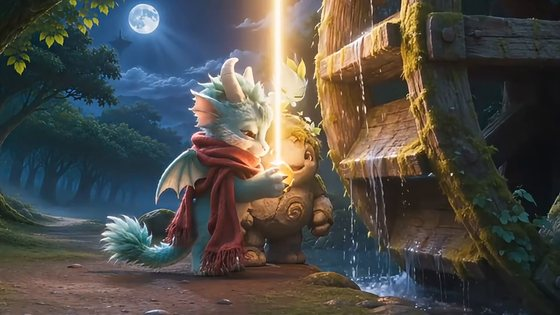 C14-15 금빛 줄기</td>
</tr>
</table>

<table>
<tr>
<td width="25%" align="center" valign="top">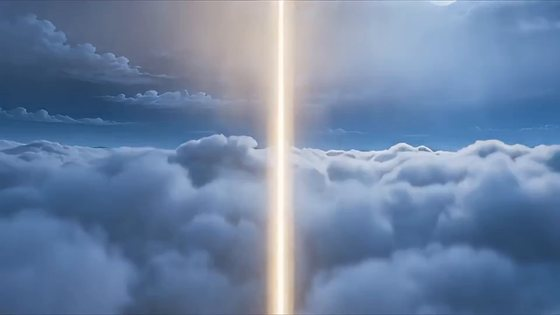 C16 빛을 따라 하늘섬으로</td>
<td width="25%" align="center" valign="top"> C17 수정을 품에 넣음</td>
<td width="25%" align="center" valign="top"> C18 수호자</td>
<td width="25%" align="center" valign="top"> C19 지붕 위의 대치</td>
</tr>
</table>

| 컷 | 장면 | 다시 만든 이유 |
|:---|:---|:---|
| C01 | 날아가는 목도리를 쫓아 달리는 루노 | 급하게 쫓아야 하는데 웃으면서 놀듯이 달렸다 |
| C02 | 한참 뒤에서 뒤뚱뒤뚱 따라오는 모코 | C01과 한 번에 만들었다 |
| C03 | 목도리가 루노를 휘감고 달아남 | 루노가 웃으면서 날갯짓을 했다 |
| C03-1 | 넘어진 둘이 몸을 털고 다시 쫓음 | 뽑다 보니 필요해져서 새로 넣은 컷이다 |
| C04 | 덤불에서 튀어나와 빈터에 뜬 목도리를 발견 | 목도리가 덤불에 묶여 나왔고, 다음엔 세로로 크게 늘어져 내려왔다. 네 번째에 나왔다 |
| C05-1 | 목도리를 쫓아 돌다 어지러워 주저앉음 | 눈이 뒤집혔고, 다음엔 혀를 내밀고 웃으며 돌았다 |
| C05-2 | 휘리가 처음 모습을 드러냄 | 휘리가 루노보다 크게 나왔고, 다음엔 목도리와 따로 날아다녔다 |
| C06 | 휘리가 목도리로 놀리고 달아남 | 목도리가 작게 나왔고 모코가 같이 웃고 있었다 |
| C07 | 물레방아를 돌다 목도리가 감김 | 감기는 과정 없이 감긴 모습으로 건너뛰었다 |
| C08 | 바퀴 안쪽에 묶인 휘리 | 양쪽 바퀴살이 서로 반대로 돌았다 |
| C09 | 모코가 돌몸으로 바퀴를 버팀 | 모코가 울면서 너무 크게 나왔고, 휘리가 바퀴와 같이 돌지 않았고, 루노가 튕겨 나왔다. 가장 여러 번 다시 만든 컷 중 하나다 |
| C10 | 어둠 속에서 루노의 첫 불티가 나옴 | 휘리가 앞만 보며 뚱한 표정이었고, 다음엔 입을 다문 채 불티가 코 위에 생겼다 |
| C11 | 불티가 닿아 수정이 켜짐 | |
| C12 | 금빛 속에서 휘리를 풀어 줌 | |
| C13 | 휘리가 목도리를 돌려줌 | |
| C14-15 | 수정을 꺼내자 금빛 줄기가 솟음 | 바퀴 전체가 빛났고, 넘어지는 동작이 화면 앞으로 튀어나왔고, 빛줄기가 하늘에서 내려온 조명처럼 보였다 |
| C16 | 금빛 줄기를 따라 하늘섬으로 올라감 | 땅에 있는 폐허로 가 버리거나, 2초 만에 도착하거나, 빛줄기가 사라지거나, 빛줄기를 타고 사람 형체가 올라갔다. 여덟 번을 버리고 아홉 번째에 나왔다 |
| C17 | 수정을 목도리 품에 넣음 | 끈을 묶는 동작과 주머니 모양이 이상했다 |
| C18 | 수호자가 어둠에서 걸어 나와 급강하 | 긴장감이 없었고, 내려다본 곳이 다른 장소로 나왔고, 화면 양쪽에 날개깃이 걸려 속도감이 없었다 |
| C19 | 지붕 위의 수호자와 마주 섬 | 끝에 날개가 화면 위로 불쑥 들어왔고, 옆모습으로 마주 서니 위협적이지 않았다 |

#### 버린 것들

<table>
<tr>
<td width="25%" align="center" valign="top"> C01: 웃으며 놀듯이 달림</td>
<td width="25%" align="center" valign="top"> C04: 목도리가 세로로 크게 내려옴</td>
<td width="25%" align="center" valign="top"> C05-1: 웃으며 도는 표정</td>
<td width="25%" align="center" valign="top"> C05-2: 휘리가 너무 큼</td>
</tr>
</table>

<table>
<tr>
<td width="25%" align="center" valign="top"> C10: 입을 다문 채 불티가 생김</td>
<td width="25%" align="center" valign="top"> C14-15: 하늘에서 내려온 조명처럼 보임</td>
<td width="25%" align="center" valign="top"> C16: 빛줄기에 사람 형체가 보임</td>
<td width="25%" align="center" valign="top"> C19: 옆모습이라 위협적이지 않음</td>
</tr>
</table>

- 컷 영상 20개를 얻는 동안 34개를 버렸다. 한 컷에 평균 두세 번을 뽑은 셈이다.
- 버린 이유는 크게 세 가지였다. 표정이 장면과 안 맞는 것(급한 장면에서 웃음), 크기나 위치가 틀린 것(휘리가 너무 큼, 목도리가 엉뚱한 곳에 있음), 있으면 안 되는 것이 생긴 것(사람 형체, 캐릭터가 하나 더)이다.
- 만드는 도중에 휘리가 갇히는 위치를 바꿨다. 뒤 장면이 바퀴 안쪽에서 벌어지기 때문에 바깥쪽 축에서 바퀴 안쪽으로 옮겼다. 그 전에 만들어 둔 두 컷은 버리고 다시 만들었다.
- 수호자의 눈을 가까이 잡는 컷은 따로 만들어 봤지만 쓰지 않기로 했다.

## LUNO — EP2 가편집과 보정 준비

- 컷 영상을 순서대로 이어 붙였다. 가편집본은 3차에서 마무리했고 길이는 2분 24초다. 계획했던 2분보다 길어졌다.
- 가편집본을 숏 31개로 나누고, 이야기 흐름과 빛이 바뀌는 곳을 기준으로 5개 구역으로 묶었다. 숲 속 추격, 물레방아 빈터, 바퀴 안쪽, 금빛 줄기와 하늘섬, 수호자다.
- 구역별 1차 보정 미리보기까지 만들었다.
- 더빙할 소리의 녹음 목록도 미리 만들어 뒀다. 어느 장면에서 누가 어떤 감정으로 소리를 내는지 적은 목록이다.

## StreamGuard — 얼굴 추적 개선

- 방송 중에 남긴 기록을 읽어 가며 얼굴을 찾고 따라가는 부분을 고쳤다. 어제와 오늘 이틀에 걸쳐 고친 것들이다.
- 화면 전체가 자주 뿌옇게 되던 문제를 고쳤다. 얼굴을 놓쳤을 때 안전하게 전체를 가리는 건 맞지만, 너무 자주 일어나서 거슬렸다. 덜 가리는 쪽으로 타협하지 않고 추적 자체가 덜 놓치게 했다.
- 가리는 원이 커졌다가 작아진 뒤 제자리로 돌아오지 않던 문제를 고쳤다.
- 휴대폰이나 모니터 화면 속에 나온 얼굴을 내 얼굴로 착각하던 것을 막았다. 모니터 쪽에 엉뚱한 원이 생기던 것은 그 자리를 아예 찾지 않는 구역으로 지정해서 없앴다.
- 손을 따라 원이 커지던 것, 헤드셋을 쓰면 깜빡이던 것, 팔이 얼굴 앞을 지나갈 때 가림이 풀리던 것을 고쳤다.
- 머리가 화면 밖으로 나가면 몸이나 손에 원을 만들지 않고 바로 빈 화면으로 넘어가게 했다.
- 메모는 화면 가운데 아래에 작은 글씨로 나오게 바꾸고, 대기화면 영상의 소리는 껐다.

---

Claude와 함께 정리한 작업 일지 · <a href="../../../README.md">전체 기록 보기</a>

