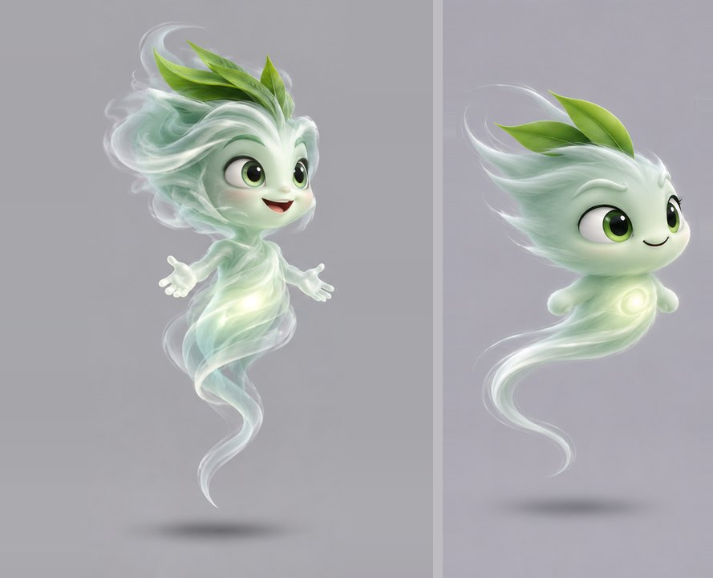

# 2026.11.20 (금)

### LUNO 시즌1 기획서 개정 및 EP2 캐릭터·배경·컷 영상 제작

`LUNO` `EP2` `기획서` `캐릭터 디자인` `컷 영상` `StreamGuard`

  
   
  EP2 컷 영상 중 하나

> 아침에 시즌1 기획서를 고치고 바로 EP2 제작에 들어갔다. 휘리를 다시 디자인하고, 컷 영상 20개를 만들어 이어 붙였다. 원하는 장면이 나올 때까지 다시 만든 영상이 34개다. StreamGuard의 추적도 고쳤다.

| 프로젝트 | 한 일 | 결과 |
|:---|:---|:---|
| LUNO | 시즌1 기획서 개정 | 아침에만 네 버전을 거쳐 EP2부터 쓸 기준 문서 확정 |
| LUNO EP2 | 캐릭터 | 휘리 새 디자인, 루노의 새 모습 |
| LUNO EP2 | 배경 | 4장 |
| LUNO EP2 | 컷 이미지 | 11장 (버린 것 13장) |
| LUNO EP2 | 컷 영상 | 20개 (버린 것 34개) |
| LUNO EP2 | 가편집과 보정 준비 | 가편집 3차 2분 24초, 숏 31개, 구역 5개 |
| StreamGuard | 얼굴 추적 개선 | 원이 틀어지던 문제들 수정 |

---

## LUNO — 시즌1 기획서 개정

- 시즌1 이야기를 조금 손보고 캐릭터 성격을 더 분명하게 넣어서 기획서를 새 버전으로 고쳤다.
- 고치고 나서 다시 읽어 보면 앞뒤가 안 맞는 곳이 보여서 또 고쳤다. 아침 동안에만 네 버전이 나왔고, 마지막 버전을 EP2부터 쓸 기준 문서로 정했다.
- 지난번에 너무 작게 줄였던 모코의 크기도 루노와 어울리게 다시 맞췄다.

## LUNO — EP2 캐릭터와 배경

<table>
<tr>
<td width="50%" align="center" valign="top"> 휘리의 이전 디자인(왼쪽)과 새 디자인(오른쪽)</td>
<td width="50%" align="center" valign="top"> EP2의 배경인 물레방아</td>
</tr>
</table>

- 조연 캐릭터 휘리를 다시 디자인했다. 기존 휘리는 보고 있으면 묘하게 불쾌한 느낌이 있었다.
- 첫 번째 새 디자인은 너무 동글동글하고 순해 보였다. 휘리는 재빠르고 장난기 많은 아이라 맞지 않았다. 두 번째에서 날렵한 느낌이 나왔고, 그 방향으로 확정했다.
- EP2에 필요한 루노의 새 모습도 네 방향으로 만들었다.
- 배경은 네 장을 만들었다. 물레방아 전경은 풀이 너무 많은 버전과 아예 없는 버전을 거쳐 그 중간으로 정했다.

## LUNO — EP2 컷 이미지

- 컷 이미지와 소품 그림을 11장 만들었고, 그 과정에서 13장을 버렸다.
- 가장 여러 번 다시 그린 건 수호자의 눈이다. 첫 번째는 너무 빛났고, 두 번째는 진짜 새처럼 사실적이었고, 세 번째는 그림체는 맞는데 눈이 귀여웠고, 네 번째는 눈매가 사나운 대신 정해 둔 수호자 모습과 달랐다. 다섯 번째에서 맞췄다.
- 컷 이미지를 쓰는 방식을 바꿨다. 영상에 그 그림이 꼭 한 장면으로 나오게 하면, 그 한 장면을 만들어 내느라 앞뒤가 이상해진다. 이번부터는 자세와 구도를 참고하는 용도로만 쓴다.

## LUNO — EP2 컷 영상

- EP1이 폭풍 장면으로 강하게 시작한 것에 비해 EP2 첫 장면이 약하다고 느꼈다. 첫 장면이 약하면 보는 사람을 붙잡지 못한다. 한밤의 숲에서 날아가는 목도리를 이미 쫓고 있는 장면으로 시작하게 바꿨다.
- 달리는 루노는 추격전처럼 옆에서 속도감 있게 찍고, 뒤따라오는 모코는 따로 한 컷으로 보여 줬다.
- 편의 끝은 다음 화가 보고 싶게 끝나되, 앞 내용과 상관없이 갑자기 끊기는 건 피했다.
- 컷 영상 20개를 만드는 동안 34개를 버렸다.

| 컷 | 무엇이 문제였나 |
|:---|:---|
| 첫 추격 컷 | 급하게 쫓아야 하는데 웃으면서 놀듯이 달렸다 |
| 목도리를 발견하는 컷 | 목도리가 덤불에 묶여 있거나 세로로 크게 내려왔다. 세 번 다시 만들었다 |
| 어지러워 쓰러지는 컷 | 눈이 뒤집히거나 혀를 내밀고 웃었다 |
| 휘리가 처음 나오는 컷 | 휘리가 너무 크게 나왔고, 다음엔 목도리와 따로 날아다녔다 |
| 휘리가 놀리는 컷 | 목도리가 작게 나왔고 모코가 웃고 있었다 |
| 바퀴가 도는 컷 | 양쪽 바퀴살이 서로 반대로 돌았다 |
| 첫 불티가 나오는 컷 | 입을 다문 채 불티가 코 위에 생겼다 |
| 빛줄기를 따라 올라가는 컷 | 2초 만에 도착해 버리거나, 빛줄기가 사라지거나, 빛줄기를 타고 사람 형체가 올라갔다. 여덟 번을 버리고 아홉 번째에 나왔다 |
| 수호자가 나타나는 컷 | 긴장감이 없었고, 내려다본 곳이 다른 장소로 나왔다 |
| 마지막 대치 컷 | 옆모습으로 마주 서니 위협적으로 보이지 않았다 |

- 만드는 도중에 휘리가 갇히는 위치를 바꿨다. 그 전에 만들어 둔 두 컷은 버리고 다시 만들었다.
- 수호자의 눈을 가까이 잡는 컷은 만들어 봤지만 쓰지 않기로 했다.

## LUNO — EP2 가편집과 보정 준비

- 컷 영상을 순서대로 이어 붙였다. 가편집본은 3차에서 마무리했고 길이는 2분 24초다.
- 가편집본을 숏 31개로 나누고, 이야기 흐름과 빛이 바뀌는 곳을 기준으로 5개 구역으로 묶었다. 구역별 1차 보정 미리보기까지 만들었다.
- 더빙할 소리의 녹음 목록도 미리 만들어 뒀다.

## StreamGuard — 얼굴 추적 개선

- 방송 중에 남긴 기록을 읽어 가며 얼굴을 찾고 따라가는 부분을 고쳤다. 어제와 오늘 이틀에 걸쳐 고친 것들이다.
- 화면 전체가 자주 뿌옇게 되던 문제를 고쳤다. 얼굴을 놓쳤을 때 안전하게 전체를 가리는 건 맞지만, 너무 자주 일어나서 거슬렸다. 덜 가리는 쪽으로 타협하지 않고 추적 자체가 덜 놓치게 했다.
- 가리는 원이 커졌다가 작아진 뒤 제자리로 돌아오지 않던 문제를 고쳤다.
- 휴대폰이나 모니터 화면 속에 나온 얼굴을 내 얼굴로 착각하던 것을 막았다. 모니터 쪽에 엉뚱한 원이 생기던 것은 그 자리를 아예 찾지 않는 구역으로 지정해서 없앴다.
- 손을 따라 원이 커지던 것, 헤드셋을 쓰면 깜빡이던 것, 팔이 얼굴 앞을 지나갈 때 가림이 풀리던 것을 고쳤다.
- 머리가 화면 밖으로 나가면 몸이나 손에 원을 만들지 않고 바로 빈 화면으로 넘어가게 했다.
- 메모는 화면 가운데 아래에 작은 글씨로 나오게 바꾸고, 대기화면 영상의 소리는 껐다.

---

Claude와 함께 정리한 작업 일지 · <a href="../../../README.md">전체 기록 보기</a>

