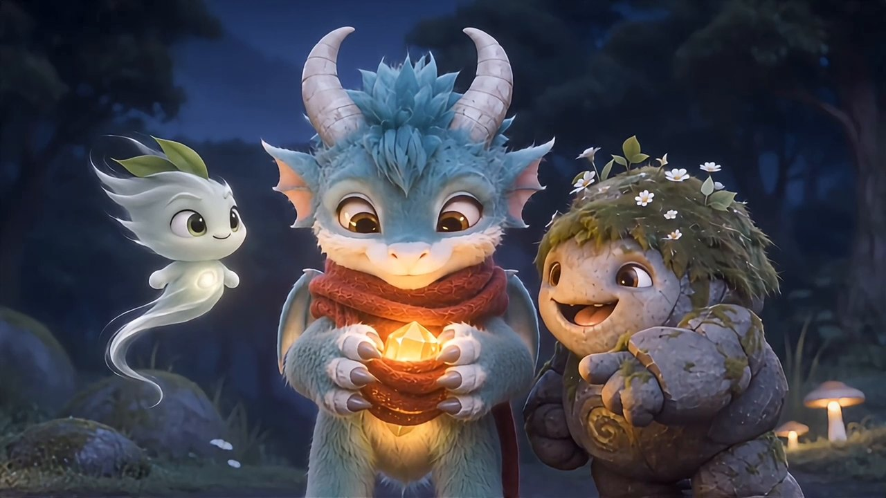

# 2026.11.22 (일)

### LUNO EP2 보정·더빙·음향 완료 및 업로드

`LUNO` `EP2` `보정` `더빙` `음향` `업로드` `Moon Films`

  
   
  EP2 완성본의 한 장면

> EP2를 하루에 끝낸 날이다. 보정본을 네 번 고치고, 더빙 방식을 도중에 바꾸고, 음악과 효과음을 넣어 완성본을 뽑았다. 밤에 인스타에 올렸다.

| 단계 | 한 일 | 결과 |
|:---|:---|:---|
| 보정 | 연출 효과 14가지 추가, 지적 사항 반영 | 보정본 4차에서 마무리 (2분 24초) |
| 더빙 | 녹음 정리와 목소리 바꾸기 시험 | 녹음 146개 정리, 방식 변경 |
| 음향 | 음악, 효과음, 숨소리 | 음악 3곡, 새 효과음 64개, 재사용 34개 |
| 엔딩 | 끝 화면 | 검은 화면의 금빛 "To be continued" |
| 최종 | 완성본, 세로 영상, 업로드 문구, 썸네일 | 완성본 2분 31초 |
| 업로드 | 인스타 릴스 | 밤 10시 25분쯤 공개 |

---

## LUNO — EP2 보정

#### 준비

- 내가 1080p로 키운 영상을 받아서 가편집본과 한 장씩 대조했다. 세 군데가 달랐다. 맨 앞 두 프레임에 엉뚱한 그림이 들어가 있었고, 한 프레임이 한 번 더 들어갔고, 맨 끝 한 프레임이 빠져 있었다. 전부 바로잡아서 가편집본과 프레임이 똑같이 맞는 걸 확인하고 시작했다.
- 이번에는 색만 맞추지 않았다. 보정 단계에서 연출 효과까지 넣기로 하고 14가지를 요청했다. 카메라 흔들림 세 곳, 시선을 모으는 효과 두 곳, 빛 효과 네 곳, 분위기를 바꾸는 보정 다섯 곳이다.

#### 넣은 효과

- 추격이 시작되는 첫 장면은 손으로 든 카메라처럼 흔들리게 했다. 루노의 발이 땅을 디디는 순간에는 크게 한 번 덜컹한다. 모코가 걸려 넘어지는 순간에도 위아래로 덜컹하게 했다.
- 루노 얼굴을 가까이 잡은 숏은 루노만 또렷하게 두고 뒤쪽을 흐리고 살짝 어둡게 했다.
- 멀리 날아가는 목도리는 목도리 둘레만 밝고 또렷하게, 나머지는 어둡게 해서 눈이 목도리로 가게 했다.
- 휘리가 처음 나타나는 순간에는 번쩍임과 빛살, 몸에서 번지는 빛, 흩어지는 반짝이를 넣었다.
- 화해하는 장면에는 따뜻한 필름 느낌을 입혔다.
- 수호자가 나오는 구간은 전체를 짙은 보라와 한밤의 파랑 계열로 묶어서 무서운 분위기를 만들었다.

#### 네 번 고친 과정

| 버전 | 보고 나서 나온 문제 | 고친 것 |
|:---|:---|:---|
| 처음 잡은 보정 | 20일에 잡아 둔 보정이 원하는 것과 반대인 곳이 있었다. 어두워야 할 장면을 밝혔고, 따뜻해야 할 숏을 차갑게 했다 | 뒤집었다. 어두운 장면은 더 어둡게 하고 빛나는 것만 밝혔다. 여기에 효과 14가지를 넣어 1차를 뽑았다 |
| 1차 | 여섯 가지가 걸렸다. 루노만 또렷하게 한 숏의 윤곽이 깔끔하지 않았고, 빛이 너무 세거나 한쪽에 뭉친 곳이 있었고, 화해 장면은 하얗게 탁해 보였고, 수호자 장면은 무섭지 않았다 | 루노를 따내는 방법을 바꿨다. 빛은 줄이고 중심 위치를 옮겼다. 탁함을 걷어 내고 수호자 장면에 무서운 색을 입혔다 |
| 2차 | 일곱 가지가 걸렸다. 루노 윤곽이 프레임마다 달라 가장자리가 지글거렸고, 어두운 테두리가 너무 빨리 풀렸고, 이어 붙인 곳이 튀었고, 한 숏의 끝이 눈부셨다 | 움직이지 않는 몸통은 윤곽을 고정했다. 테두리는 천천히 풀리게 하고, 이어 붙인 곳을 맞추고, 눈부신 곳은 눌렀다 |
| 3차 | 루노 얼굴 숏에서 눈 쪽이 잠깐 흐려졌다. 얼굴 가장자리에 걸친 눈이 배경으로 잘못 처리된 것이었다 | 그 구간의 프레임만 다시 만들어 끼웠다. 이것이 4차이고 최종이다 |

#### 이어 붙인 곳이 튀는 문제

- 보정을 하다가, 따로 만든 영상을 이어 붙인 곳에서 그림이 살짝 튀어 보이는 걸 발견했다. 네 군데였다. 배경이 몇 픽셀 어긋나 있고 밝기와 선명도가 조금씩 달랐다.
- 보정에서 앞 컷의 마지막 장면에 맞춘 뒤 서서히 되돌리는 식으로 최대한 눌렀다. 하지만 이미 편집이 끝난 뒤라 완전히 고치지는 못했다.
- 다음 편부터는 편집을 확정하기 전, 영상을 만드는 단계에서 이어 붙이는 곳을 전부 앞뒤로 넘겨 보며 확인하기로 했다. 조금이라도 다르면 그때 다시 만든다.

## LUNO — EP2 더빙

- 집에서 녹음해 온 소리가 146개였다. 어느 캐릭터의 어느 대목인지 하나씩 구분해서 루노, 모코, 휘리별로 정리했다.
- 루노와 모코의 목소리가 EP1 때와 다르게 들리면 같은 캐릭터로 안 느껴질 것 같았다. EP1과 똑같이 들리는 걸 기준으로 삼았다.
- 녹음을 캐릭터 목소리로 바꾼 샘플을 여러 개 만들어 비교했다. 여러 차례 다시 만들었는데, 기계음이 섞이거나, 귀를 찌르는 소리가 나거나, 녹음마다 높이가 달라서 같은 캐릭터가 다르게 들렸다. 약하게 바꾸면 내 목소리가 남았다.
- 결국 방식을 바꿨다. 이번 편은 녹음을 쓰지 않고 캐릭터 목소리도 새로 만들어 넣기로 했다.

## LUNO — EP2 음향

- 배경음악을 세 곡 만들었다. 추격 장면, 물레방아 장면, 수호자 장면에 하나씩이다.
- 효과음은 프롤로그와 EP1에서 만든 것 중 다시 쓸 수 있는 34개를 골라 쓰고, 새로 필요한 64개만 만들었다. 뛰면서 헥헥대는 숨소리 같은 것도 이쪽에서 만들었다.
- 만들어 놓고 쓰지 않은 것도 있다. 모코의 겁에 질린 숨소리는 넣어 보니 맞지 않아서 뺐다.
- 음악과 효과음을 타이밍에 맞춰 놓은 편집 프로젝트를 받아서 내가 마무리했다. 다 놓고 보니 소리 트랙이 스무 줄 가까이 됐다.

## LUNO — EP2 완성과 업로드

  
   
  검은 화면에 뜨는 금빛 "To be continued"

- EP2의 끝은 EP1과 다르게 했다. 가장 긴장되는 순간에 화면이 뚝 끊기고, 검은 화면에 "쿵" 소리와 함께 금빛 "To be continued"가 뜬다.
- 완성본 길이는 2분 31초다. 세로 영상도 같은 방식으로 만들었다.
- 업로드 문구에는 줄거리가 드러나는 내용을 넣지 않았다. 첫 장면에서 바로 보이는 것까지만 썼다. 썸네일도 같은 기준으로 잡았다.
- 프롤로그 썸네일은 글자 없는 것에서 글자 있는 것으로 바꾸기로 했다.
- 밤 10시 25분쯤 인스타에 올렸다.

## Moon Films — 채널 현황 점검

- 유튜브는 조회수가 거의 안 나온다. 반면 인스타에 올린 EP1 릴스는 조회수 17만을 넘겼고, 이 영상 하나로 팔로워가 700명쯤 늘었다. 보는 사람은 대부분 해외에 있다.
- 그래서 앞으로는 인스타 쪽에 더 힘을 싣기로 했다.
- 한 편을 만드는 데 2~3일이 걸린다. 일주일에 세 편까지는 가능하지만 그러면 다른 일을 전혀 못 한다. 올리는 횟수는 조절하기로 했다.
- 에피소드 사이에 올릴 게시물도 생각해 봤는데, 계정의 성격을 흐리는 내용은 올리지 않기로 했다.

---

## 공개 링크

| 항목 | 링크 |
|:---|:---|
| LUNO EP2 영상 | |

---

Claude와 함께 정리한 작업 일지 · <a href="../../../README.md">전체 기록 보기</a>

