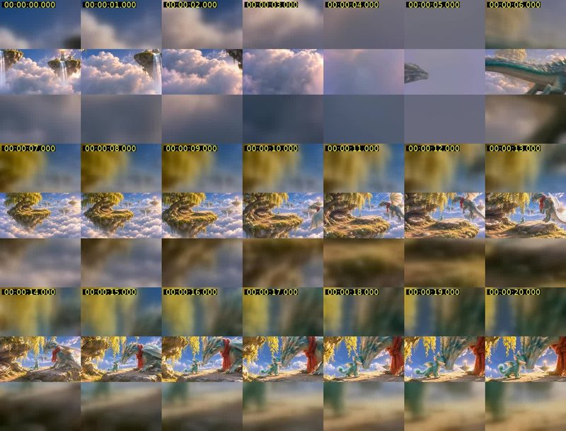
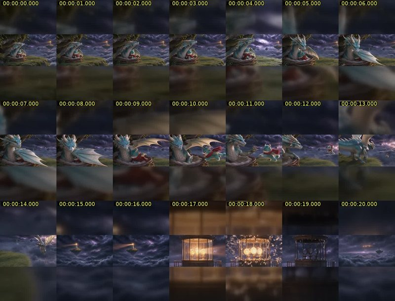
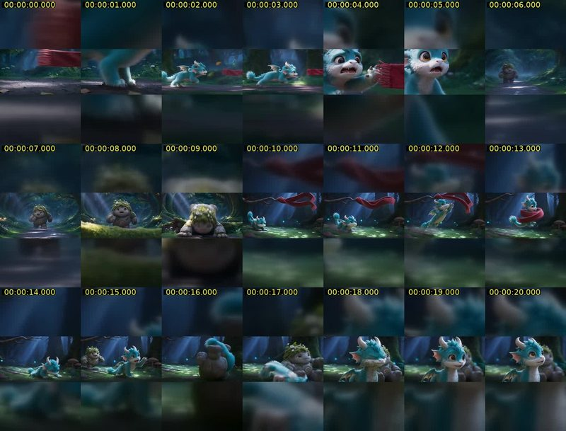
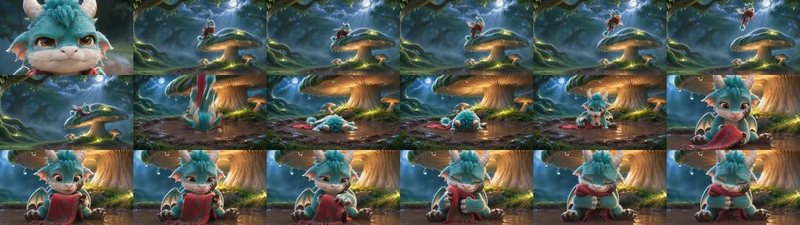
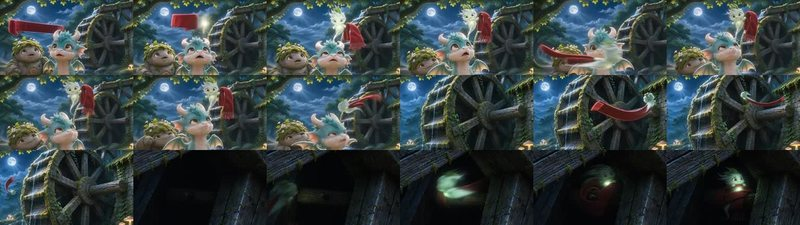

# 2026.11.23 (월)

### LUNO 릴스 지표 분석 및 EP3~8 스토리 수정, 게임 광고 기획서 작성

`LUNO` `Moon Films` `지표 분석` `스토리` `게임 광고`

> EP2를 올린 다음 날이다. 영상을 만들지 않고 숫자를 봤다. 사람들이 어디서 빠져나가는지 확인하고, 그 결과로 남은 편의 이야기를 전부 다시 다듬었다. 길어진 작업 대화를 새 대화로 옮기고, 공모전에 낼 게임 광고 기획도 시작했다.

| 프로젝트 | 한 일 | 결과 |
|:---|:---|:---|
| LUNO | 릴스 지표 분석 | 분석 문서 1개 |
| LUNO | EP3~EP8 이야기 수정 | 개선안 문서, 기획서 새 버전 |
| LUNO | 작업 대화 옮기기 | 인수인계 문서, 시험 후 보완 |
| Moon Films | 채널 방향 | 주력 플랫폼을 인스타 릴스로 변경 |
| 게임 광고 영상 | 조사와 기획 | 광고 기획서 첫 버전 |

---

## LUNO — 릴스 반응 분석

<table>
<tr>
<td width="33%" align="center" valign="top"> 프롤로그의 첫 20초를 1초씩</td>
<td width="33%" align="center" valign="top"> EP1의 첫 20초를 1초씩</td>
<td width="33%" align="center" valign="top"> EP2의 첫 20초를 1초씩</td>
</tr>
</table>

- EP2는 올린 지 12시간쯤 지나서 조회수 약 7,000, 좋아요 600, 공유 35, 리포스트 21이었다. 본 사람 열에 한 명 가까이가 좋아요를 누른 셈이다.
- 문제는 초반이다. 처음 20초 안에 빠져나가는 비율이 EP1은 40%, EP2는 50%였다. 이걸 20% 아래로 줄이는 걸 목표로 잡았다. 끝까지 보는 비율을 높이고 댓글과 공유를 늘리는 것도 같이 본다.
- 프롤로그, EP1, EP2의 인사이트 화면을 놓고 어느 구간에서 사람이 빠지는지 확인했다. 빠지는 지점의 장면을 뽑아서 무엇이 나올 때 떠나는지 봤다.
- 세 편 모두 첫 20초를 1초 단위로 펼쳐 놓고, 처음 몇 초에 무엇이 보이는지를 나란히 비교했다.
- 중간 구간도 같은 방식으로 펼쳐 봤다.

<table>
<tr>
<td width="50%" align="center" valign="top"> EP1의 54~72초 구간</td>
<td width="50%" align="center" valign="top"> EP2의 40~58초 구간</td>
</tr>
</table>

- 숫자만 보고 혼자 추측하지 않으려고, 구독자가 많은 크리에이터들이 인터뷰에서 한 말과 플랫폼이 공식으로 밝힌 내용을 찾아 정리했다. 긴 영상 기준으로 한 말들이라 2~3분짜리 대사 없는 애니메이션에는 어떻게 맞출지를 따로 따져 봤다.
- 분석한 내용은 문서 하나로 정리했다. 앞으로 매 편 올린 뒤 같은 표에 숫자를 이어 적는다.

## LUNO — EP3~EP8 이야기 수정

- 분석을 바탕으로 EP3부터 EP8까지 이야기를 전부 다시 다듬었다. EP3만 고치는 게 아니라 남은 편 전부다.
- 매번 비슷한 추격전을 조금씩 바꿔 찍는 식으로는 가고 싶지 않았다. 그런 방식으로 조회수를 내는 계정도 있지만, 만드는 나도 재미가 없고 보는 사람도 "이번에도 이런 전개네" 하고 금방 질린다. 편마다 다른 맥락과 감동이 있게 바꾸는 데 집중했다.
- 느린 감정 장면에서 사람이 빠지는 것과, 새 편을 보는 사람 대부분이 앞 편을 안 봤다는 점도 같이 고민했다.
- 무엇을 왜 바꿨는지 개선안 문서로 남기고, 수정한 내용을 기획서에 반영해 새 버전을 만들었다. EP3부터는 이 버전이 기준이다.

## LUNO — 작업 대화 옮기기

- 보정부터 음향, 최종본까지 한 대화에서 계속 했더니 대화가 너무 길어져서 답이 느려졌다.
- 지금까지의 진행 상황과 작업 규칙, 폴더 구조, 겪었던 문제를 인수인계 문서 하나로 정리했다.
- 문서만 주고 정말 같은 방식으로 일하는지 새 대화에서 시험해 봤다. 실제 편 폴더는 건드리지 않게 하고 작은 작업 몇 개를 시켰다.
- 시험에서 빠진 부분이 드러났다. 작업용 임시 파일을 폴더에 남기는 것 같은 문제였다. 그 내용을 문서에 보태고 새 대화에서 이어 가기로 했다.

## Moon Films — 채널 방향

- 주력 플랫폼을 유튜브에서 인스타 릴스로 바꿨다. 처음 정했던 "유튜브가 메인, 릴스는 홍보"를 뒤집은 것이다.

## 게임 광고 영상 — 기획 시작

- 15~60초짜리 모바일 게임 광고 영상 작업을 시작했다. 광고 공모전에 낼 작품이다.
- 광고는 만들어 본 적이 없다. 그래서 요즘 성과가 좋은 게임 광고가 어떤 모양인지부터 조사했다. 업계 리포트와 실제 광고 사례를 찾아서 첫 몇 초의 구성, 길이, 편집 리듬, 마지막에 행동을 유도하는 방식 같은 공통점을 뽑았다. 출처로 확인된 내용과 추정은 구분해서 정리했다.
- 기준은 세 가지로 잡았다. 다운로드로 이어지는 비율이 가장 중요하고, 그다음이 중간에 빠져나가지 않는 것, 조회수 순이다.
- 조사한 내용을 바탕으로 광고 기획서 첫 버전을 썼다. 나중에 계속 고쳐 쓸 문서로 만들어 뒀다.

---

Claude와 함께 정리한 작업 일지 · <a href="../../../README.md">전체 기록 보기</a>

