

# 2026.11.24 (화)

### LUNO EP3 배경·컷 이미지 제작 및 공모전 일정 조율

`LUNO` `EP3` `배경` `컷 이미지` `게임 광고` `공모전`

> 새 기획서 기준으로 EP3 제작에 들어갔다. 배경을 장소별로 만들고 각도별 그림까지 채웠다. 공모전 마감이 2주도 안 남아서 LUNO와 광고 영상 중 무엇을 먼저 할지도 정했다.

| 프로젝트 | 한 일 | 결과 |
|:---|:---|:---|
| LUNO EP3 | 제작 시작, 밤 장면 방향 | 편 폴더, 시즌 이야기 정리 글 |
| LUNO EP3 | 배경 | 15장 (버린 것 14장) |
| LUNO EP3 | 컷 이미지 | 3장 (버린 것 8장) |
| 게임 광고 영상 | 일정과 우선순위 | LUNO를 먼저 끝내고 광고에 연속으로 시간 쓰기 |
| Moon Films | 인스타 계정 상태 확인 | 팔로워 1,000명 넘김 |

---

## LUNO — EP3 시작

- 어제 고친 기획서를 기준으로 EP3 제작에 들어갔다. 편 폴더를 새로 만들었다.
- 시즌 전체 이야기를 한 번에 읽을 수 있는 글로 정리해 뒀다. 편을 만들다가 앞뒤 흐름을 확인할 때 본다.
- EP3는 밤 장면이 많다. 화면이 어두워도 캐릭터 표정은 잘 보여야 해서, 밤 장면의 밝기를 어떻게 잡을지부터 정했다.
- EP3에 새로 나오는 소품과 장소를 등록해 뒀다.
- 캐릭터 목소리는 이번부터 직접 녹음한 것과 새로 만든 것을 둘 다 준비해서 더 나은 쪽을 쓰기로 했다. 직접 녹음은 감정은 잘 살지만 목소리가 이상할 때가 있고, 만든 목소리는 반대다.

## LUNO — EP3 배경

<table>
<tr>
<td width="25%" align="center" valign="top"> 장소 1 · 기준 그림</td>
<td width="25%" align="center" valign="top">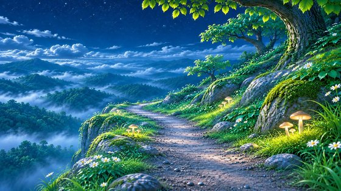 장소 1 · 내려다봄</td>
<td width="25%" align="center" valign="top">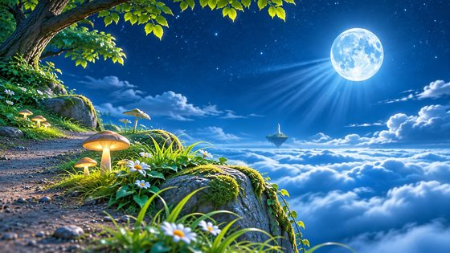 장소 1 · 끝자락</td>
<td width="25%" align="center" valign="top">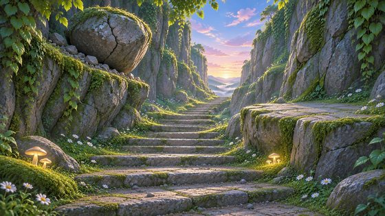 장소 2 · 기준 그림</td>
</tr>
</table>

<table>
<tr>
<td width="25%" align="center" valign="top">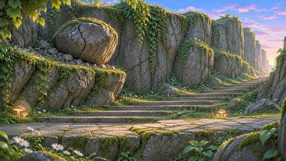 장소 2 · 옆</td>
<td width="25%" align="center" valign="top">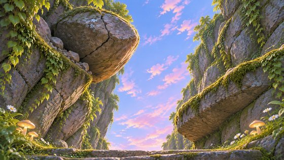 장소 2 · 올려다봄</td>
<td width="25%" align="center" valign="top">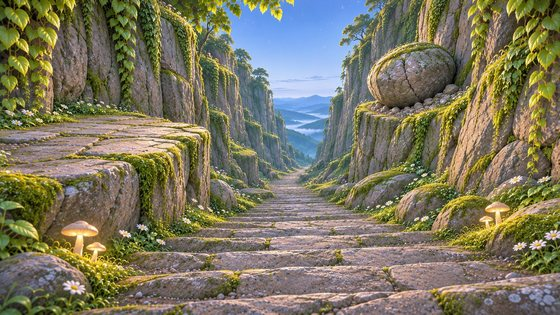 장소 2 · 돌아봄</td>
<td width="25%" align="center" valign="top">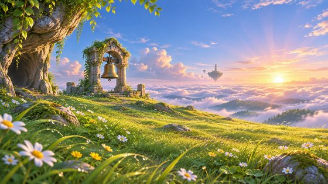 장소 3 · 기준 그림</td>
</tr>
</table>

<table>
<tr>
<td width="25%" align="center" valign="top">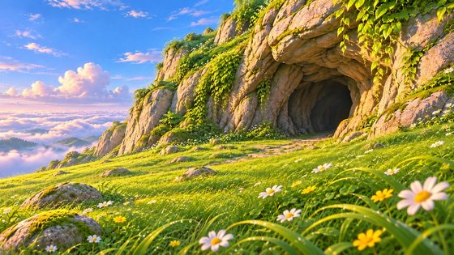 장소 3 · 반대쪽</td>
<td width="25%" align="center" valign="top">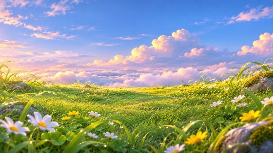 장소 3 · 가까이</td>
<td width="25%" align="center" valign="top">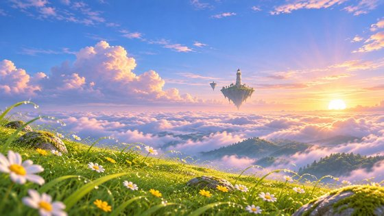 장소 3 · 먼 쪽</td>
<td width="25%" align="center" valign="top">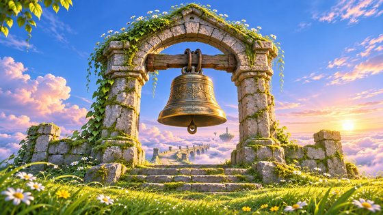 장소 4 · 기준 그림</td>
</tr>
</table>

<table>
<tr>
<td width="25%" align="center" valign="top">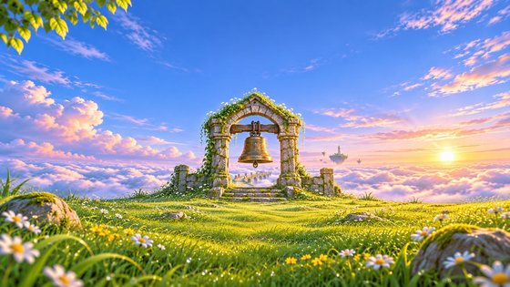 장소 4 · 멀리서</td>
<td width="25%" align="center" valign="top">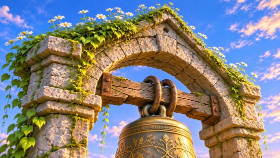 장소 4 · 윗부분</td>
<td width="25%" align="center" valign="top">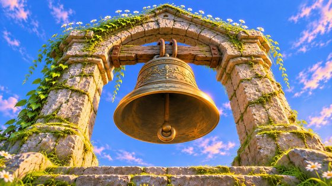 장소 4 · 아래에서</td>
<td width="25%"></td>
</tr>
</table>

- 오늘 만든 장소는 네 곳이다. 낮 12시 반쯤 네 곳의 기준 그림을 먼저 확정했고, 오후 2시 반부터 4시 사이에 각도별 그림을 채웠다.
- 장소마다 기준이 되는 그림을 먼저 만들고, 같은 장소를 다른 각도에서 본 그림을 이어서 만들었다. 하루 동안 15장을 확정했고 14장을 버렸다.
- EP2는 배경이 매번 비슷하게 보여서 단조로웠다. 장소마다 그림을 한 장만 쓰면 카메라가 늘 같은 방향에서만 찍게 되기 때문이다. 프롤로그 때는 각도가 다른 그림을 여러 장 만들었는데, EP3를 준비하다 보니 이번에도 그걸 빠뜨리고 있었다. 중간에 알아채고 각도별 그림을 다시 채웠다.
<table>
<tr>
<td width="33%" align="center" valign="top">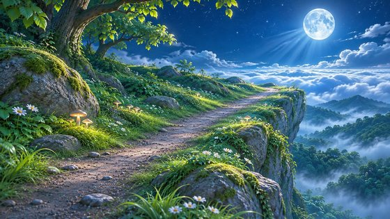 버림: 장소 1의 첫 그림</td>
<td width="33%" align="center" valign="top">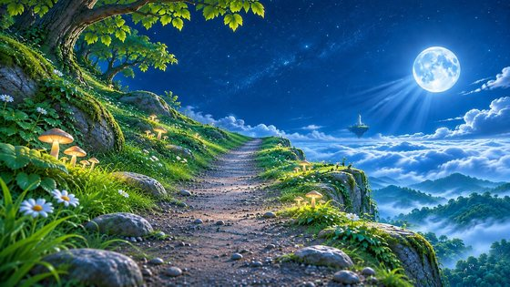 버림: 기준 그림과 같은 방향</td>
<td width="33%" align="center" valign="top">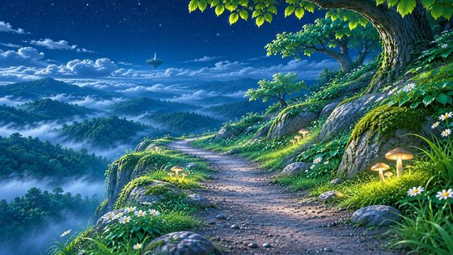 버림: 없어야 할 섬이 그려짐</td>
</tr>
</table>

<table>
<tr>
<td width="33%" align="center" valign="top">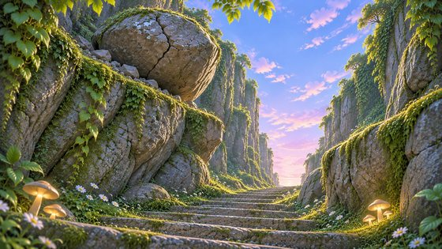 버림: 기준 그림과 거의 같음</td>
<td width="33%" align="center" valign="top">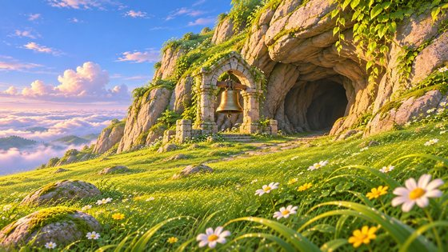 버림: 구조물이 엉뚱한 자리에</td>
<td width="33%" align="center" valign="top">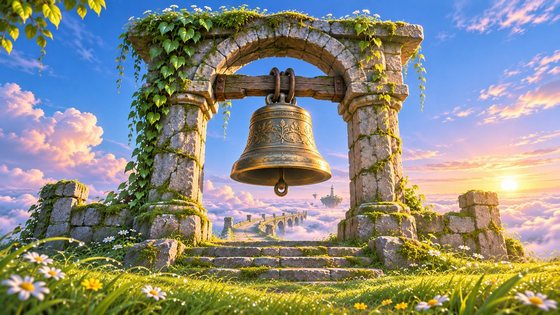 버림: 장소 4의 첫 그림</td>
</tr>
</table>

- 버린 그림은 대부분 각도 문제였다. 다른 각도로 뽑았는데 기준 그림과 거의 같은 방향으로 나오거나, 그 장소에 있으면 안 되는 것이 같이 그려졌다.

## LUNO — EP3 컷 이미지

- 주요 장면의 구도를 잡는 컷 이미지를 세 장 만들었다. 세 장을 얻느라 여덟 장을 버렸다.

## 게임 광고 영상 — 공모전 준비

- 공모전 마감이 12월 6일이다. 2주가 안 남았다. LUNO는 한 편에 3일이 걸리고 이번 주에도 올리고 싶었다. 어디에 시간을 더 쓸지 정해야 했다.
- 광고가 더 중요하다는 건 분명했다. 마감이 지나면 손댈 수 있는 게 없기 때문이다. 다만 순서는 LUNO를 먼저 하기로 했다. EP3를 목요일까지 끝내고, 그 뒤 남은 날을 끊지 않고 광고에만 쓴다. 처음 해 보는 작업이라 연속으로 쓰는 쪽이 낫다고 봤다.
- 대신 선을 하나 그었다. LUNO가 목요일을 넘겨도 광고를 시작하는 날은 미루지 않는다.
- EP3를 목요일에 올리려는 이유가 하나 더 있다. 목요일에 올린 EP1은 토요일까지 조회수가 늘다가 일요일부터 줄었다. 요일 때문인지 영상 때문인지 확인해 보고 싶었다.
- 광고 만드는 순서도 다시 생각했다. 음악을 먼저 정하고 그 박자에 컷을 맞추는 쪽이 낫겠다고 봤다. 요즘 광고에 많이 보이는 화려한 편집 효과를 얼마나 쓸지도 따져 봤다.

## Moon Films — 인스타 계정

- 팔로워가 1,000명을 넘겼다.
- 수익화 기능은 아직 열리지 않았다. 규정을 어긴 건 없고, 계정을 만든 지 얼마 안 돼서 그런 것으로 보인다. 기다렸다가 다시 확인하기로 했다.

---

Claude와 함께 정리한 작업 일지 · <a href="../../../README.md">전체 기록 보기</a>

