

# 2026.11.25 (수)

### LUNO EP3 배경 수정 및 길드원 편의 사이트 개발

`LUNO` `EP3` `배경` `길드 사이트` `웹`

> EP3 숲 배경을 네 번 만에 확정하고 각도별 그림을 다시 골랐다. 길드원들이 쓸 편의 사이트는 그동안 만든 기능을 합쳐 길드원들에게 열었다.

| 프로젝트 | 한 일 | 결과 |
|:---|:---|:---|
| LUNO EP3 | 숲 배경 다시 만들기 | 4차에서 확정 |
| LUNO EP3 | 각도별 배경 다시 고르기 | 숲 4장, 다른 장소 1장 교체 |
| 길드 사이트 | 랭킹, 길드원 정보, 본인 갱신, 공략 게시판 | 길드원에게 공개 |
| 길드 사이트 | 캡처 안내 그림, 글 공유 버튼, 투표 명단 정리 | 반영 완료 |
| 길드 사이트 | 연속 불참 표시, 불러오는 양 줄이기 | 반영 완료 |

---

## LUNO — EP3 배경 수정

<table>
<tr>
<td width="50%" align="center" valign="top"> 1차</td>
<td width="50%" align="center" valign="top"> 2차: 무늬가 너무 촘촘함</td>
</tr>
</table>

<table>
<tr>
<td width="50%" align="center" valign="top"> 3차: 너무 매끈함</td>
<td width="50%" align="center" valign="top"> 4차: 확정</td>
</tr>
</table>

- EP3 숲 장소의 배경을 다시 만들었다. 어제 만든 것을 놓고 보니 마음에 걸리는 게 많았다. 오후 3시부터 20분 사이에 네 번을 뽑았다.
- 1차는 위쪽이 훤히 열려 있어서 원하는 구도가 아니었다.
- 2차는 나무껍질 무늬, 잔풀, 자갈 같은 자잘한 무늬가 화면 가득 촘촘하게 반복됐다. 오래 보면 눈이 아팠다. 풀도 너무 많았고, 나무 몇 그루는 현실에서 볼 수 없는 모양으로 자라 있었다.
- 그래서 3차는 동화책처럼 매끈하게 다듬어 뽑았다. 이번엔 너무 그림 같아서 현실감이 없었다.
- 4차에서 중간을 찾았다. 나무와 땅의 재질은 사실적으로 두되 자잘한 반복 무늬만 걷어 냈다. 풀 양을 줄이고 나무 모양도 자연스럽게 바꿨다. 이걸로 확정했다.

<table>
<tr>
<td width="25%" align="center" valign="top"> 각도 1 · 반대 방향</td>
<td width="25%" align="center" valign="top"> 각도 2 · 옆</td>
<td width="25%" align="center" valign="top"> 각도 3 · 나무 반대편</td>
<td width="25%" align="center" valign="top"> 각도 4 · 가까이</td>
</tr>
</table>

- 확정한 그림을 기준으로 각도별 배경을 다시 만들었다. 이번에는 기준을 바꿨다. "다른 각도가 있으면 좋다"가 아니라 "EP3 장면에서 카메라가 실제로 쓰는 각도인가"를 따졌다. 쓰지 않을 각도는 빼고 자주 쓰일 각도로 바꿨다.
- 다른 장소의 옆모습 그림 한 장도 같이 고쳤다. 있으면 안 되는 불빛이 그려져 있었다.

<table>
<tr>
<td width="33%" align="center" valign="top"> 어제 만든 각도 그림: 달이 보이면 안 되는 방향인데 달이 있음</td>
<td width="33%" align="center" valign="top"> 다른 장소의 옆모습: 없어야 할 불빛이 있음</td>
<td width="33%" align="center" valign="top"> 불빛을 지운 뒤</td>
</tr>
</table>

## 길드 사이트 — 길드원에게 공개

- 하고 있는 게임의 길드원들이 쓸 편의 사이트다. 처음에는 길드 휘장을 고르는 투표 페이지 하나였는데, 거기에 기능을 붙여서 길드원 사이트로 키웠다. 오늘 그동안 만든 것을 합쳐 길드원들에게 열었다. 길드원만 쓰는 곳이라 주소는 따로 적지 않는다.
- 랭킹, 길드원, 내 캐릭터, 투표를 한 메뉴로 묶었다. 공략 메뉴도 같이 넣었다.
- 화면은 11월 26일에 찍었다. 길드원 닉네임은 다른 이름으로 바꾸고 길드 이름은 지웠다.
- 오전 11시 40분쯤 투표 쪽 명단부터 손봤다. 길드를 나간 사람과 새로 들어온 사람을 반영했다. 명단에서 빠진 닉네임으로 이미 들어온 표는 집계에서 빠진다.
- 낮 12시 40분쯤 랭킹, 길드원, 내 캐릭터가 들어간 첫 버전을 올렸다. 그 뒤 2시간 동안 네 번 더 고쳐 올렸다.

#### 레이드 참여율 랭킹

<table>
<tr>
<td width="50%" align="center" valign="top">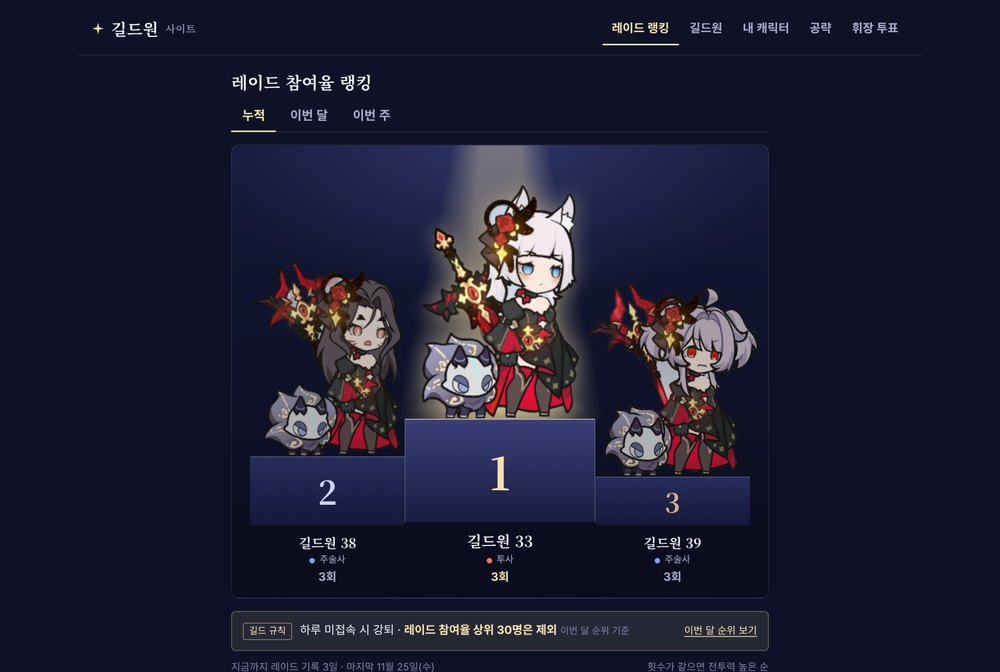 레이드 참여율 랭킹. 1~3위는 무대 위에 세운다</td>
<td width="50%" align="center" valign="top">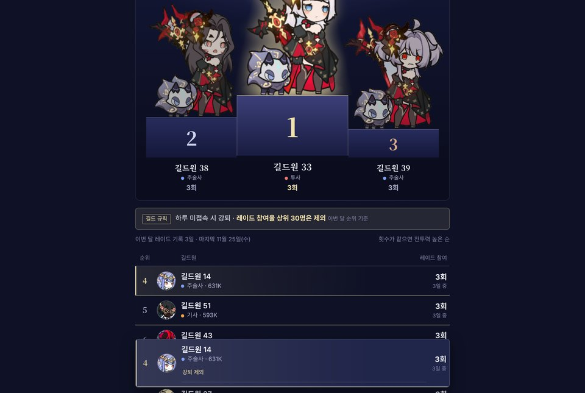 4위부터는 표로 이어진다. 길드 규칙과 내 순위가 함께 보인다</td>
</tr>
</table>

- 매일 레이드 참여 횟수를 쌓아서 누적, 이번 달, 이번 주 순위를 보여 준다. 횟수가 같으면 전투력이 높은 쪽이 위다. 1~3위는 캐릭터를 무대 위에 세워 보여 준다.
- 길드 규칙(하루 미접속 시 강퇴, 이번 달 상위 30명은 제외)을 랭킹 화면에 함께 걸었다. 참여할 이유가 눈에 보이게 하려는 것이다. 각자 지금 순위로 강퇴 대상에서 빠지는지도 표시된다.
- 참석 기록은 관리자만 넣는다. 처음에는 날짜마다 한 명씩 체크하는 방식이었는데 번거로워서, 참석한 사람의 닉네임을 띄어쓰기로 죽 적으면 한 번에 들어가게 바꿨다.
- 연달아 빠진 사람에게는 "연속 불참 2일"처럼 작은 표시가 붙는다. 처음에는 하루만 빠져도 표시가 붙었는데, 하루는 봐주기로 하고 이틀부터 붙게 했다.

#### 길드원 정보와 본인 갱신

<table>
<tr>
<td width="50%" align="center" valign="top">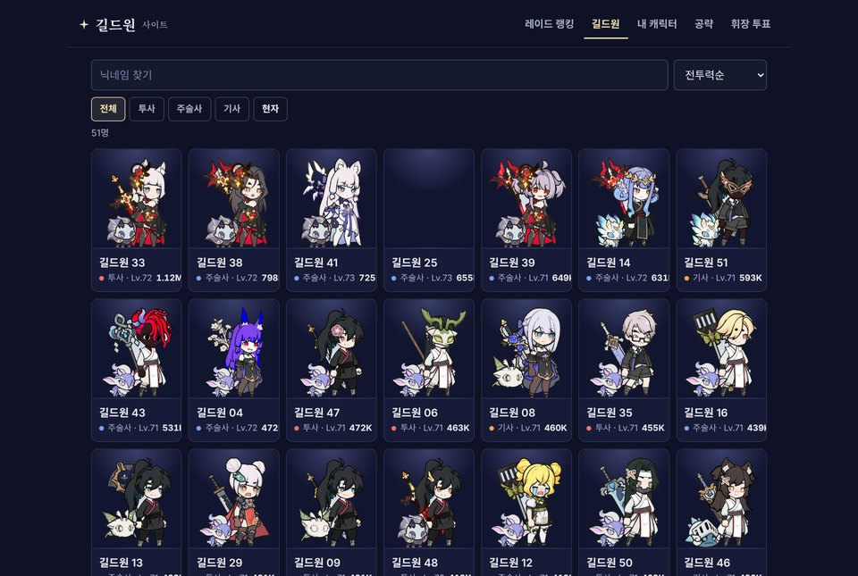 길드원 목록. 직업으로 거르고 전투력순으로 정렬한다</td>
<td width="50%" align="center" valign="top">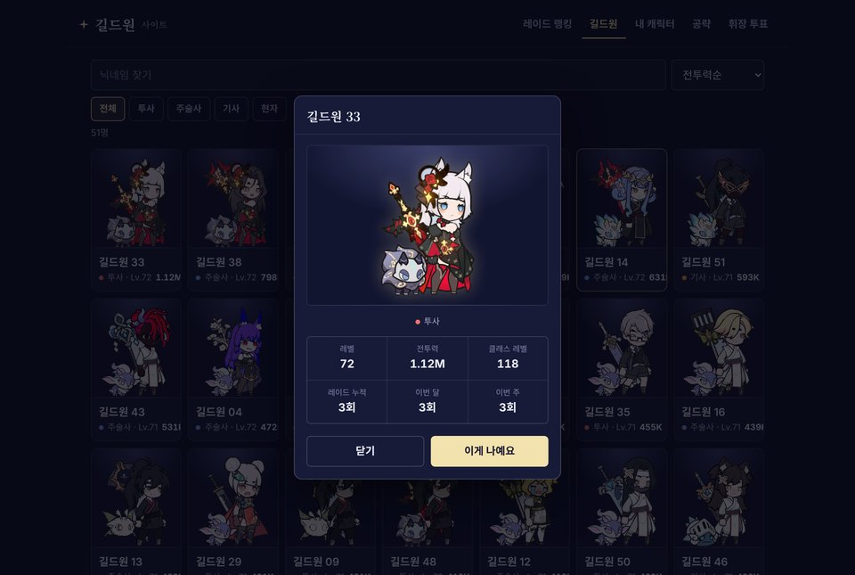 길드원을 누르면 레벨, 전투력, 레이드 참여가 나온다</td>
</tr>
</table>

- 길드원 51명의 직업, 레벨, 전투력을 찾아보고 정렬할 수 있다.
- 본인이 직접 캐릭터 화면 캡처를 올리면 정보가 갱신된다. 캡처에서 닉네임을 읽어 본인이 맞는지, 레벨과 전투력을 읽어 예전 캡처가 아닌지 확인한다. 올리기 전에 캐릭터를 오려 낸 모습을 미리 보여 준다.
- 갱신은 캐릭터당 하루 한 번으로 제한했다. 무료로 쓸 수 있는 한도 안에서 사이트를 돌리기 위해서다.
- 어떤 화면을 캡처해야 하는지 헷갈리지 않게 예시 그림을 넣었다. 그림 위에 번호 세 개를 찍고 설명에도 같은 번호를 달았다. 누르면 크게 보인다.

<table>
<tr>
<td width="50%" align="center" valign="top">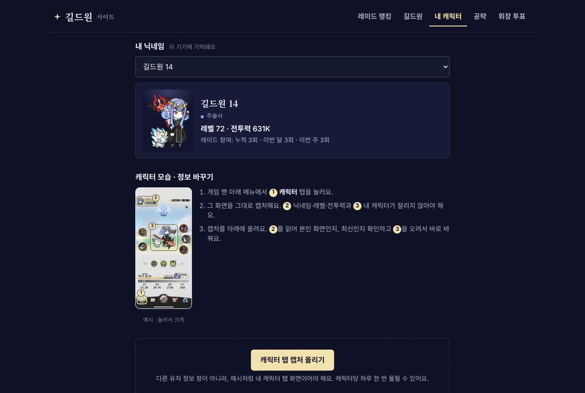 내 캐릭터: 닉네임을 고르면 캡처 올리는 방법이 나온다</td>
<td width="50%" align="center" valign="top">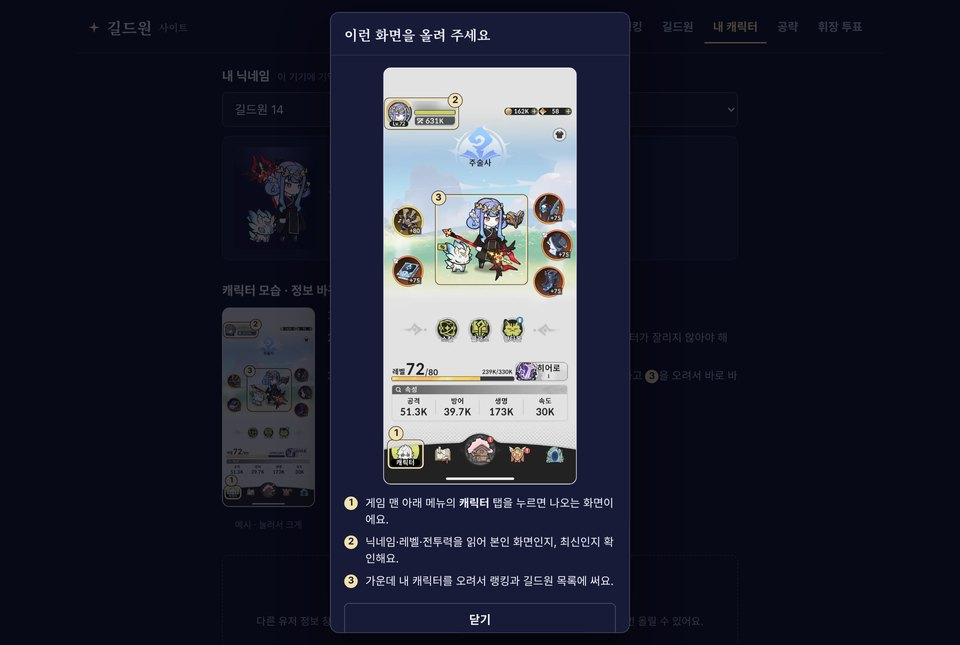 예시 그림을 누르면 크게 보인다. 번호가 설명과 짝을 이룬다</td>
</tr>
</table>

#### 공략글 게시판

- "제작 예정"이라고만 적어 둔 임시 메뉴 자리를 실제 게시판으로 바꿨다. 길드원이 직접 공략을 올리고 이미지와 링크, 출처를 달 수 있다. 댓글도 된다.
- 내 캐릭터를 선택하기 전에는 글을 쓸 수 없게 했다.
- 글 하나에 이미지는 4장, 관련 링크는 3개까지 붙일 수 있다. 본문에 적은 주소는 자동으로 링크가 된다.
- 계정이 없는 사이트라서 글을 쓴 기기를 기억해 둔다. 글과 댓글은 쓴 기기나 관리자만 지울 수 있고, 글 내용은 쓴 기기에서만 고칠 수 있다.
- 도배를 막으려고 한 네트워크에서 하루에 쓸 수 있는 글과 댓글 수에 한도를 뒀다.
- 글마다 공유 버튼을 달았다. 짧은 주소가 만들어지고, 메신저에 붙이면 제목과 첫 문장, 첫 그림이 미리보기로 뜬다.

<table>
<tr>
<td width="50%" align="center" valign="top">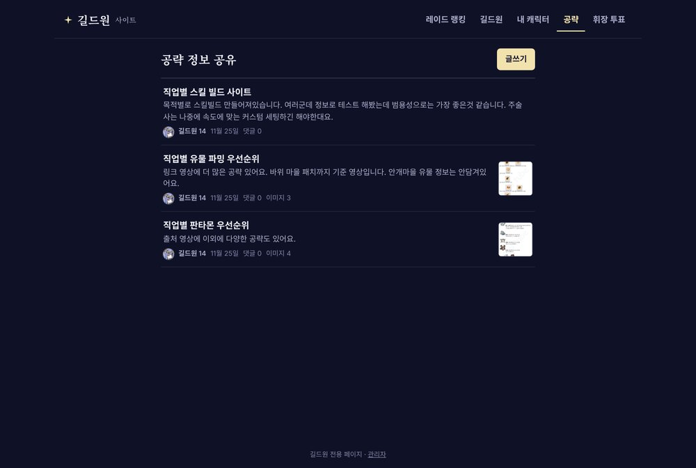 공략 게시판</td>
<td width="50%" align="center" valign="top">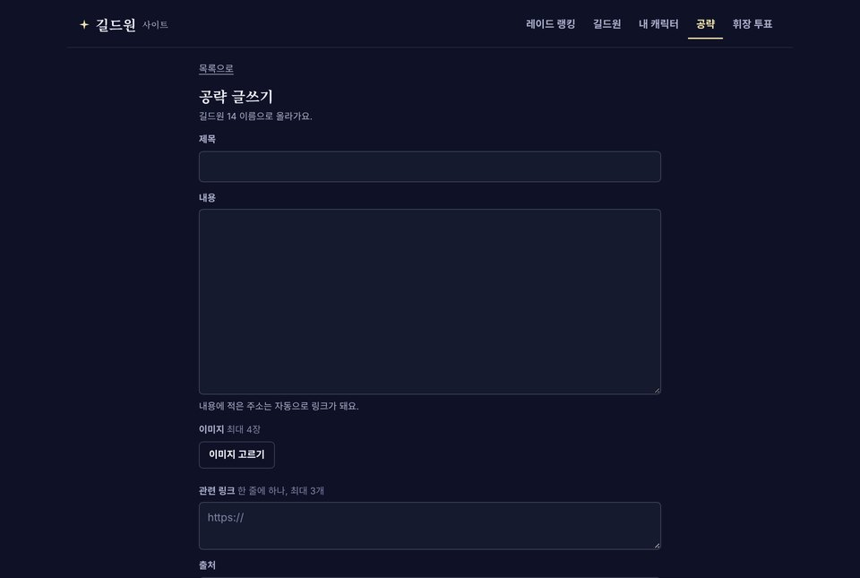 공략 글쓰기</td>
</tr>
</table>

#### 휴대폰 화면

<table>
<tr>
<td width="25%" align="center" valign="top">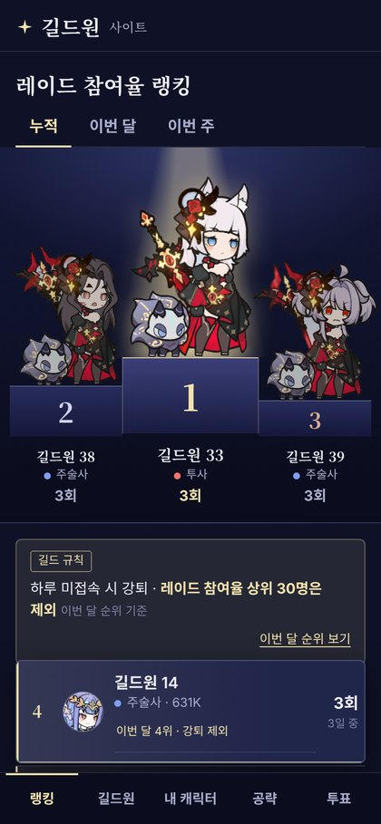 랭킹</td>
<td width="25%" align="center" valign="top">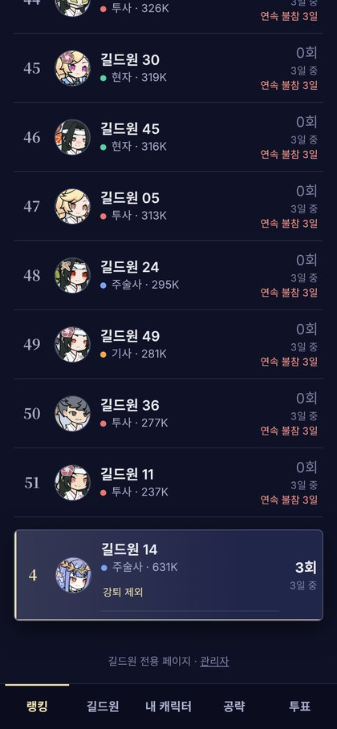 연속 불참 표시와 내 순위</td>
<td width="25%" align="center" valign="top">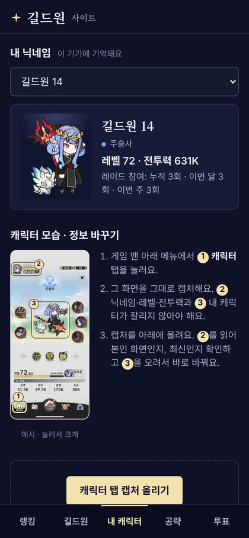 내 캐릭터</td>
<td width="25%" align="center" valign="top">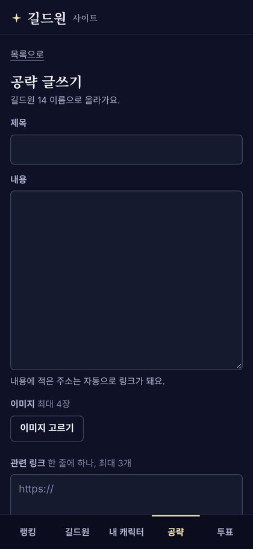 공략 글쓰기</td>
</tr>
</table>

#### 디자인과 속도

- 디자인은 '빛의 전당' 콘셉트로 맞췄다. 어두운 무대에 1위만 조명을 받는 느낌이다. 둥근 알약 모양 버튼처럼 가벼워 보이는 요소는 뺐다.
- 랭킹을 불러올 때마다 출석 기록 전체를 여러 번 훑고 있었다. 기록이 쌓일수록 무료 한도를 빨리 쓰는 구조였다. 누적 횟수는 참석을 저장할 때 미리 계산해 두고, 화면을 열 때는 최근 기록만 읽게 고쳤다. 화면에 보이는 숫자는 그대로다. 화면을 자동으로 새로 불러오는 간격도 1분에서 3분으로 늘렸다.
- 공개 전에 집계와 연속 불참 17가지 경우, 본인 갱신 28가지, 공략 글 39가지를 시험했다. 휴대폰부터 큰 화면까지 네 가지 폭에서 화면이 옆으로 넘치지 않는 것도 확인했다.

---

Claude와 함께 정리한 작업 일지 · <a href="../../../README.md">전체 기록 보기</a>

