

# 2026.11.26 (목)

### LUNO EP3 컷 영상 제작 및 작업 일지 형식 개편

`LUNO` `EP3` `컷 영상` `컷 이미지` `dev-log` `자동화`

  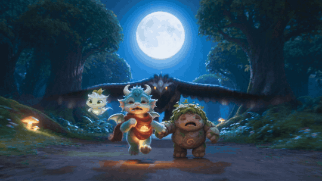
   
  EP3 컷 영상 중 하나

> EP3 컷 영상을 하루 종일 뽑았다. 오전 10시부터 오후 5시 반까지 19개를 확정했고, 그동안 버린 것이 36개다. 두 묶음은 끝내 확정하지 못하고 내일로 넘겼다. 오전에는 이 작업 일지의 형식을 바꾸고 지난 일지 13개를 다시 썼다.

| 프로젝트 | 한 일 | 결과 |
|:---|:---|:---|
| LUNO EP3 | 컷 영상 | 19개 확정 (버린 것 36개) |
| LUNO EP3 | 긴 영상을 짧게 나눠 다시 만들기 | 2개 묶음을 3개, 5개로 나눔 |
| LUNO EP3 | 첫 구간 이어 붙이기 | 4컷 구간 미리보기 1개 |
| LUNO EP3 | 컷 이미지 추가 | 1장 확정 (버린 것 1장) |
| LUNO EP3 | 컷 계획 고치기 | 영상을 뽑으며 계속 반영 |
| dev-log | 일지 형식 개편, 지난 일지 다시 쓰기 | 13개 일지, 커밋 11번 |
| dev-log | 일지 올리는 시간 변경 | 밤 11시에서 오후 5시 40분으로 |

---

## LUNO — EP3 컷 영상

<table>
<tr>
<td width="25%" align="center" valign="top">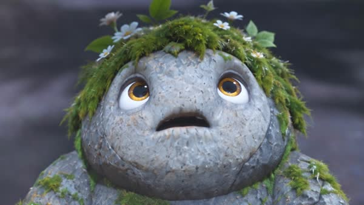 첫 구간 · 숏 1~2</td>
<td width="25%" align="center" valign="top">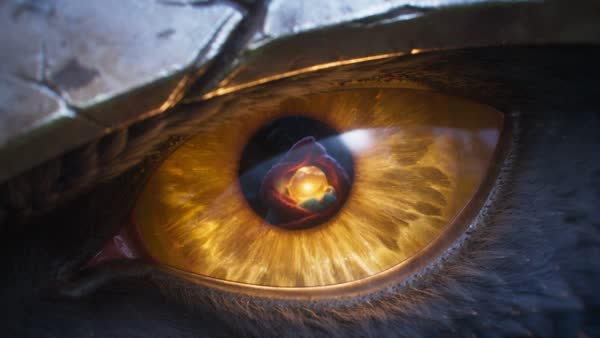 첫 구간 · 눈 클로즈업</td>
<td width="25%" align="center" valign="top">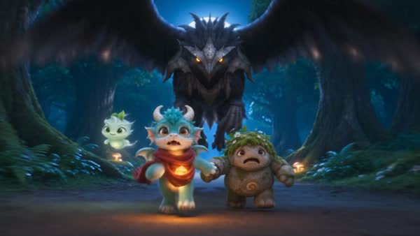 첫 구간 · 추격</td>
<td width="25%" align="center" valign="top">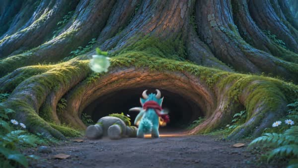 첫 구간 · 끝</td>
</tr>
</table>

<table>
<tr>
<td width="25%" align="center" valign="top"> 둘째 구간 · 1</td>
<td width="25%" align="center" valign="top">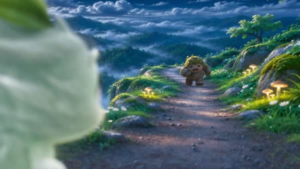 둘째 구간 · 2</td>
<td width="25%" align="center" valign="top"> 둘째 구간 · 3</td>
<td width="25%" align="center" valign="top"> 둘째 구간 · 4</td>
</tr>
</table>

<table>
<tr>
<td width="25%" align="center" valign="top"> 둘째 구간 · 5</td>
<td width="25%" align="center" valign="top">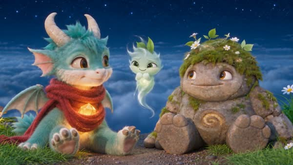 둘째 구간 · 6</td>
<td width="25%" align="center" valign="top"> 셋째 구간 · 앞</td>
<td width="25%" align="center" valign="top"> 셋째 구간 · 뒤 1</td>
</tr>
</table>

<table>
<tr>
<td width="25%" align="center" valign="top"> 셋째 구간 · 뒤 2</td>
<td width="25%" align="center" valign="top">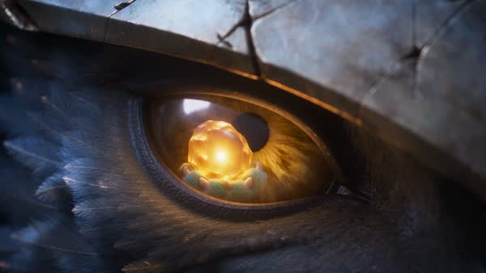 셋째 구간 · 뒤 3</td>
<td width="25%" align="center" valign="top">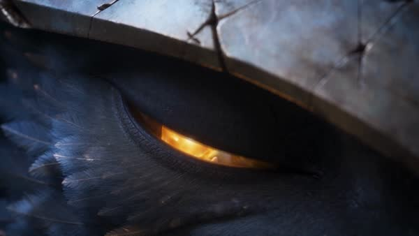 셋째 구간 · 뒤 4</td>
<td width="25%" align="center" valign="top"> 넷째 구간 · 앞 1</td>
</tr>
</table>

<table>
<tr>
<td width="25%" align="center" valign="top">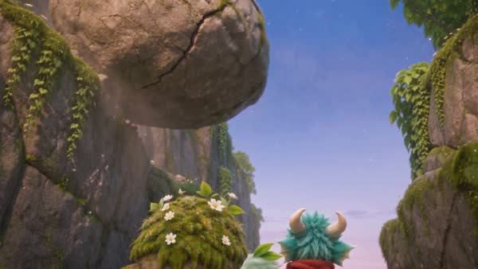 넷째 구간 · 앞 2</td>
<td width="25%" align="center" valign="top">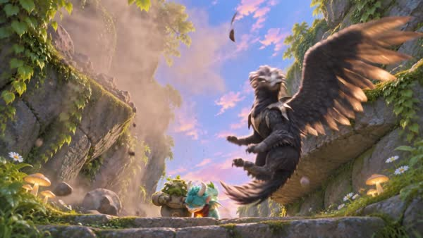 넷째 구간 · 뒤</td>
<td width="25%" align="center" valign="top">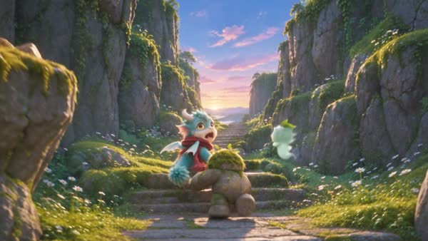 다섯째 구간</td>
<td width="25%"></td>
</tr>
</table>

- 오늘 확정한 컷 19개를 한 장면씩 모았다. EP3는 아직 올리지 않은 편이라 장면 내용은 적지 않고, 무엇이 문제였는지만 남긴다.
- 어제 오후에 첫 구간을 한 번에 뽑아 봤는데 뒤쪽 숏 세 개가 어긋나서 버렸다. 오늘은 그 구간을 숏 단위로 나눠 다시 뽑는 것부터 시작했다.
- 오전 10시 9분에 첫 결과가 나왔고 오후 5시 32분에 마지막 컷을 확정했다. 그 사이에 확정한 컷이 19개, 버린 영상이 36개다. 확정본의 원본으로 남겨 둔 영상 7개는 버린 수에서 뺐다.
- 버린 36개 중 7개는 화질을 낮춘 초안이다. 초안은 방향만 확인하는 용도라, 초안에서 좋았던 부분도 정식 화질로 다시 뽑아야 했다.

#### 주요 컷

<table>
<tr>
<td width="33%" align="center" valign="top">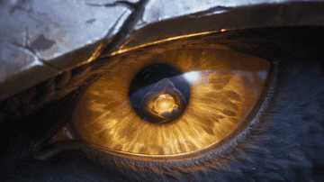 눈 클로즈업. 7번 만에 확정</td>
<td width="33%" align="center" valign="top">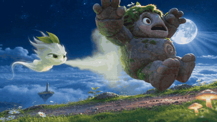 둘째 구간. 숏을 따로 다시 뽑음</td>
<td width="33%" align="center" valign="top">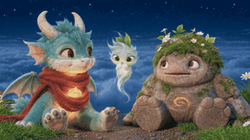 둘째 구간 끝</td>
</tr>
</table>

<table>
<tr>
<td width="33%" align="center" valign="top">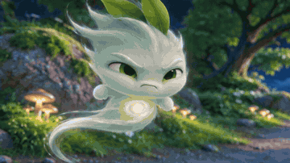 셋째 구간 뒤. 다섯 개로 나눈 것 중 하나</td>
<td width="33%" align="center" valign="top">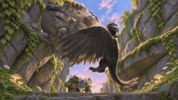 넷째 구간 뒤. 3번 만에 확정</td>
<td width="33%"></td>
</tr>
</table>

#### 묶음별 진행

| 묶음 | 시각 | 뽑은 횟수 | 결과 |
|:---|:---|:---|:---|
| 첫 구간 앞 (숏 1~2) | 10:09~11:32 | 6번 | 확정. 4차에서 뒤쪽 숏만 살리고 앞쪽을 다시 뽑아 합침 |
| 첫 구간 눈 클로즈업 | 10:21~11:45 | 7번 | 확정. 가장 여러 번 뽑은 컷 |
| 첫 구간 추격 | 10:55~12:07 | 5번 | 확정. 5차의 한 숏은 다른 컷으로 돌려 씀 |
| 둘째 구간 (4컷) | 12:07~15:24 | 11번 | 확정. 한 번에 뽑은 것을 버리고 세 개로 나눔 |
| 셋째 구간 앞 | 15:31~16:00 | 2번 | 확정 |
| 셋째 구간 뒤 (5개로 나눔) | 15:38~17:32 | 11번 | 4개 확정, 1개 미확정 |
| 넷째 구간 앞 (2컷) | 13:06~16:08 | 4번 | 확정. 초안을 한 번씩 본 뒤 정식으로 |
| 넷째 구간 가운데 | 13:11~16:55 | 4번 | 미확정 |
| 넷째 구간 뒤 | 16:12~17:16 | 3번 | 확정 |
| 다섯째 구간 | 16:58 | 1번 | 한 번에 확정 |
| 마지막 구간 | 16:24 | 초안 1번 | 초안만 확인. 끝부분 동작이 어색했고 나머지는 좋았음 |

#### 다시 만든 이유

| 문제 | 어떤 모습이었나 | 걸린 묶음 |
|:---|:---|:---|
| 상황과 안 맞는 표정 | 쫓기는 장면인데 캐릭터가 웃고 있음. 놀라는 장면이 코미디처럼 과하게 나오거나, 반대로 놀람이 아예 없음 | 첫 구간, 둘째 구간, 셋째·넷째 구간 |
| 루노의 팔다리 | 한쪽 팔이 안 보임. 두 발로 뛰어야 하는데 네 발로 달림. 팔다리가 다섯 개로 나온 것도 있음 | 첫 구간 추격, 둘째 구간, 셋째 구간 앞 |
| 굳은 자세 | 서 있는 자세 그대로 움직여서 동작에 힘이 없음 | 첫 구간 앞 |
| 다른 캐릭터의 모습 | 등록해 둔 모습과 다르게 나옴. 날개가 작아져 새처럼 보임 | 첫 구간 |
| 참조 그림이 그대로 나옴 | 구도만 참고하라고 넣은 그림이나 회색 스케치가 영상 화면에 그대로 등장. 얼굴이 컷 이미지 쪽으로 바뀌기도 함 | 첫 구간 눈 클로즈업, 넷째 구간 |
| 방향과 위치 | 달리는 방향이 앞 컷과 반대. 캐릭터가 엉뚱한 쪽을 봄. 물건이 떨어지는 방향이 틀림 | 둘째 구간, 넷째 구간 |
| 크기 | 소품이 너무 크게 나옴. 작은 캐릭터가 크게 나옴 | 둘째 구간, 셋째 구간 뒤 |
| 앞뒤 컷과 안 맞음 | 내려다본 모습이 바로 앞 컷과 다름. 없던 나무가 끝에 생김. 빈 화면에서 멈춤 | 셋째 구간, 넷째 구간 앞 |
| 한 화면에 너무 많음 | 여러 동작을 한 영상에 다 넣었더니 화면이 복잡해짐 | 둘째 구간, 셋째 구간 뒤 |

<table>
<tr>
<td width="25%" align="center" valign="top">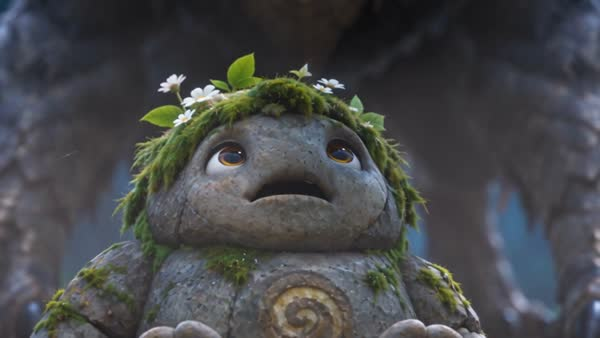 버림: 서 있는 자세 그대로, 웃는 얼굴</td>
<td width="25%" align="center" valign="top">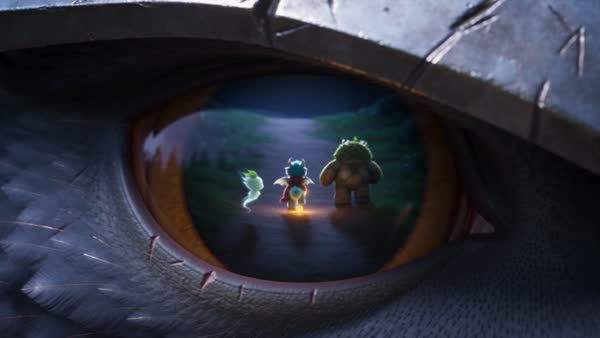 버림: 눈에 장면이 통째로 비침</td>
<td width="25%" align="center" valign="top"> 버림: 루노가 네 발로 달림</td>
<td width="25%" align="center" valign="top"> 버림: 한 영상에 다 넣은 둘째 구간</td>
</tr>
</table>

<table>
<tr>
<td width="25%" align="center" valign="top"> 버림: 웃는 얼굴, 끝에 없던 나무가 생김</td>
<td width="25%" align="center" valign="top">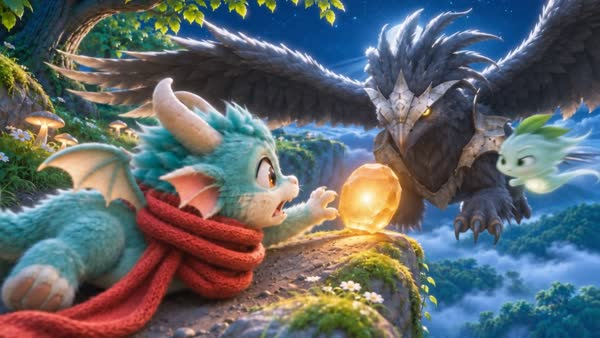 버림: 화면이 복잡하고 소품이 큼</td>
<td width="25%" align="center" valign="top">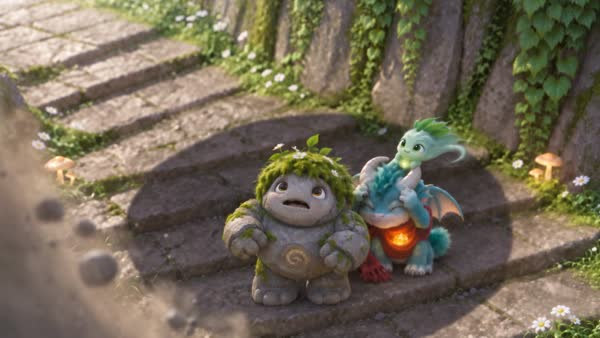 버림: 참조 그림이 그대로 나옴</td>
<td width="25%" align="center" valign="top"> 버림: 놀라는 연기가 과함</td>
</tr>
</table>

- 표정 문제가 가장 자주 나왔다. 뽑을 때마다 같은 지적을 되풀이하고 있어서, 앞으로는 모든 영상에 그 상황의 표정과 행동을 처음부터 정해 두기로 했다.
- 루노의 한쪽 팔이 안 보이는 것, 등록해 둔 그림과 똑같은 웃는 얼굴, 굳은 팔다리는 특정 컷만의 문제가 아니었다. 거의 모든 영상에서 되풀이됐다. 원인을 찾아 나머지 영상 전체에서 한꺼번에 고치기로 했다.
- 눈 클로즈업 컷은 7번을 뽑았다. 눈에 비치는 모습이 문제였다. 정면이 그대로 비치거나, 장면 전체가 통째로 비치거나, 비침이 갑자기 생겼다. 6차에서 눈과 비침은 좋았는데 비친 물건의 모습이 달라서 한 번 더 뽑았다.

#### 긴 영상을 나눠서 다시 만들기

- 둘째 구간은 처음에 한 영상으로 뽑았다(12:07). 웃는 얼굴이 나왔고, 뒤처지는 캐릭터가 화면에 보이지 않았고, 중요한 캐릭터가 배경처럼 작게 나왔다. 통째로 버리고 세 개로 나눴다.
- 나눈 뒤에도 한 영상 안의 숏이 전부 좋게 나오는 일은 드물었다. 좋은 숏만 잘라 쓰고 나머지 숏은 따로 다시 뽑았다. 둘째 구간의 첫 영상은 세 번째 숏만 쓰고, 첫 숏과 둘째 숏은 각각 두 번씩 더 뽑아서 채웠다.
- 셋째 구간 뒤쪽도 한 영상으로 뽑았다가(15:38) 화면이 복잡하고 소품이 너무 커서 버렸다. 다섯 개로 나눠 다시 뽑았다. 그중 네 개는 오후 4시에서 5시 반 사이에 확정했다.
- 남은 하나는 다섯 번을 뽑고도 확정하지 못했다. 초안에서는 소품이 너무 컸고, 정식으로 뽑은 것들은 놀라는 연기가 과하거나 없거나 앞 컷과 모습이 달랐다. 4차는 앞쪽 2.5초만 좋았다.
- 넷째 구간 가운데 묶음도 네 번을 뽑았지만 확정하지 못했다. 방향이 어긋나거나, 얼굴이 달라지거나, 스케치가 그대로 나오거나, 화면 위쪽이 가려졌다.
- 계획에 있던 영상 하나는 앞 컷에서 이어 만들지 않기로 하고 뺐다.

#### 이어 붙이기

- 둘째 구간 4컷을 이어 붙여 미리보기를 만들었다(15:24). 셋째 구간 뒤쪽도 확정한 컷끼리 붙여 흐름을 확인했다(17:32).
- 미리보기에서 컷 사이가 끊겨 보이는 곳과 화면이 늘어나 보이는 곳이 있었다. 지금 하나씩 맞추면 시간이 많이 들어서, 표시만 해 두고 전체 편집 때 한꺼번에 고치기로 했다.
- 한 숏은 좌우를 뒤집어서 앞 컷과 방향을 맞췄다.

## LUNO — EP3 컷 이미지와 컷 계획

<table>
<tr>
<td width="50%" align="center" valign="top"> 1차: 구도는 좋지만 얼굴이 사람 같음</td>
<td width="50%" align="center" valign="top">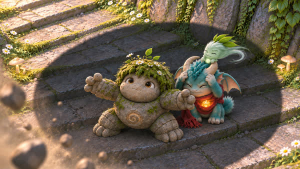 확정</td>
</tr>
</table>

- 컷 영상을 뽑다가 구도를 잡아 줄 그림이 필요한 컷이 하나 더 나와서 컷 이미지를 한 장 추가했다. 1차(13:21)는 구도는 좋았는데 캐릭터 얼굴이 사람처럼 나와서 버렸고, 다시 뽑은 것을 15:41에 확정했다.
- 컷 계획은 영상을 뽑는 내내 고쳤다. 영상을 나누거나 빼거나 숏을 다른 컷으로 돌려 쓸 때마다 반영했다. 마지막으로 고친 시각은 17:34다.

## dev-log — 작업 일지 형식 개편

- 이 저장소의 일지 쓰는 방식을 바꿨다. 그동안은 그날 한 일을 대략만 적고 꾸미는 데 신경을 썼다. 오늘부터는 무엇이 문제였고 어떻게 고쳤고 결과가 어땠는지를 단계별로 자세히 적는다.
- 제목은 커밋 메시지처럼 담백하게 쓰고, 사람이 쓴 글처럼 읽히게 말투를 고쳤다. 아이콘은 뺐다.
- 공개 저장소라서 적지 않을 것도 다시 정했다. 기획 내용과 만드는 방법에 해당하는 문장을 지난 일지에서 걷어 냈다(10:09).
- 바뀐 형식으로 11월 6일부터 25일까지의 일지 13개를 다시 썼다. 오전 10시부터 오후 1시 46분까지 11번 나눠 올렸다.

| 시각 | 한 일 |
|:---|:---|
| 10:00 | 일지 형식을 바꾸고 13개 일지를 다시 씀 |
| 10:09 | 기획·제작 방법에 해당하는 내용 제거, 채널 링크 칸 추가 |
| 11:49 | 11/09~11/25 일지에 이미지와 영상 추가 |
| 12:16 | 일지 내용을 더 자세히, 화면 구성 개편 |
| 12:26~12:30 | 프롤로그·EP1·EP2와 채널 공개 링크 추가, 길드 사이트 링크 칸 제거 |
| 12:47~13:18 | 컷 모음, 버린 영상, 보정 전후, 배경 과정, 음향 목록 추가 |
| 13:46 | StreamGuard와 길드 사이트 기록 확대 |

- 처음 다시 쓴 일지는 글에 비해 그림이 적었다. 그날 한 작업만큼 그림이 들어가야 한다고 보고 컷 모음, 버린 영상, 보정 전후 비교를 날짜별로 채웠다. 그림은 화면을 꽉 채우지 않게 표로 나눠 넣었다.
- 애니메이션이 아닌 작업도 같은 분량으로 적기로 했다. StreamGuard와 길드 사이트 쪽 기록을 늘리고 화면 그림을 넣었다. 길드 사이트 화면은 닉네임을 다른 이름으로 바꾸고 길드 이름을 지운 뒤에 찍었다. 길드원만 쓰는 곳이라 주소 칸도 없앴다.
- 일지가 올라가는 시간을 밤 11시에서 오후 5시 40분으로 옮겼다. 밤에는 사무실 컴퓨터가 꺼져 있어서 작업 폴더의 그림과 영상을 일지에 넣을 수 없었기 때문이다.

---

Claude와 함께 정리한 작업 일지 · <a href="../../../README.md">전체 기록 보기</a>

