

# 2026.11.27 (금)

### LUNO EP3 컷 영상 마무리, 가편집·보정 완료 및 음향 작업

`LUNO` `EP3` `컷 영상` `가편집` `보정` `음향` `dev-log`

  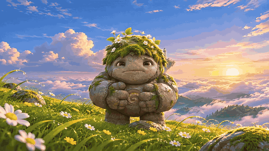
   
  EP3 보정본의 한 장면

> 어제 일지를 올린 뒤 저녁에 EP3의 남은 컷 12개를 확정하고 가편집을 6차까지 고쳤다. 길이는 1분 54.8초, 숏은 48개다. 밤에 보정 분석과 첫 보정본을 만들었고, 오늘 오전에 새로 키운 영상으로 보정본 v2를 뽑아 보정을 끝냈다. 점심 무렵 음향 단계로 넘어가 첫 곡을 세 번 만에 정했는데, 오후에 다섯 곡을 영상에 얹어 보니 곡 사이가 어색해서 음악을 한 곡으로 다시 만들었다. 효과음과 목소리는 앞 편 소리를 다시 쓰는 양을 줄이는 쪽으로 목록을 되돌렸다. 오후 5시 40분까지의 기록이다.

| 프로젝트 | 한 일 | 결과 |
|:---|:---|:---|
| LUNO EP3 (전날 저녁) | 컷 영상 | 12개 확정 (버린 것 5개). 전체 31개로 컷 영상 끝 |
| LUNO EP3 (전날 저녁) | 컷 이미지 추가 | 1장 |
| LUNO EP3 (전날 저녁) | 가편집 | 6차에서 확정. 1분 54.8초, 숏 48개 |
| LUNO EP3 (전날 밤) | 보정 분석, 첫 보정본 | 숏 48개 측정, 구역 5개, 보정본 v1 |
| LUNO EP3 | 보정 | 새로 키운 영상으로 보정본 v2, 보정 확정 |
| LUNO EP3 | 음향 계획, 첫 곡 (오전) | 음악 5곡 중 1곡 확정 (3번 만에). 새로 만들 소리 39개, 다시 쓸 소리 51곳 정리 |
| LUNO EP3 | 음악 다시 만들기 (오후) | 나눠 만든 5곡을 모두 버리고 영상 길이에 맞춘 한 곡으로 바꿈. 2번째로 뽑은 곡이 마음에 듦 |
| LUNO EP3 | 효과음·목소리 (오후) | 다시 쓰는 소리를 줄이고 목록을 원래대로 되돌림. 큰 캐릭터와 루노의 소리 방향을 다시 잡음 |
| dev-log | 일지 규칙 변경, 예약 작업 수정 | 공개 전인 편의 그림도 일지에 넣기로. 일지 작업이 맥의 메모리를 계속 차지하던 문제를 막음 |

---

## LUNO — EP3 컷 영상 마무리 (전날 저녁)

<table>
<tr>
<td width="25%" align="center" valign="top">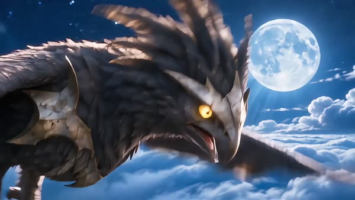 셋째 구간 · 남은 컷의 앞 숏</td>
<td width="25%" align="center" valign="top">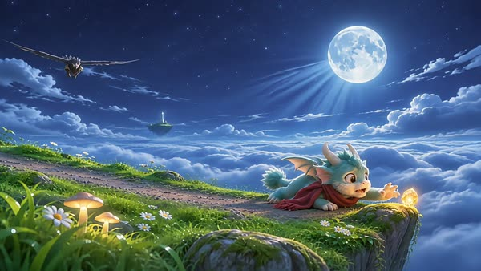 셋째 구간 · 남은 컷의 뒤 숏</td>
<td width="25%" align="center" valign="top">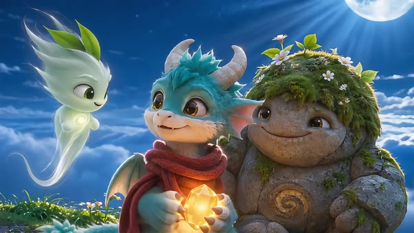 셋째 구간 끝</td>
<td width="25%" align="center" valign="top">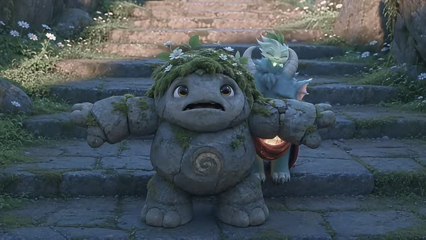 넷째 구간 가운데</td>
</tr>
</table>

<table>
<tr>
<td width="25%" align="center" valign="top">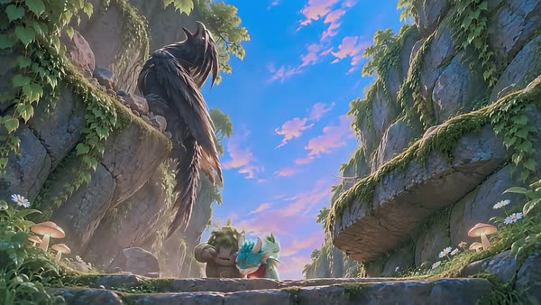 넷째 구간 · 이어 만든 컷</td>
<td width="25%" align="center" valign="top">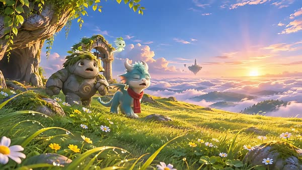 해돋이 구간 · 1</td>
<td width="25%" align="center" valign="top">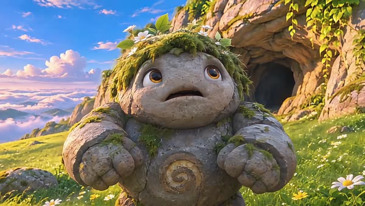 해돋이 구간 · 2</td>
<td width="25%" align="center" valign="top">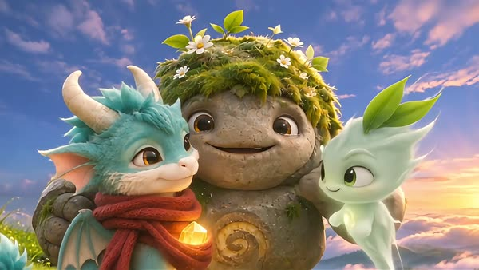 해돋이 구간 · 가편집 중에 추가</td>
</tr>
</table>

<table>
<tr>
<td width="25%" align="center" valign="top">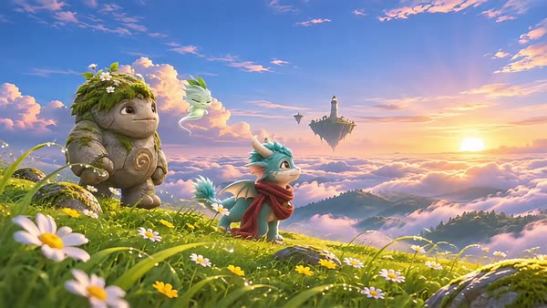 해돋이 구간 · 3</td>
<td width="25%" align="center" valign="top">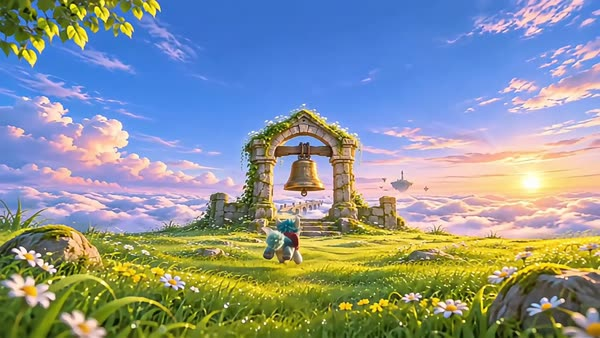 끝 구간 · 1</td>
<td width="25%" align="center" valign="top">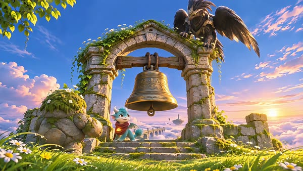 끝 구간 · 2</td>
<td width="25%" align="center" valign="top">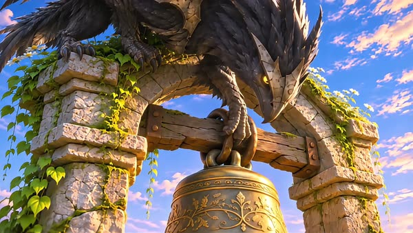 끝 구간 · 3</td>
</tr>
</table>

<table>
<tr>
<td width="25%" align="center" valign="top">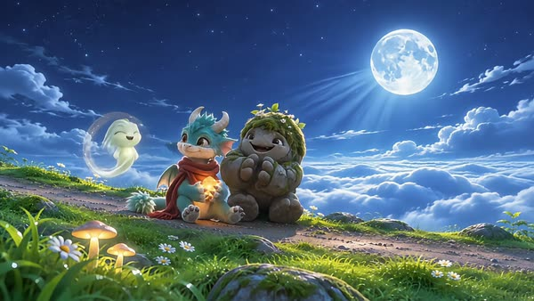 셋째 구간 끝의 둘째 숏</td>
<td width="25%" align="center" valign="top">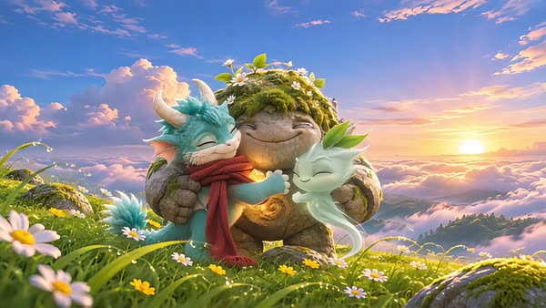 해돋이 구간 2의 둘째 숏</td>
<td width="25%" align="center" valign="top">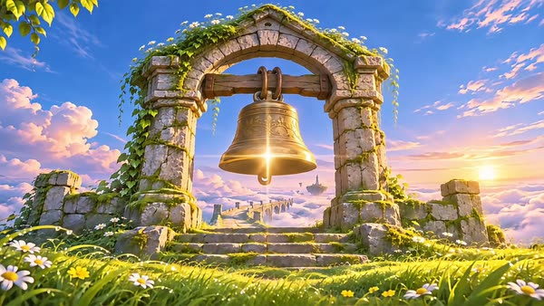 해돋이 구간 3의 둘째 숏</td>
<td width="25%" align="center" valign="top">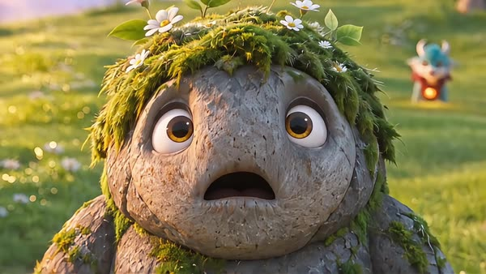 끝 구간 1의 셋째 숏</td>
</tr>
</table>

- 어제 일지에는 오후 5시 32분까지 확정한 19개를 적었다. 그 뒤 저녁에 12개를 더 확정해서 EP3 컷 영상은 31개로 끝났다. 위 그림은 저녁에 확정한 12개를 한 장면씩 모은 것이고, 숏이 여럿인 컷은 아랫줄에 한 장씩 더 넣었다. 아직 올리지 않은 편이라 장면 내용은 적지 않는다.
- 어제 확정하지 못하고 넘긴 두 묶음(셋째 구간 뒤쪽의 남은 하나, 넷째 구간 가운데)부터 끝냈다. 그다음 아직 손대지 않은 해돋이 구간과 끝 구간을 뽑았다.
- 저녁에 버린 영상은 5개다. 어제의 36개와 합치면 EP3 컷 영상을 만드는 동안 41개를 버렸다.
- 뒤쪽 구간은 앞쪽보다 훨씬 빨리 끝났다. 다섯 컷은 버린 것 없이 바로 확정했다. 어제 하루 종일 되풀이하던 표정과 팔다리 문제는 저녁에 버린 영상의 이유에 없었다.
- 어제 초안만 확인해 둔 영상 하나는 가편집에 들어가지 않았다.

#### 주요 컷

<table>
<tr>
<td width="33%" align="center" valign="top">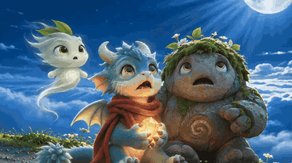 셋째 구간 끝. 한 번에 확정</td>
<td width="33%" align="center" valign="top">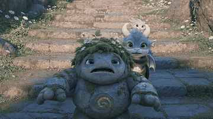 넷째 구간 가운데. 6차에서 확정</td>
<td width="33%" align="center" valign="top">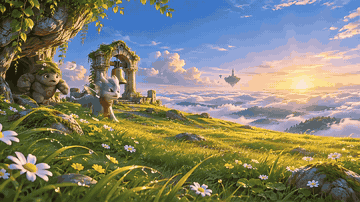 해돋이 구간 1. 한 번에 확정</td>
</tr>
</table>

<table>
<tr>
<td width="33%" align="center" valign="top">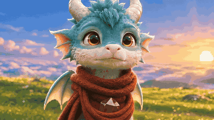 해돋이 구간 3의 끝 숏</td>
<td width="33%" align="center" valign="top">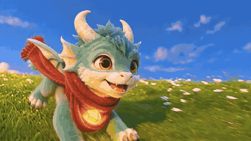 끝 구간 1의 첫 숏</td>
<td width="33%"></td>
</tr>
</table>

#### 묶음별 진행

| 묶음 | 시각 | 뽑은 횟수 | 결과 |
|:---|:---|:---|:---|
| 셋째 구간 뒤의 남은 컷 | 17:41~18:07 | 앞 숏은 어제부터 6번, 뒤 숏은 따로 2번 | 6차를 통째로 확정했다가 취소하고 앞 숏만 씀. 뒤 숏은 컷 이미지를 새로 만든 뒤 다시 뽑아 2차에서 확정 |
| 셋째 구간 끝 | 17:49 | 1번 | 버린 것 없이 확정 |
| 넷째 구간 가운데 | 17:51~17:55 | 어제부터 6차 | 6차에서 확정 |
| 넷째 구간 · 이어 만든 컷 | 18:05~18:17 | 2번 | 2차에서 확정 |
| 해돋이 구간 1 | 18:18 | 1번 | 버린 것 없이 확정 |
| 해돋이 구간 2 | 18:19~18:27 | 2번 | 2차에서 확정 |
| 해돋이 구간 3 | 18:57 | 1번 | 버린 것 없이 확정 |
| 끝 구간 1 | 18:20 | 1번 | 버린 것 없이 확정 |
| 끝 구간 2·3 | 18:31~18:54 | 통째로 1번, 나눠서 2번 | 한 영상으로 뽑은 것을 버리고 둘로 나눔. 뒤쪽은 18:46에 확정 |
| 끝 구간 2 (다시) | 20:17 | 1번 더 | 가편집을 보고 다시 만든 것으로 교체 |
| 가편집 중에 추가한 컷 | 19:38~20:17 | 1번 | 가편집 4차에 넣음 |

#### 버린 것과 다시 만든 이유

<table>
<tr>
<td width="25%" align="center" valign="top">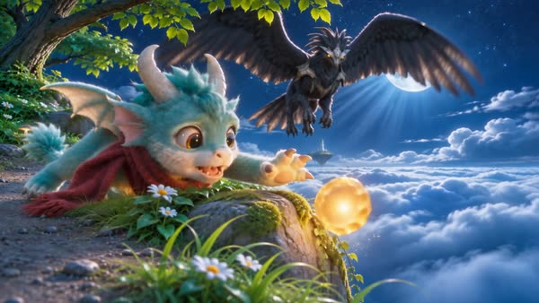 버림: 멀리 작게 보여야 할 캐릭터가 달 앞까지 크게 옴</td>
<td width="25%" align="center" valign="top">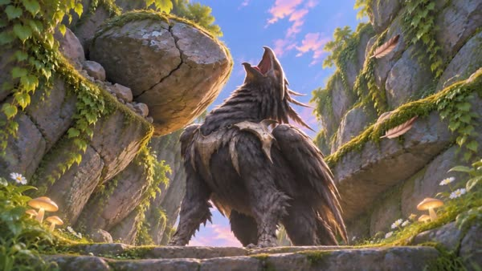 버림: 컷이 바뀐 뒤 큰 캐릭터가 가운데로 오고 아이들이 사라짐</td>
<td width="25%" align="center" valign="top">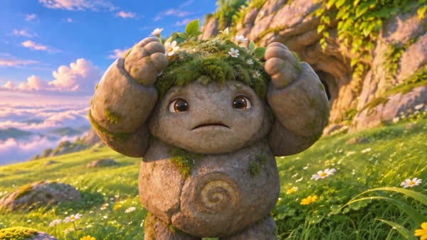 버림: 앞에 나와야 할 동작 없이 바로 안심함</td>
<td width="25%" align="center" valign="top">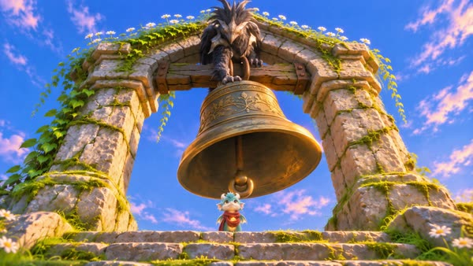 버림: 한 영상에 다 넣은 끝 구간. 시작 자리가 틀림</td>
</tr>
</table>

<table>
<tr>
<td width="25%" align="center" valign="top">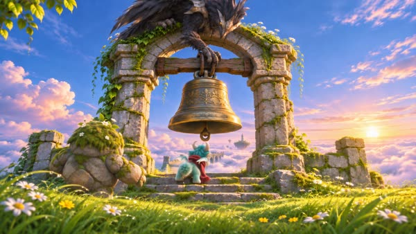 교체: 위를 올려다본 채 가만히 서 있음</td>
<td width="25%"></td>
<td width="25%"></td>
<td width="25%"></td>
</tr>
</table>

| 컷 | 무엇이 문제였나 |
|:---|:---|
| 셋째 구간 남은 컷 · 6차 | 앞 숏은 좋았는데 뒤 숏에서 큰 캐릭터가 달 쪽에서 날아옴. 통째로 확정했다가 곧 취소하고 앞 숏만 살림 |
| 셋째 구간 남은 컷의 뒤 숏 · 1차 | 멀리 작게 보여야 할 캐릭터가 달 앞까지 크게 다가옴. 참고하라고 넣은 장면에 화면이 묶여 버림 |
| 넷째 구간 이어 만든 컷 · 1차 | 컷이 바뀐 뒤 큰 캐릭터가 화면 가운데로 옮겨 오고 아이들이 화면에서 사라짐 |
| 해돋이 구간 2 · 1차 | 먼저 나와야 할 동작이 빠지고 바로 안심하는 모습으로 넘어감 |
| 끝 구간 2·3 · 통째로 뽑은 1차 | 큰 캐릭터가 엉뚱한 자리에서 시작함. 루노는 이미 도착해 있고 앞만 봄 |
| 끝 구간 2 · 1차 | 루노가 위를 올려다본 채 가만히 서 있음. 가편집 3차까지 쓰다가 다시 만든 것으로 바꿈 |

- 끝 구간은 어제 둘째·셋째 구간에서 했던 것과 같은 길을 갔다. 한 영상에 다 넣어 뽑은 것(18:31)은 캐릭터들의 자리가 처음부터 틀려 있어서 버렸고, 둘로 나눠서 다시 뽑았다.
- 끝 구간의 앞쪽 컷은 처음 뽑은 것을 가편집 3차까지 썼다. 이어 놓고 보니 루노의 행동이 앞뒤 흐름과 맞지 않아서 다시 만들었고(20:17), 가편집 4차에서 바꿔 끼웠다.

#### 컷 이미지 추가

<table>
<tr>
<td width="50%" align="center" valign="top">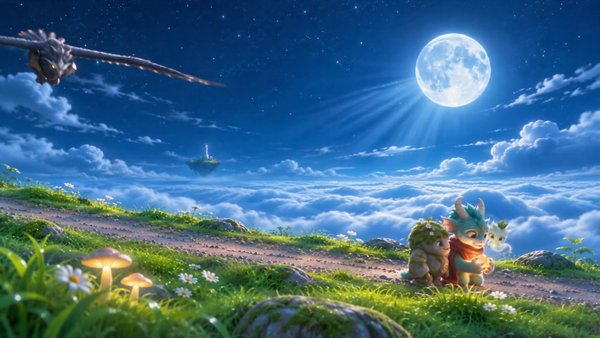 구도를 잡으려고 참고한 장면</td>
<td width="50%" align="center" valign="top">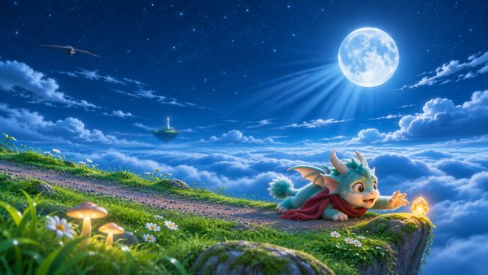 새로 만든 컷 이미지</td>
</tr>
</table>

- 셋째 구간의 남은 컷은 뒤 숏이 계속 걸렸다. 큰 캐릭터가 멀리 작게 보여야 하는데 두 번 연달아 크게 다가왔다. 구도를 잡아 줄 컷 이미지를 한 장 새로 만들었고(18:01), 그 뒤에 뽑은 것을 확정했다(18:07).

## LUNO — EP3 가편집 (전날 저녁)

- 확정한 컷을 순서대로 이어 붙인 1차가 오후 6시 58분에 나왔다. 그 뒤 밤 9시 13분까지 여섯 번 고쳤다.
- 1차를 보고 길이 목표를 버렸다(19:17). 처음에는 1분 50초 안에 넣을 생각으로 107.5초에 맞춰 계획했는데, 이어 놓고 보니 초중반이 너무 빨리 넘어갔다. 2분에도 1분 50초에도 맞추지 않고, 늘려야 할 곳만 필요한 만큼 늘리기로 했다. 최종은 114.8초다.

| 차수 | 시각 | 길이 | 숏 | 고친 것 |
|:---|:---|:---|:---|:---|
| 1차 | 18:58 | | | 확정한 컷을 순서대로 이어 붙임 |
| 2차 | 19:36 | 1분 50.9초 | 46개 | 너무 빨리 지나가던 숏 다섯 개를 0.3~0.5초씩 늘리고 한 숏은 1.6초에서 1초로 줄임. 한 숏은 70% 속도로 늦춤. 따로 만든 영상을 잇는 네 곳은 앞 영상에 크기와 위치를 맞춤 |
| 3차 | 20:01 | 1분 52.0초 | 47개 | 쓰지 않고 남겨 둔 영상에서 1초짜리 숏 하나를 가져와 끼움. 숏 두 개는 처음부터 또는 끝까지 다 씀. 눈 클로즈업은 눈꺼풀이 다시 올라가기 전에 끊음. 한 숏은 뒷부분을 잘라 3.2초에서 2초로 줄임. 한 숏은 앞부분을 70% 속도로 늦춤 |
| 4차 | 20:19 | 1분 54.3초 | 48개 | 새로 만든 컷(1.9초)을 넣고, 끝 구간의 한 컷을 다시 만든 것으로 바꿈. 뒤 영상의 캐릭터가 2.5% 작게 나온 곳은 티가 덜 나는 프레임으로 이음매를 옮김. 한 곳은 다가가던 카메라가 서서히 멈추게 이음 |
| 5차 | 21:00 | 1분 54.4초 | 48개 | 따로 만든 영상을 이은 여섯 곳의 밝기와 선명도를 앞뒤에 맞춤(그중 네 곳은 크기도). 캐릭터가 튀는 프레임 두 장과, 4프레임마다 멈칫하던 숏 두 개를 고침 |
| 6차 | 21:13 | 1분 54.8초 | 48개 | 눈 클로즈업을 0.5초 늘리고 그다음 숏을 80% 속도로 늦춤. 이것으로 확정 |

- 어제 미리보기에서 표시만 해 두었던 것들, 그러니까 컷 사이가 끊겨 보이는 곳과 화면 크기가 어긋나 보이는 곳을 5차에서 한꺼번에 맞췄다.
- EP2 때는 편집이 끝난 뒤 보정 단계에서야 이음매가 튀는 걸 발견해서 다 고치지 못했다. 이번에는 가편집 안에서 잡았다.
- 장면이 갑자기 바뀌는 곳이 하나 있는데, 영상은 그대로 두고 소리로 풀기로 했다(20:07). 뒤 화면의 소리를 0.5초 먼저 들려준다. 음향 단계에서 할 일로 적어 뒀다.
- 컷 계획도 실제 편집 길이에 맞춰 고쳤다. 마지막으로 고친 시각은 21:13이다.

## LUNO — EP3 보정

<table>
<tr>
<td width="50%" align="center" valign="top">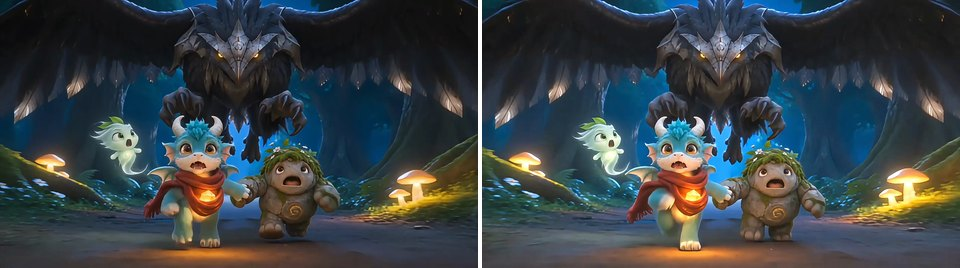 구역 1: 가장 어둡던 숏. 어두운 부분 위주로 들어 올림 (왼쪽 전, 오른쪽 후)</td>
<td width="50%" align="center" valign="top">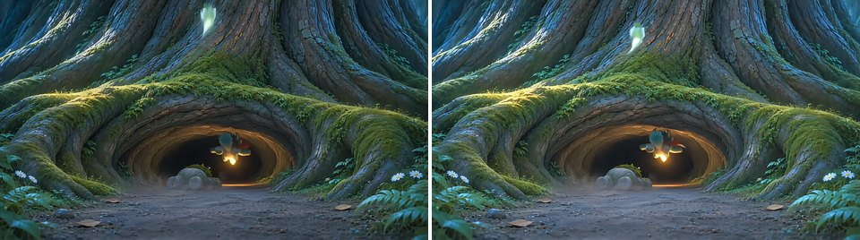 구역 1: 둘째로 어둡던 숏 (왼쪽 전, 오른쪽 후)</td>
</tr>
</table>

<table>
<tr>
<td width="50%" align="center" valign="top">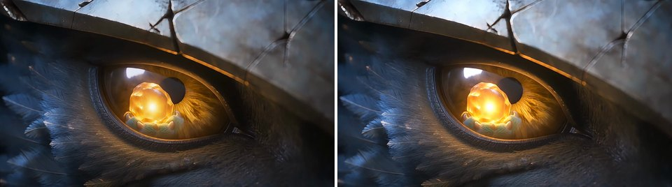 구역 2: 어둡던 눈 클로즈업을 조금 밝힘 (왼쪽 전, 오른쪽 후)</td>
<td width="50%" align="center" valign="top">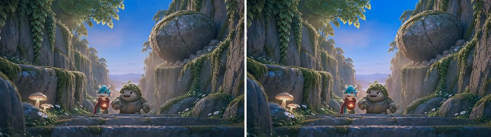 구역 3: 탁하던 색의 채도를 살림 (왼쪽 전, 오른쪽 후)</td>
</tr>
</table>

<table>
<tr>
<td width="50%" align="center" valign="top">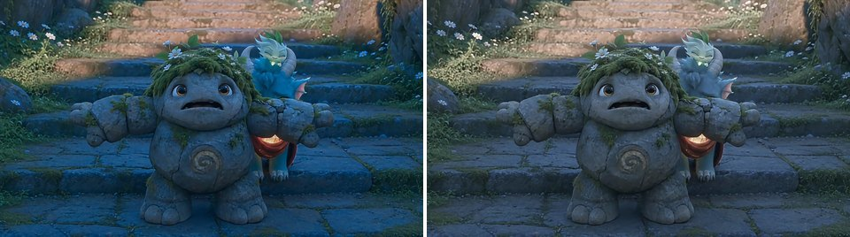 구역 3: 그림자 속 숏을 밝히고 채도를 낮춰 앞뒤에 맞춤 (왼쪽 전, 오른쪽 후)</td>
<td width="50%" align="center" valign="top">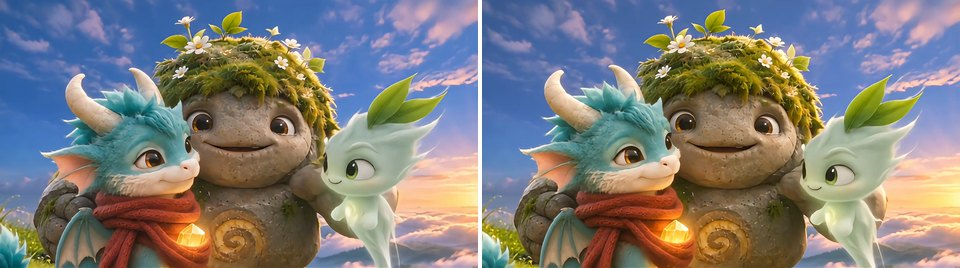 구역 4: 나중에 끼운 컷을 따뜻하고 조금 밝게 (왼쪽 전, 오른쪽 후)</td>
</tr>
</table>

#### 분석 (전날 밤)

- 밤 9시 47분에 보정을 시작했다. 숏 48개를 0.17초 간격으로 밝기와 색을 재고, 빛과 장소가 바뀌는 곳을 기준으로 구역 5개로 나눴다. 구역이 바뀌는 네 곳이 모두 하드컷이라 구역끼리 섞이는 구간은 없다.
- 방향은 단순하게 잡았다. 밤에서 새벽, 아침으로 밝아지는 흐름은 그대로 두고, 한 구역 안에서 숏끼리 밝기와 색이 튀지 않게 맞춘다. 색을 새로 입히지는 않는다. 캐릭터의 털색과 목도리 색 같은 기준색은 건드리지 않는다.

| 구역 | 구간 | 숏 | 무엇이 문제였나 | 어떻게 맞췄나 |
|:---|:---|:---|:---|:---|
| 1 · 밤 숲 | 0:00~0:10.7 | 6개 | 이 구역만 화면 평균 밝기가 기준(0~255에서 80)보다 낮았다. 가장 어두운 숏이 54, 그다음이 60이었다. 첫 10초가 편 전체에서 가장 어두운 것은 초반에 불리하다 | 어두운 부분 위주로 들어 올렸다. 달빛과 빛나는 것은 그대로 뒀다. 밤 숲 느낌이 죽지 않게 기준까지 다 올리지는 않았다. 가장 어둡던 숏은 75가 됐다 |
| 2 · 달밤 | 0:10.7~0:49.6 | 20개 | 밝기는 고르다. 넓은 화면 숏 세 개만 파랑이 짙고 채도가 높았다. 가편집 3차에 끼워 넣은 숏은 앞뒤보다 덜 파랬다. 눈 클로즈업은 어두웠다 | 넓은 숏의 채도를 낮추고 살짝 덜 파랗게 했다. 끼워 넣은 숏은 차갑게 맞췄다. 눈 클로즈업은 71까지 올렸다. 빨간 목도리가 달빛에 묻히지 않게 빨강만 조금 살렸다 |
| 3 · 푸른 새벽 | 0:49.6~1:13.7 | 9개 | 밤 장면과 이으려고 가편집에서 햇빛을 눌러 둔 구간이라 채도가 낮고 탁했다. 한 숏만 그림자 속이라 어둡고 더 파랬다. 하늘이 넓게 보이는 두 숏은 앞뒤보다 밝았다 | 구역 전체의 채도를 올렸다. 색의 방향은 바꾸지 않았다. 그림자 속 숏은 밝히고 채도를 낮춰 앞뒤에 맞췄다. 밝은 두 숏은 조금 눌렀다 |
| 4 · 해돋이 | 1:13.7~1:33.8 | 7개 | 이 편에서 가장 밝고 따뜻한 구간이라 대부분 그대로 둬도 됐다. 가편집 4차에 끼워 넣은 컷이 앞뒤보다 차갑고 어두웠다. 한 숏은 뒤 숏보다 많이 따뜻했다 | 끼워 넣은 컷을 따뜻하게, 조금 밝게 했다. 따뜻한 숏은 조금만 덜어 냈다. 나머지 다섯 숏은 손대지 않았다 |
| 5 · 아침 | 1:33.8~1:54.8 | 6개 | 해돋이와 같은 아침빛이고 숏끼리 큰 차이가 없었다. 한 숏에 자홍빛이 돌았고 한 숏이 조금 어두웠다 | 두 숏만 살짝 고쳤다. 나머지 네 숏은 손대지 않았다 |

#### 키운 영상의 프레임 맞추기

- 보정은 내가 1080p로 키운 영상에 한다. 받을 때마다 가편집본과 한 장씩 대조하는데, 이번에도 어긋난 프레임이 있었다.
- 어젯밤에 처음 받은 영상은 다섯 군데가 달랐다. 2번 프레임에 엉뚱한 그림이 들어가 있었고, 123번과 1379번이 한 번씩 겹쳤고, 1377번이 빠졌고, 맨 끝 한 프레임이 모자랐다. 바로잡아서 보정본 v1을 뽑았다(22:27).
- 그런데 이 영상은 미리보기 영상으로 키운 것이었다. 오늘 오전 11시 45분에 화질이 좋은 가편집 6차 원본으로 다시 키운 영상을 받았다(1920×1080, 2758프레임).
- 새 영상은 64번과 1381번 프레임이 앞 프레임과 같은 그림으로 한 번씩 더 들어가 있었다. 두 장을 뺐다. 잘못 들어가거나 빠진 프레임은 없었다. 겹치거나 빠지는 자리가 받을 때마다 달라서, 앞으로도 새로 받으면 대조부터 다시 한다.
- 숏별 밝기와 색은 첫 번째 영상과 거의 같았다(0~255 기준으로 1 안쪽). 어젯밤에 잡은 보정값을 그대로 썼다.

#### 보정본 v2

- 낮 12시 6분에 보정본 v2를 뽑았다. 2756프레임, 1분 54.8초다. 뽑은 뒤 가편집 6차와 전 프레임을 다시 대조했다. 자리가 어긋난 프레임 0개, 겹친 프레임 0개다.
- 화면 평균 밝기는 가편집 100.1에서 104.5가 됐다. 밤 숲의 숏 세 개(75~78)와 눈 클로즈업(71)은 기준 80에 조금 못 미치지만 그대로 뒀다.
- 보정은 v2로 끝내기로 했다. 처음에는 장면마다 분위기를 더 살리는 보정과 카메라 흔들림, 빛 효과 같은 연출 효과도 생각했는데 넣지 않는다. 색을 맞춘 것으로 충분하다고 봤다. EP2에서 효과 14가지를 넣고 보정본을 네 번 고친 것과는 다르게 갔다.
- 끝 글자는 최종 단계에서 넣는다.

## LUNO — EP3 음향

#### 오전 — 계획과 첫 곡

- 어젯밤 9시 37분에 가편집 6차 기준으로 음향 계획을 정리했다. 보정본도 길이가 같아서 시간을 그대로 쓴다.
- 배경음악은 다섯 곡으로 나눴다. 음악을 도중에 잘라서 뚝 끊기는 느낌이 나는 게 싫어서, 앞 곡의 끝 울림 위에서 다음 곡이 시작하게 계획했다. 다섯 곡 모두 자르지 않고 끝까지 깐다.

| 곡 | 길이 | 상태 (오후 1시) |
|:---|:---|:---|
| 음악 1 | 30초 | 세 번 만에 확정 (12:46) |
| 음악 2 | 25초 | 아직 |
| 음악 3 | 27초 | 아직 |
| 음악 4 | 23초 | 아직 |
| 음악 5 | 22초 | 아직 |

- 첫 곡은 추격 장면에 깔리는 곡이다. 1차는 너무 무거웠다. 귀여운 애니메이션이 아니라 다큐에 나올 법한 음악이었다. 고쳐서 뽑은 2차는 반대로 너무 가볍고 익살스러웠다. 3차에서 그 사이를 잡았다. 다급하게 조여 오되 무겁지 않은 쪽이다.
- 확정한 곡의 실제 흐름을 재 보니 계획한 시간과 다른 곳이 있었다. 21초쯤에 있어야 할 멈춤이 없고 24초까지 같은 세기로 이어진다.
- 효과음과 목소리는 프롤로그, EP1, EP2에서 만든 것으로 대신할 수 있는 곳을 먼저 골라내고, 새로 필요한 것만 추렸다. 다시 쓰는 곳이 51곳, 새로 만들 소리가 39개다. 새 소리는 아직 만들지 않았다.

| 묶음 | 새로 만들 소리 | 앞 편 소리를 다시 쓰는 곳 |
|:---|:---|:---|
| 밤 숲 | 5개 | 6곳 |
| 달밤 앞쪽 | 3개 | 5곳 |
| 달밤 뒤쪽 | 2개 | 6곳 |
| 푸른 새벽 | 7개 | 1곳 |
| 해돋이 | 1개 | 3곳 |
| 아침 (끝 구간) | 5개 | 1곳 |
| 말이 아닌 목소리 (숨, 한숨, 큰 캐릭터의 소리) | 6개 | 11곳 |
| 캐릭터 목소리 | 10개 | 18곳 |
| 합계 | 39개 | 51곳 |

- 새로 만들 소리는 큰 충격음, 날갯짓, 구르는 소리, 발소리, 돌이 갈라지고 쏟아지는 소리, 쇠와 나무 소리 같은 것들이다. 장소가 바뀔 때마다 갈아 끼울 바탕 소리도 세 가지를 새로 만든다. 밤 숲의 바탕 소리는 EP1 것을 다시 쓴다.
- 누가 언제 어떤 소리를 내는지 적은 목소리 시간표도 만들었다. 63곳이다. 캐릭터 목소리는 이번 편부터 직접 녹음한 것과 만든 것을 둘 다 해 보고 나은 쪽을 쓰기로 했는데, 이 표가 녹음 목록을 겸한다.
- 크게 낼 소리는 세 곳으로 정했다. 나머지 충격음은 그보다 작게 둬야 큰 곳이 산다. 음악과 효과음을 거의 비워 둘 곳도 세 군데 정해 뒀다.
- 프롤로그 때 루노의 높은 소리가 다른 소리보다 튀어서 거슬렸다. 이번에도 음악과 목소리 모두 귀를 찌르는 높은 음이 나오지 않게 잡았다.

#### 오후 — 다섯 곡을 버리고 한 곡으로

- 여기서부터는 오후 1시에 일지를 올린 뒤의 작업이다. 위의 계획과 표는 오전 기준이고, 오후에 음악 쪽 계획이 통째로 바뀌었다.
- 첫 곡에 이어지는 둘째 곡도 들어 보니 마음에 들지 않았다. 더 모험하는 느낌이 나게 다시 만들기로 했다.
- 나눠 만든 곡들을 영상에 얹어 이어 보니 더 큰 문제가 보였다. 음악이 자연스럽게 바뀌지 않고, 한 곡이 끝난 뒤 다음 곡을 트는 것처럼 들렸다. EP2에서는 없던 느낌이다.
- 원인은 오전에 세운 계획이었다. 뚝 끊기는 게 싫어서 곡마다 끝까지 다 깔았더니 곡의 끝맺음(높아지는 음, 큰 북 소리)이 그대로 들렸다. 곡 안에서 음악이 잠깐 끝났다가 다시 한 번 소리가 나는 곳도 어색했다. EP2 때처럼 곡을 도중까지만 쓰고 줄여 가면서 다음 곡을 겹쳐 키우는 쪽이 맞다고 봤다.
- 그래도 다섯 곡은 분위기가 서로 너무 달라서 이음매가 전부 어색했다. 다섯 곡을 모두 버렸다. 오전에 세 번 만에 정한 첫 곡도 같이 버렸다. 대신 영상 길이에 맞춘 한 곡을, 처음부터 끝까지 끊기는 데 없이 이어지게 만들어 보기로 했다.

| 한 곡으로 뽑은 것 | 어땠나 |
|:---|:---|
| 1차 | 뒤쪽은 괜찮았다. 추격 부분이 어두운 판타지 영화 음악처럼 들렸다. 실사로 찍은 중세 기사가 나올 것 같은 느낌이라 귀여운 캐릭터 애니메이션과 맞지 않았다 |
| 2차 | 분위기는 비슷하게 두고 캐릭터 애니메이션답게 고쳐 뽑았다. 마음에 들었다. 조금만 더 무거웠으면 하는 아쉬움은 남았다 |

- 오전의 첫 곡이 무거움과 익살 사이를 찾느라 세 번 걸렸는데, 한 곡으로 바꾼 뒤에도 걸린 곳은 같은 추격 부분이었다.
- 더 손보고 싶은 곳이 하나 있다. 긴장이 이어지는 구간 안에 분위기가 잠깐 풀리는 순간이 있는데, 거기서는 무거운 음악이 가라앉았다가 다시 긴장이 시작될 때 돌아왔으면 한다.

#### 오후 — 효과음과 목소리

- 오전에는 앞 편의 소리를 되도록 다시 쓰는 쪽으로 목록을 짰다. 그렇게 넣어 본 결과는 이상했다. 다시 쓴 소리가 너무 많았다. 새로 만들 소리 목록을 줄이기 전의 원래 목록으로 되돌렸고, 앞 편에서 가져온 캐릭터 목소리는 일단 넣지 않기로 했다. 위 표의 39개와 51곳은 오전 기준 숫자다.
- 소리를 얹는 편집 프로젝트에 까는 영상도 바꾸기로 했다. 보정본을 그대로 까는 대신, 언제 어떤 효과음과 목소리가 들어가는지가 화면에 표시된 영상을 쓴다. EP2에서 녹음할 때 보던 영상과 같은 방식이다.
- 새로 만든 소리 가운데 방향이 틀린 것들을 다시 잡았다.

| 소리 | 무엇이 문제였나 | 바꾼 방향 |
|:---|:---|:---|
| 큰 캐릭터의 소리 | 사자 울음이나 들짐승 소리처럼 나왔다 | 새 쪽에 가까운 소리로. 이 캐릭터와 관련된 소리를 모두 같은 기준으로 맞춤 |
| 루노의 소리 | 갓난아기 목소리처럼 나왔다 | 그보다 큰, 초등학생 남자아이쯤 되는 목소리로 |
| 루노의 웃음소리 | 웃는 게 아니라 글자를 그대로 읽는 것처럼 나왔다 | 웃음과 기쁨이 느껴지게 |

## dev-log — 일지 규칙 변경, 예약 작업 수정

- 이 일지의 규칙을 하나 바꿨다. 아직 공개하지 않은 편의 컷 이미지, 컷 영상, 캐릭터 그림도 공개한 편과 똑같이 넣는다. 대신 글로는 그 편의 이야기를 풀어 쓰지 않는다. 오늘 일지가 그 규칙으로 쓴 첫 일지다.
- 이 일지를 올리는 예약 작업도 고쳤다. 작업이 돌 때마다 사무실 맥에 가상 서비스가 켜졌고, 작업이 끝나도 꺼지지 않아서 메모리를 계속 차지했다. 그 기능을 쓰지 않고 폴더의 파일만 읽어 가도록 바꿨다.

---

Claude와 함께 정리한 작업 일지 · <a href="../../../README.md">전체 기록 보기</a>

